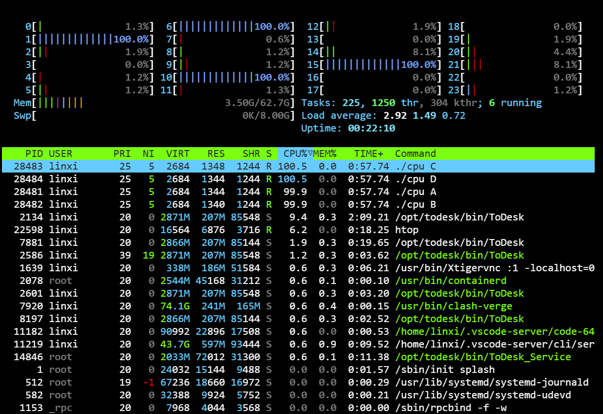

# 1 - 操作系统简介

操作系统（OS）是计算机系统的核心软件，向下管理硬件资源，向上为应用程序提供服务，主要扮演三重角色：

- **资源管理器**：负责 CPU、内存、磁盘等物理资源的分配与调度，实现高效共享。
- **虚拟机器**：通过虚拟化技术，将物理资源转换为通用、易用的虚拟形式，为程序提供独占资源的假象。
- **接口提供者**：以系统调用（system call）的形式暴露 API，支持程序运行、内存分配、设备访问等操作。

## 一、三大核心问题

本书后续章节的内容均围绕以下三个问题展开：

- 如何**虚拟化资源**：将有限的物理资源转化为多个程序可共享的虚拟资源，兼顾效率与易用性。
- 如何**构建正确的并发程序**：多线程共享内存时，如何避免数据竞争等问题，保证程序正确性。
- 如何**实现数据持久性**：在内存易失的前提下，通过软硬件协作，安全、高效地长期存储数据。

## 二、虚拟化

虚拟化是操作系统的核心技术，目标是让多个程序看似同时使用物理资源。

### CPU 虚拟化

单个 CPU（或少量 CPU）通过操作系统调度快速切换多个程序，模拟出无限个虚拟 CPU。运行多个 `cpu.c` 实例（循环打印字符串）即可验证：操作系统通过进程切换，使多个程序看似并行执行。其中，操作系统负责进程的启动、暂停与切换，硬件提供特权级支持（如中断），确保调度可控。

```shell
~/DevKit/Projects/OSTEP/codes/intro main ?2 ❯ ./cpu A & ; ./cpu B & ; ./cpu C & ; ./cpu D &                                                                                                Py DeepLearning linxi@linxi1989
[1] 28481
[2] 28482
A
[3] 28483
B
[4] 28484
C
D                                                                                                                                                                                                                          
~/DevKit/Projects/OSTEP/codes/intro main ?2 ❯ A                                                                                                                                          ≡ Py DeepLearning linxi@linxi1989
B
C
D
A
B
C
D
A
B
C
D
A
B
C
D
```

下图为 htop 中显示的进程占用情况：



### 内存虚拟化

每个程序拥有独立的**虚拟地址空间**，由操作系统映射到物理内存，形成"私有内存"的假象。同时运行多个 `mem.c` 实例时，各进程被分配到相同的虚拟地址（如 0x200000），但彼此修改的值相互独立。这种隔离避免了一个程序的错误操作影响其他程序或操作系统。

默认开启 ASLR（地址空间随机化），各进程的虚拟地址并不相同，但值各自独立累加、互不影响：

```shell
./mem 1 & ./mem 2 &                                                                                          ✘ INT 54s Py DeepLearning linxi@linxi1989
[1] 103819
[2] 103820
(103819) addr pointed to by p: 0x6193261ad2a0
(103820) addr pointed to by p: 0x59233dedc2a0                                                                                                                                                           
~/DevKit/Projects/OSTEP/codes/intro main !1 ?4 ❯ (103819) value of p: 2                                                                                               ≡ Py DeepLearning linxi@linxi1989
(103820) value of p: 3
(103819) value of p: 3
(103820) value of p: 4
(103819) value of p: 4
(103820) value of p: 5
(103819) value of p: 5
(103820) value of p: 6
~/DevKit/Projects/OSTEP/codes/intro main !1 ?4 ❯ (103819) value of p: 6                                                                                               ≡ Py DeepLearning linxi@linxi1989
(103820) value of p: 7
(103819) value of p: 7
(103820) value of p: 8
(103819) value of p: 8
(103820) value of p: 9
(103819) value of p: 9
(103820) value of p: 10
(103819) value of p: 10
(103820) value of p: 11
(103819) value of p: 11
(103820) value of p: 12
(103819) value of p: 12
(103820) value of p: 13
(103819) value of p: 13
(103820) value of p: 14
```

关闭 ASLR 后，各进程会分到相同的虚拟地址（即书中所说的 0x200000）：

```shell
setarch $(uname --machine) --addr-no-randomize /bin/bash
./mem 1 & ./mem 2 &
```

```shell
~/DevKit/Projects/OSTEP/codes/intro main !1 ?4 ❯ setarch $(uname --machine) --addr-no-randomize /bin/bash                                                               Py DeepLearning linxi@linxi1989
./mem 1 & ./mem 2 &
~/DevKit/Projects/OSTEP/codes/intro main !1 ?4 ❯ ./mem 1 & ./mem 2 &                                                                                                    Py DeepLearning linxi@linxi1989
[1] 112463
[2] 112464
(112463) addr pointed to by p: 0x5555555592a0                                                                                                                                                           
(112464) addr pointed to by p: 0x5555555592a0
~/DevKit/Projects/OSTEP/codes/intro main !1 ?4 ❯ (112463) value of p: 2                                                                                               ≡ Py DeepLearning linxi@linxi1989
(112464) value of p: 3
(112463) value of p: 3
(112464) value of p: 4
(112463) value of p: 4
(112464) value of p: 5
(112463) value of p: 5
(112464) value of p: 6
(112463) value of p: 6
(112464) value of p: 7
(112463) value of p: 7
(112464) value of p: 8
(112463) value of p: 8
(112464) value of p: 9
(112463) value of p: 9
(112464) value of p: 10
(112463) value of p: 10
(112464) value of p: 11
(112463) value of p: 11
(112464) value of p: 12
(112463) value of p: 12
(112464) value of p: 13
(112463) value of p: 13
```

若 `setarch` 权限不足，可改为全局关闭（需 root，用完恢复默认值 2）：

```shell
sudo sh -c 'echo 0 > /proc/sys/kernel/randomize_va_space'   # 0 = 关闭
sudo sh -c 'echo 2 > /proc/sys/kernel/randomize_va_space'   # 2 = 恢复默认
```

## 三、并发

并发关注多任务同时执行带来的问题，核心挑战在于多线程共享内存时的正确性。

由于指令并非原子操作（`counter++` 需依次完成读取、递增、写回三步），多线程操作共享数据时结果会出现不一致。`threads.c` 中两个线程各递增计数器 100000 次，最终结果小于 200000，且每次运行结果均不相同：

```shell
~/DevKit/Projects/OSTEP/codes/intro main ?4 ❯ ./threads 100                                                                               ✘ INT 41s Py DeepLearning linxi@linxi1989
Initial value : 0
Final value   : 200
~/DevKit/Projects/OSTEP/codes/intro main ?4 ❯ ./threads 1000                                                                                        Py DeepLearning linxi@linxi1989
Initial value : 0
Final value   : 2000
~/DevKit/Projects/OSTEP/codes/intro main ?4 ❯ ./threads 10000                                                                                       Py DeepLearning linxi@linxi1989
Initial value : 0
Final value   : 20000
~/DevKit/Projects/OSTEP/codes/intro main ?4 ❯ ./threads 100000                                                                                      Py DeepLearning linxi@linxi1989
Initial value : 0
Final value   : 129151
~/DevKit/Projects/OSTEP/codes/intro main ?4 ❯ ./threads 100000                                                                                      Py DeepLearning linxi@linxi1989
Initial value : 0
Final value   : 145841
~/DevKit/Projects/OSTEP/codes/intro main ?4 ❯ ./threads 100000                                                                                      Py DeepLearning linxi@linxi1989
Initial value : 0
Final value   : 106505
```

解决方式是引入同步原语（锁、信号量等），辅以硬件提供的原子指令，保证共享数据操作的完整性。加锁后的版本见 `thread_v2.c`，结果正确，但执行时间明显变长。

```shell
~/Dev/Projects/OSTEP/codes/intro main !3 ?6 ❯ ./thread_v2 100                                                                    Py DeepLearning linxi@linxi1989
Initial value : 0
Final value   : 200
~/Dev/Projects/OSTEP/codes/intro main !3 ?6 ❯ ./thread_v2 1000                                                                   Py DeepLearning linxi@linxi1989
Initial value : 0
Final value   : 2000
~/Dev/Projects/OSTEP/codes/intro main !3 ?6 ❯ ./thread_v2 10000                                                                  Py DeepLearning linxi@linxi1989
Initial value : 0
Final value   : 20000
~/Dev/Projects/OSTEP/codes/intro main !3 ?6 ❯ ./thread_v2 100000                                                                 Py DeepLearning linxi@linxi1989
Initial value : 0
Final value   : 200000
~/Dev/Projects/OSTEP/codes/intro main !3 ?6 ❯ ./thread_v2 1000000                                                                Py DeepLearning linxi@linxi1989
Initial value : 0
Final value   : 2000000
```

## 四、持久性

持久性解决内存易失的问题，依靠 I/O 设备（磁盘、SSD）与文件系统实现数据的长期存储。

文件系统是操作系统管理持久化的核心，负责磁盘空间分配、数据结构维护与读写调度。`io.c` 通过 `open()` 创建文件、`write()` 写入数据、`close()` 关闭文件，由文件系统保证数据写入磁盘，断电后不丢失。为保障可靠性，文件系统采用日志（journaling）、写时复制（copy-on-write）等协议；为提升性能，采用延迟写入、批量处理等策略。

## 五、设计目标

操作系统的设计需在多个目标之间权衡：

1. **抽象易用**：提供简洁的资源抽象（进程、文件），隐藏硬件细节，降低编程难度。
2. **高性能**：最小化操作系统自身的开销（时间、空间）。
3. **保护与隔离**：隔离不同程序的资源访问，防止恶意或误操作影响其他程序或操作系统。
4. **高可靠性**：即使面临硬件故障或程序错误，也能恢复到稳定状态。
5. **拓展目标**：能效优化、安全防护、移动性支持等。

## 六、发展历史

操作系统的发展是"功能迭代 + 问题解决"的过程：

1. **早期批处理（Just Libraries）**：操作系统仅为常用函数库，单程序运行，人工调度作业，无资源隔离。
2. **系统调用与保护机制**：引入用户态/内核态，通过陷阱（trap）指令触发系统调用，操作系统获得硬件特权级，实现资源保护。
3. **多道程序设计**：操作系统将多个程序加载到内存，通过快速切换提升 CPU 利用率。UNIX 成为标杆，具有简洁、可扩展、支持 C 语言编译等特点。
4. **现代操作系统**：PC 普及（早期 DOS、Mac OS 缺乏隔离）→ Linux 崛起（开源、兼容 UNIX）→ 移动设备 OS（Android 基于 Linux），重新引入隔离、调度、虚拟内存等多道程序设计的核心特性。

## 七、作业类型

本书作业分为两类，旨在强化理论与实践的结合：

1. **模拟类作业**：通过程序模拟系统行为（磁盘调度、进程调度等），观察不同机制的性能差异，无需依赖真实硬件。
2. **真实代码交互类作业**：基于 UNIX/Linux 系统，编写 C 语言程序、测量系统性能或修改系统组件，熟悉系统调用与底层机制。

实践环境要求：UNIX 系系统（Linux、macOS）、C 编译器（gcc）、Python、代码编辑器。

## 八、总结

1. 操作系统的本质是"抽象层 + 资源管理器"，通过虚拟化、并发控制、持久性三大功能，平衡易用性、效率与安全性。
2. 虚拟化制造资源独占的假象，并发解决多线程共享的正确性问题，持久性保障数据的长期存储，三者共同构成现代操作系统的基石。
3. 操作系统的发展是问题驱动的迭代，核心思想（隔离、调度、抽象）始终延续。
4. 实践是掌握操作系统的关键，通过模拟与真实代码实验，可深入理解底层机制的工作原理。