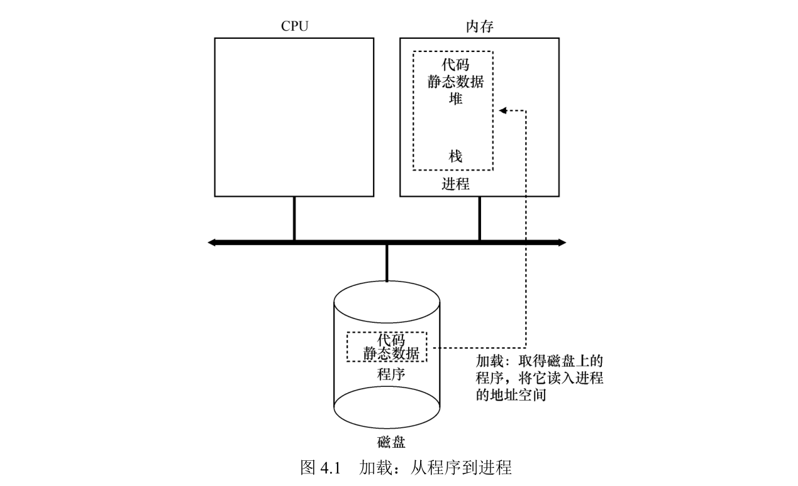
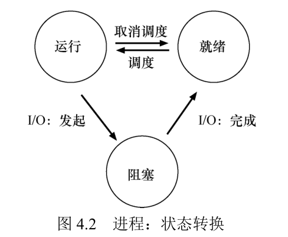
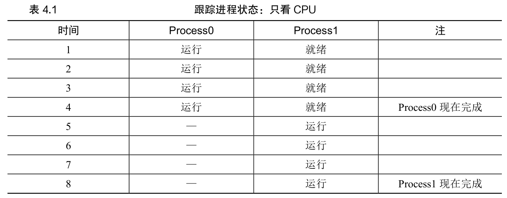
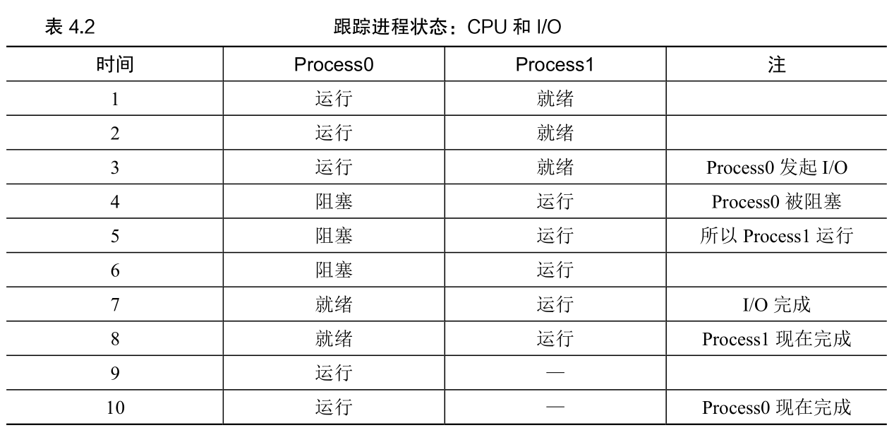

# 1 - 进程

## 一、核心问题与虚拟化原理
### 1. 核心问题（CRUX）
如何用少量物理CPU，为用户提供“近乎无限个虚拟CPU”的错觉？让多个程序看似同时运行，提升系统易用性。

### 2. 核心解决方案：CPU虚拟化与时间共享
- **虚拟化本质**：OS通过“分时复用CPU”实现——运行一个进程→暂停→运行另一个，循环往复，营造多进程并发的错觉。
- **关键技术**：**时分共享（Time Sharing）**，即资源按时间片分配给多个实体；对应空间共享（Space Sharing，如磁盘按空间划分），是OS共享资源的核心方式。
- **性能代价**：若进程过多，每个进程的CPU时间片被分割，运行速度会变慢。

### 3. OS的核心设计范式：机制与策略分离
- **机制**：底层实现功能的方法/协议（如上下文切换，让OS能切换进程执行），回答“如何做”。
- **策略**：上层决策算法（如调度策略，决定优先运行哪个进程），回答“选哪个”。
- **价值**：模块化设计，可独立修改策略（如切换调度算法）而不改动底层机制。

## 二、进程的本质：运行中的程序
进程是OS对“运行中程序”的抽象，其核心是**机器状态**——程序运行时需访问或修改的系统资源集合，包括三部分：
1. **内存**：进程的地址空间，存储代码、静态数据、堆（动态分配）、栈（局部变量/参数/返回地址）。
2. **寄存器**：包括程序计数器（PC，指向下一步执行的指令）、栈指针、通用寄存器等，直接影响指令执行。
3. **I/O信息**：当前打开的文件描述符（如UNIX默认的标准输入/输出/错误）等持久化存储相关信息。

## 三、进程API（核心接口）
所有现代OS都提供的进程操作接口，覆盖生命周期管理与控制：
- **创建（Create）**：启动新进程（如shell执行命令、双击应用图标）。
- **销毁（Destroy）**：强制终止进程（应对失控程序）。
- **等待（Wait）**：阻塞当前进程，直到目标进程终止。
- **杂项控制（Miscellaneous Control）**：暂停（Suspend）或恢复（Resume）进程。
- **状态查询（Status）**：获取进程运行时长、当前状态等信息。

## 四、进程创建的完整流程
OS将磁盘上的“静态程序”转化为“动态进程”，需完成以下步骤：
1. **加载代码与静态数据**：从磁盘读取程序指令和初始化变量，载入进程地址空间（早期OS“立即加载”，现代OS“延迟加载”，仅在需要时加载代码/数据）。
2. **初始化栈（Stack）**：分配内存用于存储局部变量、函数参数、返回地址，同时填充`main()`的参数（`argc`和`argv`数组）。
3. **分配堆（Heap）**：预留初始内存空间，供程序通过`malloc()`动态申请（后续可按需扩容）。
4. **I/O初始化**：UNIX系统中默认打开3个文件描述符（标准输入、输出、错误），方便程序读写终端。
5. **启动执行**：通过专用机制跳转到`main()`函数，将CPU控制权转移给新进程，程序正式运行。

示意图如图 4.1 所示



## 五、进程状态与转换
进程在生命周期中会在三种核心状态间切换，状态变化由OS或进程自身操作触发：
### 1. 三种基本状态
- **运行（Running）**：进程正在CPU上执行指令。
- **就绪（Ready）**：进程已具备运行条件，但OS暂未分配CPU时间片。
- **阻塞（Blocked）**：进程因发起I/O（如磁盘读写、网络请求）等操作，需等待事件完成后才能继续运行。

### 2. 状态转换规则



- 就绪 → 运行：OS调度（分配CPU时间片）。
- 运行 → 就绪：OS取消调度（收回CPU时间片，如时间片用完）。
- 运行 → 阻塞：进程发起I/O操作（如`read()`磁盘文件）。
- 阻塞 → 就绪：I/O事件完成（如磁盘数据读取完毕）。

### 3. 状态转换示例
| 场景                | 进程0状态变化                | 进程1状态变化                | 核心逻辑                     | 图示 |
|---------------------|-----------------------------|-----------------------------|------------------------------|---|
| 纯CPU进程（无I/O）  | 运行→完成（退出）           | 就绪→运行→完成（退出）       | 先运行进程0，结束后运行进程1 |   |
| 带I/O的进程         | 运行→阻塞（发起I/O）→就绪（I/O完成）→运行→完成 | 就绪→运行→完成（退出）       | 进程0阻塞时，OS调度进程1运行，提升CPU利用率 |   |

## 六、核心数据结构：进程控制块（PCB）
OS通过数据结构跟踪所有进程状态，核心是**进程控制块（Process Control Block, PCB）**，也称“进程描述符”。

### 1. PCB核心字段（以xv6系统的`proc`结构为例）

| 分类 | 字段 | 说明 |
|------|------|------|
| 基本信息 | `state` | 进程状态 |
| 基本信息 | `pid` | 进程ID |
| 基本信息 | `parent` | 父进程指针 |
| 内存信息 | `mem` | 进程内存起始地址 |
| 内存信息 | `sz` | 内存大小 |
| 内存信息 | `kstack` | 内核栈地址 |
| 执行上下文 | `context` | 寄存器上下文，存储暂停时的寄存器值，用于恢复运行 |
| 执行上下文 | `tf` | 陷阱帧 |
| I/O相关 | `ofile` | 打开的文件列表 |
| I/O相关 | `cwd` | 当前工作目录 |
| 其他 | `chan` | 阻塞原因 |
| 其他 | `killed` | 是否被终止 |

### 2. 进程列表（Process List）
OS维护的所有PCB集合，用于全局管理进程（如遍历就绪进程、查找阻塞进程、清理终止进程）。

### 3. 扩展状态
除核心三状态外，OS还会定义特殊状态：
- 初始状态（如xv6的`EMBRYO`）：进程创建中未就绪。
- 僵尸状态（`ZOMBIE`）：进程退出但未被父进程清理，保留退出码供父进程查询（父进程调用`wait()`后，OS清理该状态）。

## 七、核心总结
1. 进程是OS最基础的抽象，本质是“运行中的程序”，其状态由内存、寄存器、I/O信息共同构成。
2. CPU虚拟化的核心是“时间共享”，依赖上下文切换机制和调度策略，平衡并发与性能。
3. 进程生命周期的核心是“状态转换”，OS通过PCB跟踪进程信息，通过状态切换优化CPU利用率（如I/O阻塞时切换其他进程运行）。
4. 机制与策略分离是OS设计的关键原则，让系统更灵活、易扩展。

## 八、实践作业（Simulation）
通过`process-run.py`模拟器，验证进程状态转换与调度策略的影响，核心任务：
1. 计算CPU利用率（如纯CPU进程与I/O进程的资源占用差异）。
2. 分析调度触发时机（`SWITCH ON END` vs `SWITCH ON IO`）对进程完成时间的影响。
3. 验证I/O完成后的调度策略（`IO RUN LATER` vs `IO RUN IMMEDIATE`）对资源利用率的影响。

以下命令均在 `homework/cpu-intro` 目录下执行，`-c` 表示直接给出结果，`-p` 表示打印统计信息。

### 1. 计算 CPU 利用率

```shell
./process-run.py -l 5:100,5:100 -c -p   # 两个纯 CPU 进程，各 5 条指令
```

```text
Time        PID: 0        PID: 1           CPU           IOs
  1        RUN:cpu         READY             1
  2        RUN:cpu         READY             1
  3        RUN:cpu         READY             1
  4        RUN:cpu         READY             1
  5        RUN:cpu         READY             1
  6           DONE       RUN:cpu             1
  7           DONE       RUN:cpu             1
  8           DONE       RUN:cpu             1
  9           DONE       RUN:cpu             1
 10           DONE       RUN:cpu             1

Stats: Total Time 10
Stats: CPU Busy 10 (100.00%)
Stats: IO Busy  0 (0.00%)
```

```shell
./process-run.py -l 4:100,1:0 -c -p   # 纯 CPU 进程 + 只发一次 I/O 的进程
```

```text
Time        PID: 0        PID: 1           CPU           IOs
  1        RUN:cpu         READY             1
  2        RUN:cpu         READY             1
  3        RUN:cpu         READY             1
  4        RUN:cpu         READY             1
  5           DONE        RUN:io             1
  6           DONE       BLOCKED                           1
  7           DONE       BLOCKED                           1
  8           DONE       BLOCKED                           1
  9           DONE       BLOCKED                           1
 10           DONE       BLOCKED                           1
 11*          DONE   RUN:io_done             1

Stats: Total Time 11
Stats: CPU Busy 6 (54.55%)
Stats: IO Busy  5 (45.45%)
```

```shell
./process-run.py -l 1:0,4:100 -c -p   # 交换两者顺序
```

```text
Time        PID: 0        PID: 1           CPU           IOs
  1         RUN:io         READY             1
  2        BLOCKED       RUN:cpu             1             1
  3        BLOCKED       RUN:cpu             1             1
  4        BLOCKED       RUN:cpu             1             1
  5        BLOCKED       RUN:cpu             1             1
  6        BLOCKED          DONE                           1
  7*   RUN:io_done          DONE             1

Stats: Total Time 7
Stats: CPU Busy 6 (85.71%)
Stats: IO Busy  5 (71.43%)
```

| 进程参数（`-l`） | 总时间 | CPU 利用率 | I/O 利用率 | 说明 |
|---|---|---|---|---|
| `5:100,5:100` | 10 | 100% | 0% | 两个纯计算进程，CPU 从不空闲 |
| `4:100,1:0` | 11 | 54.55% | 45.45% | 进程1 只发 I/O，等 I/O 完成时 CPU 空转 5 拍 |
| `1:0,4:100` | 7 | 85.71% | 71.43% | I/O 进程放前面，一阻塞就切去跑 CPU，I/O 与 CPU 重叠 |

结论：进程执行的先后顺序会显著影响 CPU 利用率。纯 CPU 进程能占满 CPU；而"只发 I/O"的进程若排在后面，会让 CPU 在等待 I/O 期间空转；把它挪到前面，I/O 与 CPU 计算即可重叠，总时间从 11 降到 7。

### 2. 调度触发时机：SWITCH_ON_END vs SWITCH_ON_IO

```shell
./process-run.py -l 1:0,4:100 -c -p -S SWITCH_ON_END   # 进程跑完才切换
```

```text
Time        PID: 0        PID: 1           CPU           IOs
  1         RUN:io         READY             1
  2        BLOCKED         READY                           1
  3        BLOCKED         READY                           1
  4        BLOCKED         READY                           1
  5        BLOCKED         READY                           1
  6        BLOCKED         READY                           1
  7*   RUN:io_done         READY             1
  8           DONE       RUN:cpu             1
  9           DONE       RUN:cpu             1
 10           DONE       RUN:cpu             1
 11           DONE       RUN:cpu             1

Stats: Total Time 11
Stats: CPU Busy 6 (54.55%)
Stats: IO Busy  5 (45.45%)
```

```shell
./process-run.py -l 1:0,4:100 -c -p -S SWITCH_ON_IO    # 进程发 I/O 就切换
```

```text
Time        PID: 0        PID: 1           CPU           IOs
  1         RUN:io         READY             1
  2        BLOCKED       RUN:cpu             1             1
  3        BLOCKED       RUN:cpu             1             1
  4        BLOCKED       RUN:cpu             1             1
  5        BLOCKED       RUN:cpu             1             1
  6        BLOCKED          DONE                           1
  7*   RUN:io_done          DONE             1

Stats: Total Time 7
Stats: CPU Busy 6 (85.71%)
Stats: IO Busy  5 (71.43%)
```

| 调度策略 | 总时间 | CPU 利用率 |
|---|---|---|
| `SWITCH_ON_END` | 11 | 54.55% |
| `SWITCH_ON_IO` | 7 | 85.71% |

结论：`SWITCH_ON_END` 在进程发起 I/O 时不切换，CPU 空等 5 拍；`SWITCH_ON_IO` 在进程阻塞时立即切换到其他就绪进程，总时间从 11 降到 7。"一阻塞就切"比"等进程跑完再切"更高效。

### 3. I/O 完成后的调度：IO_RUN_LATER vs IO_RUN_IMMEDIATE

进程0 为 3 次 I/O，其余 3 个进程各 5 条纯 CPU 指令：

```shell
./process-run.py -l 3:0,5:100,5:100,5:100 -S SWITCH_ON_IO -I IO_RUN_LATER -c -p
```

```text
Time        PID: 0        PID: 1        PID: 2        PID: 3           CPU           IOs
  1         RUN:io         READY         READY         READY             1
  2        BLOCKED       RUN:cpu         READY         READY             1             1
  3        BLOCKED       RUN:cpu         READY         READY             1             1
  4        BLOCKED       RUN:cpu         READY         READY             1             1
  5        BLOCKED       RUN:cpu         READY         READY             1             1
  6        BLOCKED       RUN:cpu         READY         READY             1             1
  7*         READY          DONE       RUN:cpu         READY             1
  8          READY          DONE       RUN:cpu         READY             1
  9          READY          DONE       RUN:cpu         READY             1
 10          READY          DONE       RUN:cpu         READY             1
 11          READY          DONE       RUN:cpu         READY             1
 12          READY          DONE          DONE       RUN:cpu             1
 13          READY          DONE          DONE       RUN:cpu             1
 14          READY          DONE          DONE       RUN:cpu             1
 15          READY          DONE          DONE       RUN:cpu             1
 16          READY          DONE          DONE       RUN:cpu             1
 17    RUN:io_done          DONE          DONE          DONE             1
 18         RUN:io          DONE          DONE          DONE             1
 19        BLOCKED          DONE          DONE          DONE                           1
 20        BLOCKED          DONE          DONE          DONE                           1
 21        BLOCKED          DONE          DONE          DONE                           1
 22        BLOCKED          DONE          DONE          DONE                           1
 23        BLOCKED          DONE          DONE          DONE                           1
 24*   RUN:io_done          DONE          DONE          DONE             1
 25         RUN:io          DONE          DONE          DONE             1
 26        BLOCKED          DONE          DONE          DONE                           1
 27        BLOCKED          DONE          DONE          DONE                           1
 28        BLOCKED          DONE          DONE          DONE                           1
 29        BLOCKED          DONE          DONE          DONE                           1
 30        BLOCKED          DONE          DONE          DONE                           1
 31*   RUN:io_done          DONE          DONE          DONE             1

Stats: Total Time 31
Stats: CPU Busy 21 (67.74%)
Stats: IO Busy  15 (48.39%)
```

```shell
./process-run.py -l 3:0,5:100,5:100,5:100 -S SWITCH_ON_IO -I IO_RUN_IMMEDIATE -c -p
```

```text
Time        PID: 0        PID: 1        PID: 2        PID: 3           CPU           IOs
  1         RUN:io         READY         READY         READY             1
  2        BLOCKED       RUN:cpu         READY         READY             1             1
  3        BLOCKED       RUN:cpu         READY         READY             1             1
  4        BLOCKED       RUN:cpu         READY         READY             1             1
  5        BLOCKED       RUN:cpu         READY         READY             1             1
  6        BLOCKED       RUN:cpu         READY         READY             1             1
  7*   RUN:io_done          DONE         READY         READY             1
  8         RUN:io          DONE         READY         READY             1
  9        BLOCKED          DONE       RUN:cpu         READY             1             1
 10        BLOCKED          DONE       RUN:cpu         READY             1             1
 11        BLOCKED          DONE       RUN:cpu         READY             1             1
 12        BLOCKED          DONE       RUN:cpu         READY             1             1
 13        BLOCKED          DONE       RUN:cpu         READY             1             1
 14*   RUN:io_done          DONE          DONE         READY             1
 15         RUN:io          DONE          DONE         READY             1
 16        BLOCKED          DONE          DONE       RUN:cpu             1             1
 17        BLOCKED          DONE          DONE       RUN:cpu             1             1
 18        BLOCKED          DONE          DONE       RUN:cpu             1             1
 19        BLOCKED          DONE          DONE       RUN:cpu             1             1
 20        BLOCKED          DONE          DONE       RUN:cpu             1             1
 21*   RUN:io_done          DONE          DONE          DONE             1

Stats: Total Time 21
Stats: CPU Busy 21 (100.00%)
Stats: IO Busy  15 (71.43%)
```

| I/O 完成策略 | 总时间 | CPU 利用率 | I/O 利用率 |
|---|---|---|---|
| `IO_RUN_LATER` | 31 | 67.74% | 48.39% |
| `IO_RUN_IMMEDIATE` | 21 | 100% | 71.43% |

结论：`IO_RUN_LATER` 下，进程0 的 I/O 完成后要排队，等三个纯 CPU 进程全部跑完才继续后面的 I/O，中间 CPU 空闲、只剩串行 I/O，资源浪费严重。`IO_RUN_IMMEDIATE` 下，I/O 一完成进程0 立即抢回 CPU，趁其他进程仍处于就绪态就交错执行，CPU 利用率拉满到 100%，总时间从 31 降到 21。

### 小结

让 CPU 与 I/O 尽可能重叠——I/O 阻塞时立即切走、I/O 完成时优先切回——既能缩短总完成时间，又能提高 CPU 利用率。