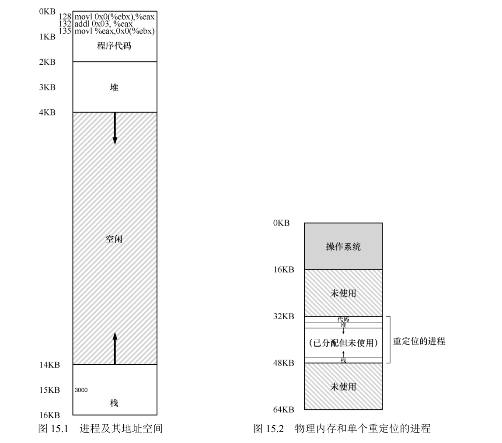
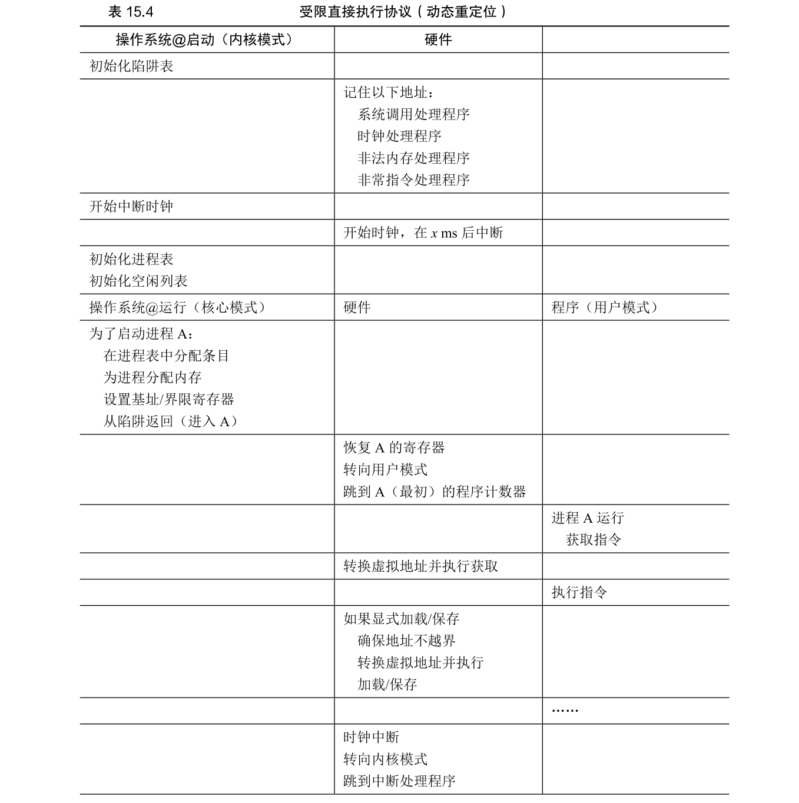
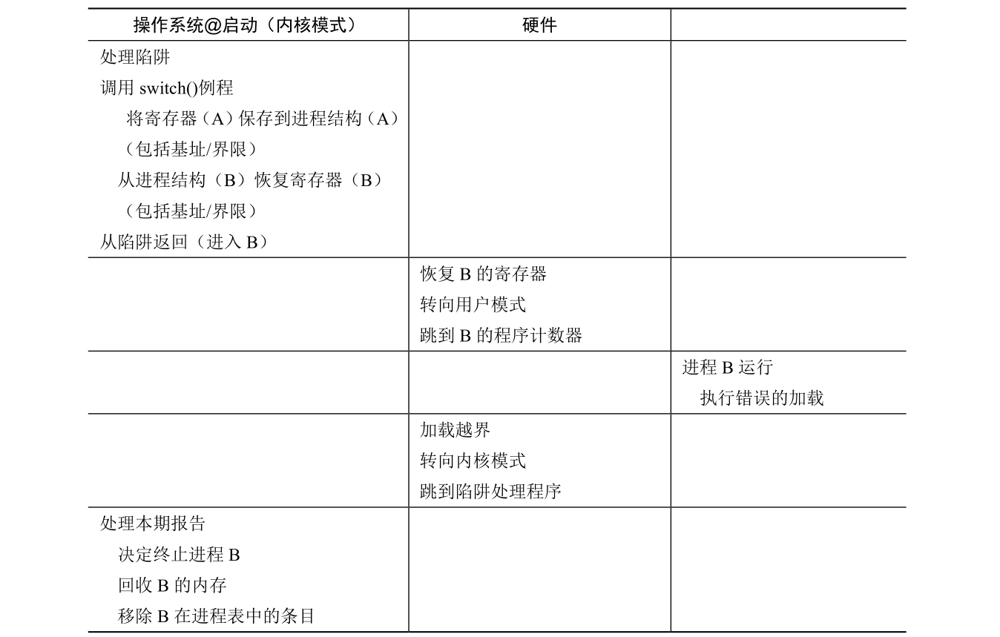

# 10 - 内存地址转换

CPU 虚拟化靠"有限直接执行"，内存虚拟化也是一样的思路：让程序直接跑以保证效率，OS 只在关键节点介入。地址转换就是这个核心机制——每次程序访问内存时，硬件自动把它发出的虚拟地址翻译成真实物理地址，程序全程无感，还以为自己独占一块从 0 开始的私有内存。

先立三条简化假设（后面几章会逐个拆掉）：地址空间在物理内存里**连续**、地址空间**小于**物理内存、所有地址空间**一样大**。

## 一、动态重定位（基址 + 边界）

最简单的地址转换技术叫**动态重定位（Base-and-Bounds）**，靠两个 CPU 寄存器：

- **基址寄存器（Base）**：存这个进程地址空间在物理内存里的起始位置（也就是"偏移量"）。
- **边界寄存器（Bounds/Limit）**：存地址空间的大小，用来校验虚拟地址有没有越界。



### 地址转换公式

```
物理地址 = 虚拟地址 + 基址寄存器值
```

比如虚拟地址 15KB、基址 32KB，物理地址就是 47KB。

每次转换前先做边界检查：虚拟地址 ≥ 边界值（或为负）就触发异常，OS 干掉这个违规进程；通过检查才做加法。这样程序只能碰到自己地址空间里的东西。

### 对比：静态重定位

早期是软件方案：加载程序时由加载器把程序里所有地址直接改写成物理地址。没保护（程序能乱访问别的内存）、也搬不了家，后来被动态重定位取代。

### 转换示例

进程地址空间 16KB，加载到物理内存 32KB 处（基址=32KB，边界=16KB）：

| 虚拟地址 | 计算 | 结果 |
|----------|------|------|
| 0KB | 0KB + 32KB | 32KB（合法） |
| 128B | 128B + 32KB | 32896B（合法，取指令） |
| 15KB | 15KB + 32KB | 47KB（合法，访问变量 x） |
| 17KB | 17KB ≥ 16KB | 异常（越界） |

## 二、硬件要提供什么

要让这套机制既快又受控，硬件得给：

| 硬件需求 | 作用 |
|----------|------|
| 特权模式（内核态/用户态） | 防止用户进程改基址/边界寄存器 |
| 基址-边界寄存器对 | 存物理起始位置和大小，每 CPU 一套 |
| 转换 + 边界检查电路 | 快速做虚拟地址→物理地址加法转换和合法性校验 |
| 改基址-边界的特权指令 | 只有内核态能改寄存器 |
| 异常处理程序注册指令 | OS 设置越界等异常的处理逻辑 |
| 异常触发机制 | 越界或用户执行特权操作时触发CPU异常 |

## 三、OS 要干什么

OS 负责"管理"，硬件负责"执行"：

| OS 职责 | 具体内容 |
|---------|----------|
| 内存管理 | 维护**空闲列表（Free List）**，跟踪物理内存中未使用的连续区域；<br>进程创建时从空闲列表分配连续物理内存，用于存储进程地址空间；<br>进程终止时回收该进程占用的物理内存，归还空闲列表 |
| 基址-边界寄存器管理 | 进程首次运行前，把地址空间的物理起始地址写入基址寄存器、大小写入边界寄存器；<br>上下文切换时，把当前进程的基址-边界值保存到 PCB，恢复待运行进程的值（每 CPU 仅一套寄存器，需按进程切换） |
| 异常处理 | 开机时注册异常处理程序（内存越界、非法特权操作）；<br>触发异常时终止违规进程、回收内存、清理相关数据结构（如进程表项） |
| 地址空间重定位（可选） | 进程未运行时，把其地址空间从物理内存一处复制到另一处，更新 PCB 中的基址值；进程恢复运行时经新基址转换，完全无感知 |

## 四、优点与局限

优点：

- **高效性**：地址转换和边界检查都由硬件完成，只做一次加法和比较，几乎不影响程序运行效率；
- **透明性**：程序一行代码都不用改，仍然以为自己地址空间从 0 开始，完全感知不到转换过程；
- **保护性**：边界检查严格限制访问范围，防止进程非法访问其他进程或 OS 的内存；
- **灵活性**：支持动态重定位，OS 可以随时调整进程在物理内存中的位置（搬完改基址即可）。

局限是**内部碎片（Internal Fragmentation）**：地址空间要连续分配，但程序往往用不满整块空间，栈、堆之间的空隙就浪费了。比如分配了 16KB 的地址空间，栈和堆只占一部分，剩下的都是碎片。




## 五、总结

1. 地址转换是内存虚拟化的核心，靠硬件（基址-边界寄存器、转换电路）和 OS 协作，动态完成虚拟地址→物理地址。
2. 基址-边界是最简单的地址转换技术，高效、透明、有保护，但存在内部碎片。
3. 逻辑上延续"有限直接执行"：硬件做高效转换和检查，OS 做分配、寄存器管理、异常处理。
4. 后续章节会放松假设，引入分段、分页，解决内部碎片和灵活分配的问题。

## 六、作业方向（Simulation）

通过 `homework/vm-mechanism/relocation.py` 模拟基址-边界的地址转换：随机生成基址、边界和一组虚拟地址，判断每个 VA 是否合法并计算物理地址。`-a` 地址空间大小、`-p` 物理内存、`-n` 地址数、`-b/-l` 手动指定基址/边界、`-c` 看答案。

1. 基于不同随机种子，判断虚拟地址是否合法，并计算合法地址的物理地址；
2. 确定边界寄存器的最小取值，确保所有生成的虚拟地址均合法；
3. 在给定边界值与物理内存大小的情况下，计算基址寄存器的最大允许值；
4. 分析边界寄存器值与随机生成虚拟地址合法性的比例关系，绘制图表。

### 1. 不同种子的地址转换

```shell
./relocation.py -s 0 -c
./relocation.py -s 1 -c
./relocation.py -s 2 -c
```

```text
# s=0  Base=12418  Limit=472
  VA 430 -> VALID: 12848   (430 + 12418)
  VA 265 -> VALID: 12683
  VA 523 -> SEGMENTATION VIOLATION   (523 >= 472)
  VA 414 -> VALID: 12832
  VA 802 -> SEGMENTATION VIOLATION
```

规则就一条：`VA < Limit` 就 `PA = VA + Base`，否则越界异常。

### 2. 让所有虚拟地址都合法的边界最小值

虚拟地址是 `[0, asize)` 内随机生成的，所以要全部合法，边界取**地址空间大小**即可：`-l 1k`（asize=1k 时）：

```shell
./relocation.py -a 1k -l 1k -s 0 -c
```

```text
Limit: 1024
VA 776 -> VALID   VA 430 -> VALID   ...   全部 VALID
```

### 3. 基址寄存器的最大允许值

地址空间的末尾 `Base + Limit` 不能超出物理内存，所以 **Base_max = 物理内存大小 − Limit**。默认物理内存 16k（16384）、Limit 取 100 时，Base 最大只能到 16284。

### 4. 边界值越小，合法比例越低

合法地址的比例 ≈ `Limit / 地址空间大小`。把边界设小（`-l 256`）再跑，随机 VA 基本全越界：

```shell
./relocation.py -a 1k -l 256 -s 0 -c
```

```text
Limit: 256
VA 776 -> VIOLATION   VA 430 -> VIOLATION   ...   全部 VIOLATION
```

对比 `-l 1k`（全合法）和 `-l 256`（全越界），边界越小，能放行的虚拟地址越少，正好反映"越界保护"就是靠这条边界线卡出来的。
