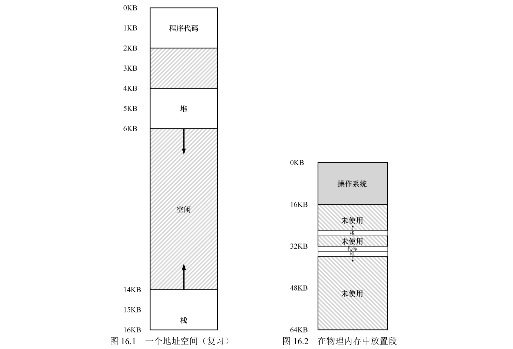
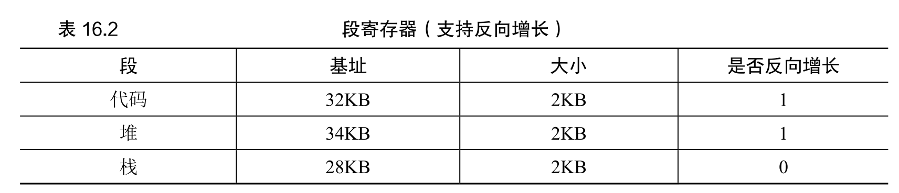
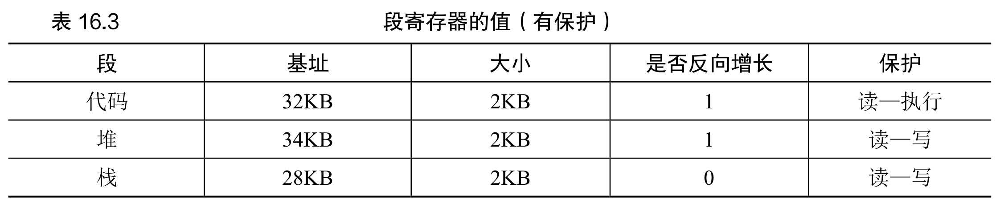
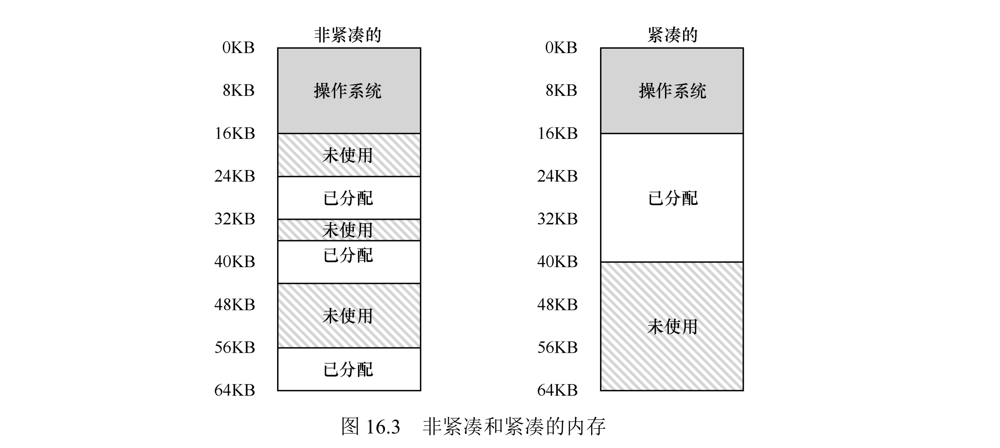

# 11 - 内存分段

基址-边界机制给整个地址空间配一对寄存器，但真实程序的地址空间很"稀疏"——栈和堆中间往往隔着一大段没用到的空档。空档也要在物理内存里占地方，这就浪费了。分段就是为了解决这个问题：不再管"整个地址空间"，而是给**每个逻辑段**（代码、堆、栈）单独配一对基址-边界寄存器。

## 一、基本思想：每个段一对基址-边界

为每个**逻辑段**（代码、堆、栈）各自独立分配一块连续物理内存，各自有自己独立的基址（物理起始地址）和边界（大小）寄存器。栈和堆之间的空档就不用再分配物理内存了，地址空间可以又大又稀疏。



举个例子：地址空间 0-16KB 里，代码段占 0-2KB，堆占 4-7KB，栈占 14-16KB（中间 2-4KB、7-14KB 是空的）。分段的物理分配是：

| 段类型 | 基址 | 大小 | 增长方向 | 权限 |
|--------|------|------|----------|------|
| 代码段 | 32KB | 2KB | 正向 | 读-执行 |
| 堆 | 34KB | 3KB | 正向 | 读-写 |
| 栈 | 28KB | 2KB | 反向 | 读-写 |

这些段在物理内存里的摆放示意（栈基址 28KB、反向增长，实际占用 26~28KB）：

```text
  0 KB ┌──────────┐
       │   空闲   │
 26 KB ├──────────┤ ← 栈（2KB，基址 28KB，向下长）
       │   栈     │
 28 KB ├──────────┤
       │   空闲   │
 32 KB ├──────────┤ ← 代码段（2KB）
       │  代码段  │
 34 KB ├──────────┤ ← 堆（3KB）
       │   堆     │
 37 KB ├──────────┤
       │   空闲   │
 64 KB └──────────┘
```

三个段加起来只占 6KB 物理内存，而不是 16KB 的完整地址空间。

## 二、地址翻译

翻译分两步：先判断虚拟地址属于哪个段，再算出段内偏移，最后加上该段的基址。

判断段有两种方式：

- **显式方式**：用虚拟地址的高位比特标段。比如 14 位地址取前 2 位：00→代码、01→堆、11→栈；剩下的低位就是段内偏移。需满足“偏移 < 段大小”（边界检查），否则触发段错误（Segmentation Fault）。
- **隐式方式**：看地址是哪来的——程序计数器（PC）产生的地址去代码段，栈指针（SP）的去栈段，其余去堆。


翻译示例（沿用上面的寄存器配置）：

| 示例 | 判断段 | 段内偏移 | 物理地址计算 | 结果 |
|------|--------|----------|--------------|------|
| 虚拟地址 100 | 高位 00 → 代码段 | 100（< 2KB，合法） | 32KB + 100 | 32868 |
| 虚拟地址 4200 | 落在堆段（起始 4096） | 4200 − 4096 = 104 | 34KB + 104 | 34920 |
| 虚拟地址 15KB | 落在栈段（反向增长） | 15KB − 14KB = 1KB，转负 = 1KB − 4KB = −3KB | 28KB + (−3KB) | 25KB |

### 段错误（Segmentation Fault）

遇到下面任一种，硬件触发异常、OS 终止进程：
- 高位比特指向无效段；
- 段内偏移 ≥ 段大小；
- 访问权限不匹配（比如写只读代码段）。

## 三、栈的反向增长

栈向低地址长，和代码段、堆方向相反，需要硬件额外支持：用寄存器里的**增长方向位**区分（1=正向，0=反向）。翻译时要先把正向偏移转成负偏移（负偏移 = 正向偏移 − 段最大大小），再做边界检查（负偏移的绝对值 ≤ 段大小）。

上面那个栈地址 15KB：假设栈段最大 4KB，正向偏移 = 15KB − 14KB = 1KB，转负 = 1KB − 4KB = −3KB，物理地址 = 28KB + (−3KB) = 25KB。



## 四、共享与保护

- **保护位（Protection Bits）**：每个段配上读/写/执行权限，翻译时顺便检查。代码段只读+执行（防篡改），堆/栈读+写（禁止执行，防注入）。越权就异常。
- **代码共享**：代码段设为只读+执行后，可以让多个进程把它映射进各自的地址空间，共享同一块物理内存——省内存，又不破坏隔离（反正谁都改不了）。



## 五、OS 要干什么

1. **上下文切换**：保存当前进程所有段寄存器的值（基址、大小、权限）到 PCB，恢复下一个进程的。
2. **段增长管理**：堆/栈要扩容时（`malloc`/`sbrk`），OS 检查有没有空闲物理内存，有就更新段大小寄存器，没有就拒绝。
3. **空闲管理**：段大小可变，频繁分配/释放后物理内存会出现**外部碎片**——总空闲够，但都是不连续的小块，塞不下一个大段。解决办法是内存紧凑（暂停进程、把段拷到连续区、改基址、合并空洞，代价大），或者靠首次适配/最佳适配等空闲列表算法（只能缓解，不能根治）。



## 六、分段的短板

1. **外部碎片**是最大问题；
2. **灵活性不够**：只能按固定的几个逻辑段分，扛不住更稀疏的地址空间（比如多个离散数据段）；
3. **段大小受限**：显式方式下，段大小由高位比特数决定（2 位标段 → 每段最多 4KB），不好扩容。

## 七、总结

1. 分段的价值：解决稀疏地址空间的浪费，支持代码共享和权限保护，翻译靠硬件直接算、很高效。
2. 代价是引入外部碎片，而且灵活性仍被固定逻辑段限制。
3. 这些缺陷催生了分页（Paging）——把地址空间和物理内存都切成固定大小的页，彻底解决外部碎片。

## 八、作业方向（Simulation）

通过 `homework/vm-segmentation/segmentation.py` 模拟两段式地址翻译：地址空间从中间一分为二，低半段是段 0（正向增长，如代码/堆），高半段是段 1（负向增长，如栈）。`-A` 指定访问地址序列，`-b/-l/-B/-L` 指定两段的基址/边界，`-c` 看答案。

1. 给定地址空间和物理内存参数，计算虚拟地址→物理地址的翻译结果；
2. 配置基址-边界参数，生成指定的“合法/非法”地址序列；
3. 调整参数使90%的随机虚拟地址合法，或全部非法；
4. 验证栈反向增长、权限检查的翻译逻辑。

### 1. 默认参数的地址翻译

```shell
./segmentation.py -s 0 -c
```

```text
Segment 0 base 6890  limit 472   (正增长)
Segment 1 base 4692  limit 450   (负增长)
VA 523 -> VIOLATION (SEG1)   VA 414 -> VALID SEG0: 7304
VA 802 -> VALID SEG1: 4470   VA 310 -> VALID SEG0: 7200
```

规则：`VA < asize/2` 属于段 0，`PA = VA + base0`（需 `VA < len0`）；`VA >= asize/2` 属于段 1，`PA = base1 + (VA - asize)`（负偏移）。

### 2. 用寄存器配置生成合法/非法序列

把边界设小，就能"点杀"特定访问。例如段 0 边界设为 400，那么 `VA < 400` 合法、`400 ≤ VA < 512` 越界。

### 3. 让 90% 合法 / 全部非法

地址空间对半分，两段各占一半。要让某段约 90% 的随机地址合法，就把该段边界设成"半空间 × 0.9"；要全部非法，两个边界都设为 0：

```shell
./segmentation.py -a 1k -p 32k -n 5 -s 0 -l 0 -L 0 -b 0 -B 1024 -c   # 全非法
./segmentation.py -a 1k -p 64k -n 10 -s 0 -l 512 -L 512 -b 0 -B 32768 -c  # 全合法
```

```text
# -l 0 -L 0:  全部 SEGMENTATION VIOLATION
# -l 512 -L 512: 全部 VALID（每段边界=半空间大小）
```

### 4. 栈的反向增长

段 1（负向增长）的翻译最能体现"栈向低地址长"：`PA = base1 + (VA − asize)`，VA 越大（越靠近栈顶），算出的偏移越负，物理地址越靠下。上面的 `VA 802 → PA 4470`、`VA 864 → PA 32608` 都是这种负偏移的结果。

（注：模拟器用段寄存器做地址翻译，不实际检查权限位；权限位属于硬件实现，翻译逻辑里只体现在"越界 vs 合法"上。）