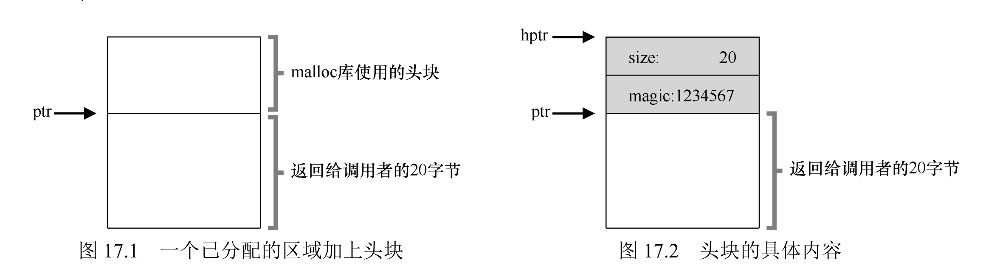
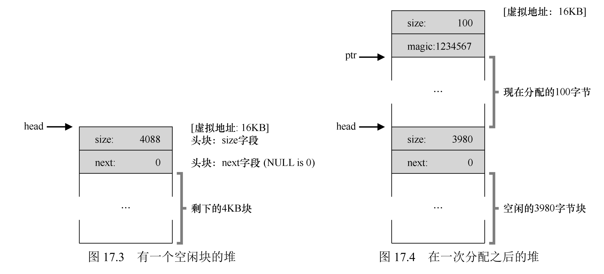

# 12 - 空闲内存管理

这一章讲分配器怎么管理堆里那块"空闲"内存，来满足大小不一的 `malloc` 请求。核心难题是**外部碎片**：总空闲空间明明够，却被切成一块块不连续的小块，结果一个稍大的连续请求塞不进去。

比如下面这种情况：总空闲 20 字节，却碎成两块 10 字节，一个 15 字节的请求就失败了。

```text
┌──────────┬──────────┬──────────┐
│ 空闲 10B │  已分配  │ 空闲 10B │
└──────────┴──────────┴──────────┘

总空闲 = 20 字节，但最大连续空闲块只有 10 字节
→ 15 字节的分配请求失败（外部碎片）
```

## 一、基本假设

先立几条简化假设（后面的讨论都基于此）：

1. 接口就是 `malloc(size_t size)`（分配）和 `free(void *ptr)`（释放），`free` 无需传入大小参数；
2. 主要关注**外部碎片**（离散小自由块导致无法满足连续请求），内部碎片（分配块大于请求的浪费）暂不重点讨论；
3. 内存不可重定位：分配给程序的内存块不能移动，无法通过紧凑（Compaction）消除碎片；
4. 管理范围：分配器管理一块连续的内存区域（堆），不够时可通过系统调用扩展。

## 二、四个底层机制

| 机制 | 核心逻辑 | 作用 / 原因 | 示意 |
|------|----------|-------------|------|
| 拆分（Splitting） | 自由块比请求大时，切成"满足请求（含头部）+ 剩余自由块"两块 | 避免大块浪费，充分利用内存 | `┌────────────────────┐`<br>`│    空闲 10 字节   │`<br>`└────────────────────┘`<br>`        ↓ 拆分`<br>`┌──────────┬───────────────────┐`<br>`│已分配(1B)│  空闲 9 字节      │`<br>`│  +头部   │                   │`<br>`└──────────┴───────────────────┘` |
| 合并（Coalescing） | 释放时检查前后相邻块，若也是空闲就并成一块大的 | 避免释放产生更多碎块，缓解外部碎片 | `[块][空闲][空闲] → [块][  合并后的大空闲  ]` |
| 头部跟踪（Header） | 分配块前嵌一个头部，存块大小（含头部）和魔术数；`free` 用 `header = ptr - 1` 取出 | 自动算出释放块大小，free 无需传大小 |  |
| 嵌入式自由链表 | 链表节点（地址、大小、下一节点指针）直接存在自由块内部 | 分配器自己不能调 malloc，只能借用空闲空间存链表 |  |

## 三、分配策略

| 策略 | 怎么选块 | 优点 | 缺点 |
|------|----------|------|------|
| 最佳适配（Best Fit） | 搜索所有自由块，选"最小能满足请求"的块 | 浪费最少 | 要遍历全链表，还容易留下一堆微小碎块 |
| 最差适配（Worst Fit） | 搜索所有自由块，选"最大的"块 | 保留大块 | 要遍历，实际表现差、易碎 |
| 首次适配（First Fit） | 从头找第一个够用的 | 快 | 链表头部易被切碎，越往后越慢 |
| 下次适配（Next Fit） | 从上次停的地方接着找 | 分散压力 | 整体碎片率没明显优势 |

链表排序也影响效率：按地址排序（ADDRSORT）方便合并相邻块；按大小排序（SIZESORT）加速最佳适配的搜索。

## 四、进阶方法

### 1. 分离链表（Segregated Lists）

按大小分组，给常用尺寸（8/16/64 字节…）各维护一条自由链表，其余交给通用分配器。典型实现是 Solaris 内核的 Slab 分配器：给常用对象（锁、inode）建专用缓存池，空闲对象预初始化，不够就向通用分配器要一个页大小的 slab。快、几乎无碎片，代价是要平衡专用池和通用池。

### 2. 伙伴分配（Buddy Allocation）

内存块大小严格是 2 的幂。分配时递归把大块劈成两个"伙伴"；释放时如果伙伴也空着就合并、再往上合并。合并逻辑极简（靠地址 bit 判断伙伴），但会有内部碎片（2 的幂可能大于请求）。


### 3. 其他

用平衡二叉树/伸展树替代链表降低搜索；多核上用 Hoard、jemalloc 这类支持并发、避免锁竞争的分配器。

## 五、向 OS 要内存

分配器自由空间不够时，通过 `sbrk`（扩展堆顶）或 `mmap`（映射匿名页）向 OS 申请，OS 分配物理页、映射进进程地址空间。

## 六、总结

1. 可变大小内存块带来外部碎片，靠"拆分 + 合并"缓解。
2. 拆分、合并是机制，首次/最佳适配等是策略，分离链表、伙伴分配是结构优化。
3. 没有通用最优：要空间利用率（最佳适配）就得牺牲时间，要速度（首次适配）就可能多碎片。
4. 实际按负载选：内核固定大小对象用 Slab，通用用首次适配 + 合并，多核用 jemalloc。

## 七、作业方向（Simulation）

通过 `homework/vm-freespace/malloc.py` 模拟分配器。`-p` 策略（FIRST/BEST/WORST）、`-l` 链表排序、`-C` 合并、`-A` 指定操作序列（`+10` 分配 10 字节、`-0` 释放第 0 个）、`-c` 看答案。

1. 对比不同策略（首次/最佳/最差适配）的分配结果，观察自由链表状态变化；
2. 分析链表排序方式（地址/大小排序）对策略效率的影响；
3. 验证合并（-C flag）对碎片的缓解效果，对比有无合并时的自由链表长度；
4. 调整分配比例（-P），观察接近100%或0%时的分配成功率；
5. 构造高碎片场景（-A flag），测试不同策略的抗碎片能力。

### 1. 策略对比（FIRST/BEST/WORST）

先分配 30、40，再释放这两个，然后请求 20，看三种策略选哪块：

```shell
./malloc.py -S 100 -b 1000 -H 0 -a 1 -l ADDRSORT -p FIRST -A +30,+40,-0,-1,+20 -c
./malloc.py -S 100 -b 1000 -H 0 -a 1 -l ADDRSORT -p BEST  -A +30,+40,-0,-1,+20 -c
./malloc.py -S 100 -b 1000 -H 0 -a 1 -l ADDRSORT -p WORST -A +30,+40,-0,-1,+20 -c
```

```text
# 释放后自由链表有两块（30B、40B），请求 20 字节：
FIRST: Alloc(20) returned 1000 (searched 1 elements)   # 第一个够用的块
BEST:  Alloc(20) returned 1000 (searched 3 elements)   # 最小的够用块
WORST: Alloc(20) returned 1030 (searched 3 elements)   # 最大的块（地址不同）
```

`FIRST` 找到第一个够用的就停（只搜 1 个）；`BEST`/`WORST` 遍历全链表（搜 3 个），一个选最小、一个选最大。

### 2. 链表排序方式

`-l ADDRSORT` 按地址排序（方便合并相邻块），`-l SIZESORT+/-` 按大小排序（方便最佳适配直接取），`-l INSERT-FRONT/BACK` 控制插入位置。排序改变的是"链表里的第一个块是谁"，从而影响 `FIRST` 的命中结果。

### 3. 合并（-C）对碎片的缓解

分配三个 10 字节后释放第 0 和第 2 个：

```shell
./malloc.py -S 100 -b 1000 -H 4 -a 4 -l ADDRSORT -p FIRST -A +10,+10,+10,-0,-2 -c
./malloc.py -S 100 -b 1000 -H 4 -a 4 -l ADDRSORT -p FIRST -A +10,+10,+10,-0,-2 -c -C
```

```text
# 无 -C:
Free(ptr[2])
Free List [ Size 3 ]: [ addr:1000 sz:16 ][ addr:1032 sz:16 ][ addr:1048 sz:52 ]

# 有 -C:
Free(ptr[2])
Free List [ Size 2 ]: [ addr:1000 sz:16 ][ addr:1032 sz:68 ]
```

合并后，中间的 16 字节块和后面的 52 字节块并成了 68 字节，自由链表少了一块——碎片被压回去了。

### 4. 分配比例（-P）的影响

`-P 100`（全是分配）时堆从头一路切走，直到耗尽：

```shell
./malloc.py -S 100 -b 1000 -H 4 -a 4 -l ADDRSORT -p FIRST -n 8 -P 100 -c
```

```text
ptr[0] = Alloc(8)  returned 1004 (searched 1 elements)
ptr[1] = Alloc(3)  returned 1016 (searched 1 elements)
ptr[2] = Alloc(5)  returned 1024 (searched 1 elements)
ptr[3] = Alloc(4)  returned 1036 (searched 1 elements)
ptr[4] = Alloc(6)  returned 1044 (searched 1 elements)
ptr[5] = Alloc(6)  returned 1056 (searched 1 elements)
ptr[6] = Alloc(8)  returned 1068 (searched 1 elements)
ptr[7] = Alloc(3)  returned 1080 (searched 1 elements)
```

前 8 次全成功，堆还剩一点；再来一个大请求就会失败。`-P` 接近 100% 时自由空间被连续切走，成功与否取决于堆够不够。

### 5. 构造高碎片场景（-A）

用 `-A` 精确构造"分配-释放交替"的序列（如 `+10,+10,+10,-0,-2` 这种隔一个释放一个），就能造出外部碎片；再用不同策略或 `-C` 对比抗碎片能力——如上第 3 条，`-C` 能把 3 块碎块压缩成 2 块。
