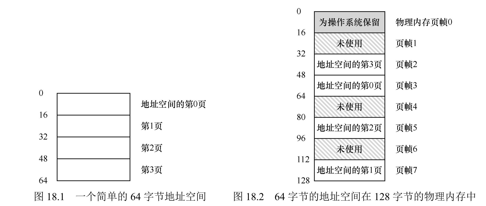
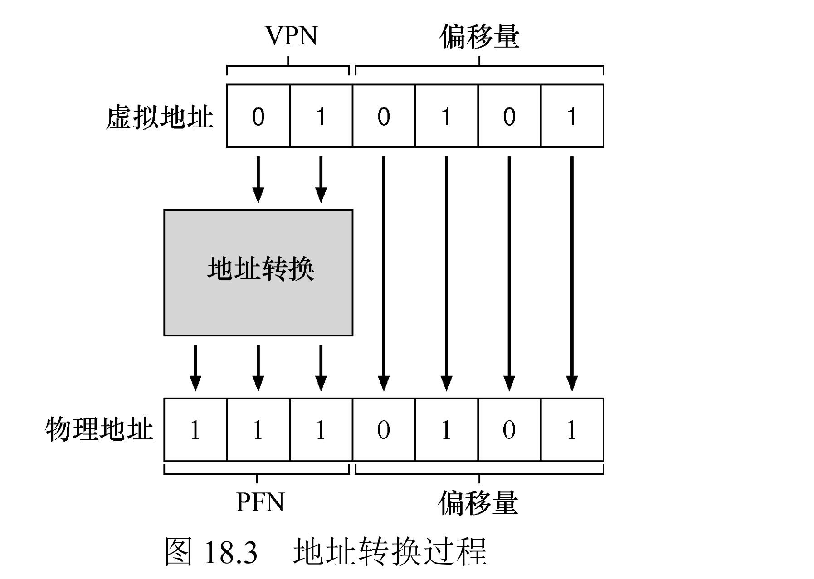
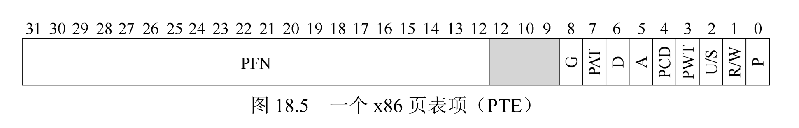
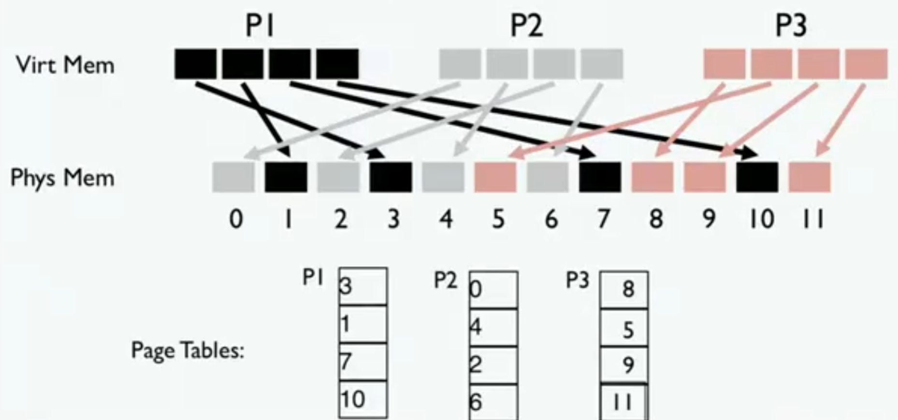

# 13 - 分页

分段用可变大小的段，带来了外部碎片（空洞越积越多、放不下新段）。分页换个思路：把虚拟地址空间和物理内存都切成**固定大小**的块——虚拟页（VPN，Virtual Page Number）和物理页框（PFN，Physical Frame Number），大小一样，再用一张**页表**记录每个虚拟页映射到哪个物理页框。因为都是等大的块，物理内存无所谓连续不连续，外部碎片就没了，还能支持稀疏地址空间。



## 一、地址翻译

把虚拟地址（VA）拆成两半：

```
虚拟地址 = 虚拟页号（VPN） + 页内偏移（Offset）
```

- **VPN**：拿去索引页表，查出对应的物理页框号 PFN；
- **Offset**：页内字节位置，翻译前后**不变**（虚拟页和物理页框一样大）。

页大小决定 Offset 占几位（`Offset 位数 = log₂(页大小)`），剩下的高位就是 VPN。页表就是个线性数组，硬件拿 **页表基址寄存器（PTBR）** 找到页表物理地址，再按 `PTEAddr = PTBR + VPN × sizeof(PTE)` 定位到对应页表项。

最后拼接：`物理地址 = PFN << 偏移位数 | Offset`。



一个完整的例子，参数如下：

| 关键参数 | 取值 |
|----------|------|
| 虚拟地址空间大小 | 64 字节（6 位 VA） |
| 页大小 | 16 字节（4 位 Offset） |
| 虚拟页数量 | 4 个（VPN 0~3） |
| 物理内存大小 | 128 字节（8 个页框） |
| 页表映射关系 | VPN0→PFN3、VPN1→PFN7、VPN2→PFN5、VPN3→PFN2 |

翻译流程验证：虚拟地址 21（二进制 `010101`）→ 按 6 位地址、4 位 Offset 拆开，VPN = `01`（高 2 位）、Offset = `0101`（低 4 位）→ 查页表 VPN 01 对应 PFN 7 → 物理地址 = 7 × 16 + 5 = 117。117 正好落在物理页框 7（112~127）内，对应 VPN1 的存储位置。

## 二、页表为什么这么大

页表本身要占内存，而且不小。32 位地址空间、4KB 页，VPN 占 20 位 = 100 万个虚拟页，每项 4 字节，页表就有 **4MB/进程**，100 个进程就是 400MB。所以页表存不进 MMU 寄存器，只能放物理内存里，由 OS 管理。

```
32 位虚拟地址（4KB 页）:
┌──────────────┬──────────────┐
│  VPN 20 位   │  Offset 12 位│
└──────────────┴──────────────┘
    → 2^20 = 100 万个虚拟页
    → 页表大小 = 100 万 × 4 字节 = 4MB
```

一个类比：你印了一本电话簿，给全国每个人（包括根本没有电话的人）都预印了一行，结果电话簿本身比真有电话的人还多几百倍——页表就是这种"宁可全印，也不漏人"的后果。

那为什么页默认是 **4KB**？

1. **历史与兼容**：x86 最早支持 4KB，海量软硬件都围着它设计，改不动。
2. **内部碎片的折中**：页太大浪费内存（1KB 的程序也占一整页），太小则页表爆炸，4KB 是经验平衡点。
3. **磁盘 I/O 粒度匹配**：传统磁盘扇区 512B，4KB 是整数倍，传输对齐方便。

## 三、页表项（PTE）里装什么

PTE是分页机制的控制核心，包含两类信息：地址映射 + 控制位。以 x86 为例：

| 字段 | 作用 |
|------|------|
| 有效位（Valid） | 该虚拟页是否被使用（支持稀疏地址空间，访问无效页触发段错误） |
| 保护位（Protect） | 读/写/执行权限，违规触发保护错误 |
| 存在位（Present） | 页是否在物理内存（不在则需从磁盘换入，对应后续交换技术） |
| 脏位（Dirty） | 页是否被改过（换出时只写改过的页，省 I/O） |
| 引用位（Accessed） | 页是否被访问过（用于页面替换算法） |
| 物理页框号（PFN） | 映射到的物理页框（核心字段） |



> x86 不区分"有效位"和"存在位"，只用一个存在位（P）：P=1 表示有效且在内存，P=0 表示无效或需换入，访问时触发陷阱由 OS 处理。

## 四、分页 vs 分段：碎片从哪来

**分段 = 外部碎片**（空洞散落、越积越多，想放个连续的新段可能放不下）：

```text
物理内存（段必须连续）

┌─────────────────────┐
│     代码段  10KB     │
├─────────────────────┤
│   ▒ 空洞 2KB  ▒      │ ← 太小，用不上
├─────────────────────┤
│     数据段  8KB      │
├─────────────────────┤
│   ▒ 空洞 5KB  ▒      │ ← 又用不上
├─────────────────────┤
│     堆段    12KB     │
└─────────────────────┘
   想放 9KB 新段？总空闲可能够，但没有连续 9KB → 只能搬移所有段（紧缩），代价极高
```

**分页 = 内部碎片**（有界，每段最多浪费不到一页）：

```text
物理内存 = 固定 4KB 页框，任意页框都能用
┌───┬───┬───┬───┬───┬───┬───┬───┐
│ 0 │ 1 │ 2 │ 3 │ 4 │ 5 │ 6 │ 7 │
└───┴───┴───┴───┴───┴───┴───┴───┘

10KB 代码段 = 2 满页(8KB) + 1 个用 2KB 的页
┌────────┬────────┬──────┬──┐
│  4KB   │  4KB   │ 2KB  │░░│ ← 内碎片最多 2KB，永远有界
└────────┴────────┴──────┴──┘
```

**分页为什么不怕物理内存"不连续"**：

```text
虚拟地址空间（进程看到的，连续）        物理内存（实际是散的页框）

  [ code  ]                             [ A ] [   ] [ C ] [ B ] [   ]
  [ data  ]                             [   ] [ B ] [   ] [   ] [ A ]
  [ stack ]                             [   ] [   ] [   ] [   ] [ C ]

           └────── 页表映射（虚页 → 实帧）──────┘

左边：虚拟地址连续，进程感知不到分页。
右边：A/B/C 三个物理页框散落在不同位置，靠页表对上，无所谓连续。
```

一句话：**分段是"散落的、会恶化的外碎片"，分页是"固定的、每段最多一页的内碎片"**——用可控的小浪费，换掉不可控的大问题。

下面是具体更为细致的虚拟内存和物理内存分页映射图



## 五、优势与代价

优势（对比分段）：无外部碎片、物理内存无需连续、支持稀疏地址空间（无效页不占物理页框）、不用假设堆栈增长方向，适配任意地址空间使用模式。

代价：页表过大、每次内存访问都要多查一次页表（翻译变慢，理论上慢 50%+）。这两个问题分别由后面的多级页表、TLB 解决。

## 六、总结

1. 分页用"固定大小块"替代分段的"可变大小段"，以有界的内部碎片换掉外部碎片。
2. 地址翻译 = 拆 VPN/Offset → 查页表 → 拼 PFN 和 Offset，靠硬件 MMU + 进程私有页表。
3. 代价是页表空间开销和访问延迟，需要多级页表、TLB 优化。
4. 分页是所有现代操作系统（Linux/Windows/macOS）的基础内存虚拟化方案。

## 七、作业方向（Simulation）

通过 `homework/vm-paging/paging-linear-translate.py` 模拟线性页表。`-a` 地址空间、`-p` 物理内存、`-P` 页大小、`-u` 已用页百分比、`-n` 地址数、`-c` 看答案。

1. 页表大小变化规律：测试地址空间大小（-a）和页大小（-P）对线性页表大小的影响，分析“大页”未被普遍使用的原因；
2. 地址翻译实践：给定不同虚拟地址空间（-a）、物理内存（-p）、页大小（-P），验证虚拟地址到物理地址的翻译结果；
3. 稀疏地址空间验证：通过`-u`参数调整已分配虚拟页比例，观察页表中有效PTE的数量变化；
4. 参数合理性分析：判断极端参数组合（如`-P 8 -a 32`、`-P 1m -a 256m`）的现实可行性，分析原因；
5. 边界测试：探索地址空间大于物理内存时的分页行为，验证稀疏地址空间的优势。

### 1. 页表大小变化规律

页表项数 = 地址空间大小 ÷ 页大小（也就是虚拟页数）：

```shell
./paging-linear-translate.py -a 32k -p 1m -P 4k  -n 0 -s 0 -c
./paging-linear-translate.py -a 32k -p 1m -P 32k -n 0 -s 0 -c
```

```text
-a 32k -P 4k:  页表条目 8 个    （32k ÷ 4k  = 8 个虚拟页）
-a 32k -P 32k: 页表条目 1 个    （32k ÷ 32k = 1 个虚拟页）
```

页越大、表越小，但每个进程都要浪费接近一页的内部碎片；页越小、表越大，甚至页表本身比数据还占地方。所以"大页"没被普遍采用——4KB 是在"页表大小"和"内部碎片"之间的折中。

### 2. 地址翻译实践

```shell
./paging-linear-translate.py -a 16k -p 64k -P 4k -n 5 -s 0 -c
```

```text
Page Table (from entry 0 down to the max size)
  0x8000000c      ← VPN0 有效，PFN = 0xc
  0x00000000      ← VPN1 无效
  0x00000000      ← VPN2 无效
  0x80000006      ← VPN3 有效，PFN = 0x6
Virtual Address Trace
  VA 0x00003229 (12841) --> 00006229 (25129) [VPN 3]
  VA 0x00001369 ( 4969) -->  Invalid (VPN 1 not valid)
  VA 0x00001e80 ( 7808) -->  Invalid (VPN 1 not valid)
  VA 0x00002556 ( 9558) -->  Invalid (VPN 2 not valid)
  VA 0x00003a1e (14878) --> 00006a1e (27166) [VPN 3]
```

页表项格式：最高位是有效位，`1` 后面跟着 PFN，`0` 表示无效。翻译走三步——拆 VPN/Offset（16k = 4 页、VPN 2 位，Offset 12 位）、查页表、拼 PFN 和 Offset。拿 VA 12841（0x3229）看：VPN = 12841 ÷ 4096 = 3，查得 PFN=6，拼接 = 6×4096 + 0x229 = 0x6229 = 25129 ✓。VA 4969 的 VPN=1 无效，直接报 Invalid。

### 3. 稀疏地址空间（-u）

`-u` 控制虚拟页里有多少被"使用"（有效）：

```shell
./paging-linear-translate.py -a 64k -p 1m -P 4k -n 1 -s 0 -u 10 -c
./paging-linear-translate.py -a 64k -p 1m -P 4k -n 1 -s 0 -u 90 -c
```

```text
-u 10: 页表 16 个条目里只有 2 个有效（0x8 开头），其余 14 个是 0x00000000
-u 90: 16 个条目全部有效
```

`-u` 越低，页表里的 `0x00000000`（无效项）越多——这些没被用到的虚拟页不占物理页框，这正是稀疏地址空间的优势：进程地址空间再大，只有真正用到的页才占内存。

### 4. 极端参数是否现实

- **页太小（-P 8）**：`-a 64k -P 8` 要 8192 个页表条目，而 `-P 4k` 只要 16 个——页表项数量爆炸，而且每 8 字节的页配一个 4 字节的 PTE，页表开销快赶上页本身了：

```shell
./paging-linear-translate.py -a 64k -p 1m -P 8 -n 0 -s 0 -c
```

```text
页表条目 8192 个（对照 -P 4k 只有 16 个）
```

- **页太大（-P 1m）**：`-a 256m -P 1m` 才 256 个条目，表很小，但每个程序都要浪费接近 1MB 的内部碎片（1KB 的程序也占一整页），同样不现实。

### 5. 边界测试

模拟器强制"物理内存 > 地址空间"，所以 `-a 64k -p 32k` 直接报错：

```shell
./paging-linear-translate.py -a 64k -p 32k -P 4k -n 1 -s 0 -c
```

```text
Error: physical memory size must be GREATER than address space size (for this simulation)
```

真实系统里虚拟地址空间可以超过物理内存——靠"换入换出"把不用的页先挪到磁盘、需要时再换回来（后面交换/页替换章节会讲）。这个模拟器不做交换，所以干脆禁止这种情况。