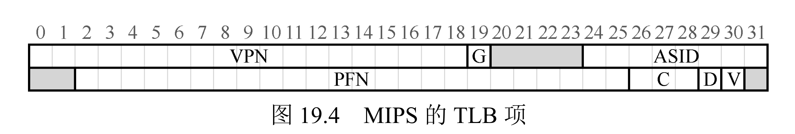

# 14 - TLB：加速地址翻译

分页的代价是慢：每次访问内存都要先查页表，等于一次访存变两次。TLB（Translation Lookaside Buffer，转换后备缓冲区）就是给页表加的一层硬件快表，把最近用过的"虚拟页→物理页框"映射缓存起来，让绝大多数翻译直接在 TLB 里出结果，省掉那次额外的访存。

## 一、TLB 是什么

TLB 是 MMU 里的一块专用高速缓存，存的是最近用过的页表项（VPN→PFN + 权限位）。它和页表是"缓存-主存"的关系：

- **页表**：完整的 VPN→PFN 映射，权威数据源，放物理内存里，访问慢（百纳秒级）。
- **TLB**：缓存高频映射，容量小（几十到几百条）、速度跟寄存器一个量级（1~3 个 CPU 周期）。

## 二、翻译流程：先查 TLB，再查页表

**没有 TLB：**

每次访存要两次物理内存操作：先查页表拿 PFN，再访目标地址。缺点是翻译延迟高（主存访问需百纳秒级），导致内存访问性能下降50%以上。

**有 TLB：**

- **命中（Hit）**：拆出 VPN 在 TLB 里匹配，直接拿到 PFN，拼上 Offset 就是物理地址——只访存一次，翻译几乎零开销。
- **未命中（Miss）**：TLB 里没有，去物理内存查页表拿 PFN，把这个新映射写进 TLB（满了就按替换策略淘汰旧条目），以后再访问这个 VPN 就命中了。

TLB 能这么省，靠的是程序的**局部性**：时间局部性（刚访问过的页很快还会用）+ 空间局部性（连续访问的指令/数据往往在同一页或相邻页）。所以几十到几百条条目就能覆盖 99% 以上的翻译。

### 示例：一次完整的 TLB 执行

页大小 4KB，`VPN = 地址 >> 12`、`offset = 地址 & 0xFFF`。页表放在物理内存里（`PTBR` 指向它），当前 TLB 有两条。CPU 执行一个循环，交替访问数组 a（虚拟页 1）和数组 b（虚拟页 2）：

```text
物理内存布局                 数据结构                    指令执行 (Virt -> Phys)
      +----------+
 0 KB |   PT     | <--- PTBR      [P1 Page Table]          Virt            Phys
      +----------+                 +---+---+---+---+      load 0x1000     load 0x0004 (Red/Miss)
 4 KB |   PT     |                 | 1 | 5 | 4 |...|      (Retry)         load 0x5000
      +----------+                 +---+---+---+---+      load 0x1004     load 0x5004 (Green/Hit)
 8 KB |   P1     |                   0   1   2   3        load 0x1008     load 0x5008 (Green/Hit)
      +----------+                                        load 0x100c     load 0x500C (Green/Hit)
12 KB |   P2     |                 [CPU's TLB]            ...
      +----------+                 +-------+-----+-----+  load 0x2000     load 0x0008 (Red/Miss)
16 KB |   P2     |                 | Valid | VPN | PPN | (Retry)         load 0x4000
      +----------+                 +-------+-----+-----+  load 0x2004     load 0x4004
20 KB |   P1     |                 |   1   |  1  |  5  |
      +----------+                 +-------+-----+-----+
24 KB |   P1     |                 |   1   |  2  |  4  |
      +----------+                 +-------+-----+-----+
28 KB |   P2     |
      +----------+
```

图示说明：

- 三个栏是并排的三张图：左边画物理内存中进程1进程2长什么样（地址 + `PT`/`P1`/`P2` 标签），中间画两个数据结构（页表、TLB），右边画 CPU 发出的访问序列，别把它们看成一张图。
- 页表下面那行 `0 1 2 3` 是每一列的下标，代表 **VPN（虚拟页号）**；格子里 `1 5 4` 是对应的 **PFN**。合起来就是 `VPN0→PFN1`、`VPN1→PFN5`、`VPN2→PFN4`。
- 物理地址 = **PFN × 页大小 + 页内偏移**（页大小 4KB = 0x1000）。例如 `load 0x1000`：VPN = 0x1000 >> 12 = 1、offset = 0x1000 & 0xFFF = 0，查表得 PFN 5，于是物理地址 = 5 × 0x1000 + 0 = **0x5000**；`load 0x1004` = 5 × 0x1000 + 4 = 0x5004。

逐条过程：

| 虚拟访问 | VPN | 物理地址 | 结果 |
|---------|-----|----------|------|
| load 0x1000 | 1 | 0x5000 | Miss（翻页表后装进 TLB） |
| load 0x1004 | 1 | 0x5004 | Hit |
| load 0x1008 | 1 | 0x5008 | Hit |
| load 0x100c | 1 | 0x500c | Hit |
| load 0x2000 | 2 | 0x4000 | Miss（翻页表后装进 TLB） |
| load 0x2004 | 2 | 0x4004 | Hit |

- **Miss**：拆出 VPN → TLB 里没有 → 拿 `PTBR` 翻页表得到 PFN → 回填 TLB（满则按 LRU 淘汰最久没用的）→ 拼出物理地址访存。
- **Hit**：直接拿 TLB 里的 PFN，跳过页表，只访存一次。
- 循环只有两个页反复用，2 条 TLB 正好装下，所以绝大部分命中；一旦 touching 到第三个页，就开始淘汰旧条目、重新 miss。

补充：为什么 TLB 里没有 `VPN 0 → PFN 1`？图里页表明明有这条映射，但 TLB 只剩 VPN 1、VPN 2。原因是 TLB 容量只有 2 条、只装当前热点：程序一开始 `load 0x0004`（VPN 0）时确实把 `VPN 0 → PFN 1` 装进了 TLB；随后循环转入 VPN 1、VPN 2，当 `load 0x2000`（VPN 2）第三次 miss 时 TLB 已满，按 LRU 把最久没用的 VPN 0 挤了出去。之后循环再没碰 VPN 0，所以这个快照里只剩 VPN 1、VPN 2。页表是权威全量映射，`VPN 0 → PFN 1` 始终保留；TLB 只是缓存热点，容量不够就淘汰，等真正回访 VPN 0 时会重新 miss、再翻页表装回来。

## 三、TLB 条的件与映射方式

每个 TLB 条目含：VPN（用于匹配）、PFN、控制位（有效/保护/脏）、**ASID**（地址空间标识，区分不同进程，避免切换时清空整个 TLB）。



VPN 的匹配方式决定 TLB 结构：

| 映射方式 | 怎么匹配 | 优点 | 缺点 |
|----------|----------|------|------|
| 全相联 | 任意 VPN 可放任意条目，遍历匹配 | 命中率最高，无冲突 | 硬件复杂、匹配稍慢 |
| 直接映射 | 按 VPN 模 TLB 大小落到唯一条目 | 硬件最简单、最快 | 冲突未命中多 |
| 组相联 | 先分组（VPN 到固定组），组内全相联 | 平衡命中率与速度 | 无明显短板，现代 CPU 主流 |

## 四、未命中的处理

- **硬件处理（x86 等 CISC）**：MMU 自己遍历页表找 PFN，自动写进 TLB，无需 OS 插手；若页表项标记"不存在"（页被换出），才触发缺页异常交给 OS。
- **软件处理（MIPS 等 RISC）**：未命中触发异常、把控制权交给 OS，OS 遍历页表、用专用指令更新 TLB。灵活可定制，但软件开销略大。

## 五、替换与一致性

- **替换策略**（TLB 满时淘汰谁）：LRU（最少最近使用，命中率最高）、NRU（最近未使用）、随机。
- **一致性**（TLB 不能和页表脱节）：
  - 上下文切换：不同进程 VPN 可能撞，简单做法是清空 TLB；用 ASID 标记则只需切 ASID 寄存器，不必清空。
  - 页表项修改：OS 换出页、改权限时，用 `flush_tlb_range` 之类指令主动刷掉失效条目。

## 六、优化手段

1. **大页（Huge Pages）**：页从 4KB 变成 2MB/1GB，一条 TLB 条目能覆盖多得多的内存。128 条 TLB + 2MB 页 = 256MB，比 4KB 页覆盖大 512 倍。数据库、虚拟机上很赚。
2. **多级 TLB**：L1（小而快）+ L2（大而慢），L1 没命中先去 L2，少去主存碰页表。
3. **局部性**：让相关数据挤在少数物理页（紧凑布局）、按行优先遍历矩阵，减少 TLB 条目需求。
4. **预取**：检测到顺序访问就提前把对应映射加载进 TLB。

## 七、层次化内存的分工

| 组件 | 作用 | 延迟 |
|------|------|------|
| TLB | 缓存 VPN→PFN，加速地址翻译 | 1~3 周期 |
| Cache | 缓存物理地址的数据/指令 | ~10 周期 |
| 页表 | 完整 VPN→PFN（权威源） | ~100 周期 |
| 主存 | 存程序、数据、页表 | 100+ 周期 |

完整访问流：CPU 出虚拟地址 → 拆 VPN+Offset → 查 TLB（命中得 PFN，未命中查页表并回填）→ 拼物理地址 → 查 Cache（命中取数，未命中查主存并回填）→ 返回数据。

## 八、总结

1. TLB 是页表的高速缓存，靠局部性用小容量高速缓存换低延迟。
2. 容量小则硬件便宜但未命中高，靠映射方式、替换策略、大页来平衡。
3. TLB 让虚拟内存访问逼近物理内存速度，是现代 CPU 必备组件。
4. 优化核心：提命中率（大页、局部性）+ 降未命中惩罚（多级 TLB、预取）。

## 九、作业方向（无模拟器，手算）

通过TLB相关模拟器（如`tlb-sim.py`）验证核心特性，核心任务：
1. 命中率分析：测试不同TLB容量（-s）、页大小（-p）对命中率的影响，绘制命中率曲线；
2. 未命中惩罚测试：对比“有/无TLB”“单级/多级TLB”的内存访问延迟，量化TLB的加速效果；
3. 大页优化验证：测试4KB页与2MB大页在相同工作负载下的TLB未命中次数，分析大页的适用场景；
4. 替换策略对比：对比LRU、NRU、随机替换策略的命中率，评估不同策略的性能差异；
5. 上下文切换影响：测试“有/无ASID”时，上下文切换后的TLB命中率变化，验证ASID的优化价值。