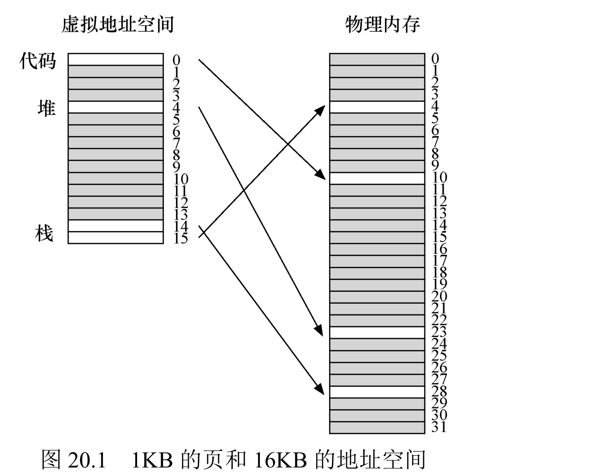
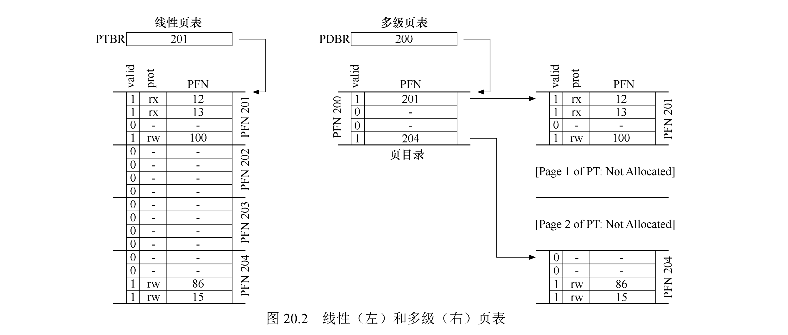
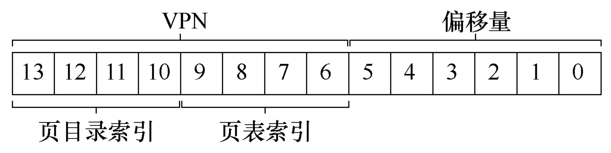
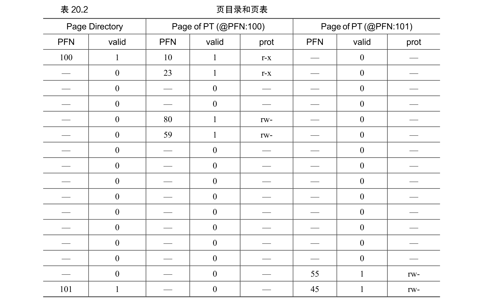

# 15 - 小型页表

分页的页表太大：32 位地址空间、4KB 页，一个进程的线性页表就是 4MB，100 个进程就是 400MB。小型页表要解决的问题就是——**别为那些没在用的大片虚拟地址白占页表空间**，只为真正用到的虚拟页存映射。



## 一、多级页表（主流做法）

单级页表是一整块连续数组，哪怕进程只用了几页，也得把整张表建出来。多级页表把它拆成树：**页目录 → 页表 → 物理页**，只为"确实有有效映射"的页表页分配内存，其余直接省略。



以 32 位 + 4KB 页的二级页表为例，虚拟地址拆三段：

```
┌──────────────┬──────────────┬──────────────┐
│ 页目录索引 10位 │ 页表索引 10位 │ 页内偏移 12位 │
└──────────────┴──────────────┴──────────────┘
```

翻译分两步：

1. 用**页目录索引**查页目录（Page Directory），取出 存储页目录项（PDE）；PDE 有效时指向一个二级页表的物理页框。
2. 用**页表索引**查那个二级页表，取出 PTE，得到物理页框号（PFN）。
3. `PFN × 页大小 + 偏移` = 物理地址。




用一个带实际值的例子确认一下。看上面的页目录：每个 PDE 描述一个页表页的情况，地址空间里有**两处有效区域**（开头和结尾），中间大片是无效映射。

- **PFN 100（页表第 0 页）**：存着前 16 个 VPN（VPN 0~15）的映射。其中 VPN 0、1（代码段）、VPN 4、5（堆）有效，其余标无效。
- **PFN 101（页表另一页）**：存着最后 16 个 VPN 的映射，其中 VPN 254、255（栈）有效。

这就是多级结构省空间的本质：线性页表要为这 256 个 VPN 建**完整的 16 页**；多级只建 **3 页**——1 页页目录 + 2 页真正有映射的页表。地址空间越大、越稀疏，省得越夸张。

空间效果：32 位系统里进程只用 12MB（3 个二级页表时），单级页表要 4MB，二级页表只要 1KB（页目录）+ 3×1KB（二级页表）= 4KB，省 99%+。

64 位实际用 48 位，需要四级：`PGD → PUD → PMD → PT`，层级更多、索引更细。

### 示例：一个 24 位地址的二级页表翻译

用一个 24 位地址的二级页表做练习：顶层 4 位是**页目录索引**，中间 8 位是**页表索引**，低 12 位是**页内偏移**（这里的顶层习惯上叫"段号"，本质上就是页目录索引）。

```text
[ seg # (4 bits) ] [ page number (8 bits) ] [ page offset (12 bits) ]

  +-----+------------+----------+-----+           +--------+
  | seg |    base    |  bounds  | R W |           |  ...   |  0x001000
  +-----+------------+----------+-----+           +--------+
  |  0  |  0x002000  |   0xff   | 1 0 |           |  0x01f |
  +-----+------------+----------+-----+           +--------+
  |  1  |  0x000000  |   0x00   | 0 0 |           |  0x011 |
  +-----+------------+----------+-----+           +--------+
  |  2  |  0x001000  |   0x0f   | 1 1 |           |  0x003 |
  +-----+------------+----------+-----+           +--------+
                                                  |  0x02a |
  0x002070 read:   0x004070                       +--------+
  0x202016 read:   0x003016                       |  0x013 |
  0x104c84 read:   error                          +--------+
  0x010424 write:  error                          |  ...   |  0x002000
  0x210014 write:  error                          +--------+
  0x203568 read:   0x02a568                       |  0x00c |
                                                  +--------+
                                                  |  0x007 |
                                                  +--------+
                                                  |  0x004 |
                                                  +--------+
                                                  |  0x00b |
                                                  +--------+
                                                  |  0x006 |
                                                  +--------+
                                                  |  ...   |  Assume bounds:
                                                  +--------+  # PTE entries
```

三个 error 对应三种保护：seg 1 是空段（越界）、seg 0 只读却写（权限不足）、seg 2 的页号 16 超 bounds（越界）。

逐条推导。拆址规则：`seg# = VA>>20`、`page = (VA>>12)&0xFF`、`offset = VA&0xFFF`；物理地址 = `PFN << 12 | offset`。

| 访问 | seg# / page / offset | 段表检查 | 页表查询 | 结果 |
|------|----------------------|----------|----------|------|
| `0x002070` read | 0 / 2 / 0x070 | seg0：base 0x002000、bounds 0xff、可读 | 页表 seg0[2] = 0x004 | `0x004070` |
| `0x202016` read | 2 / 2 / 0x016 | seg2：base 0x001000、bounds 0x0f、可读写 | 页表 seg2[2] = 0x003 | `0x003016` |
| `0x104c84` read | 1 / 4 / 0xc84 | seg1：bounds=0（空段，任何 page 都越界） | — | 越界 error |
| `0x010424` write | 0 / 16 / 0x424 | seg0：只读（W=0）却执行写 | — | 权限 error |
| `0x210014` write | 2 / 16 / 0x014 | seg2：page 16 ≥ bounds 15 | — | 越界 error |
| `0x203568` read | 2 / 3 / 0x568 | seg2：可读写 | 页表 seg2[3] = 0x02a | `0x02a568` |

推导示例（`0x002070`）：`0x002070` 拆成 seg=0、page=2、offset=0x070 → 段表 seg0 指向 base 0x002000、bounds 0xff，page 2 合法且可读 → 到 base 0x002000 的页表里取第 2 项 PFN=0x004 → 拼出 `0x004 << 12 | 0x070 = 0x004070`。

## 二、段页式混合

思路是"分段 + 分页"：给每个逻辑段（代码/堆/栈）单独一张页表，只存这段里有效页，段之间的空洞不用建表。

虚拟地址拆成三段：

```text
虚拟地址 = 段号（SN） | 段内 VPN | 页内偏移（offset）
```

段表存每段的页表基址和边界（外加有效位、权限位）：

```text
段表[SN] = { base, bounds, valid, prot }
```

翻译流程与公式：

```text
1. 边界检查：    if VPN >= bounds  →  fault（越界）
2. 定位 PTE：    PTE = SegTable[SN].base + VPN   （段内按 VPN 作下标）
3. 拼物理地址：  PA = (PTE.PFN << offset_bits) | offset
```

适合堆、栈小、中间大量空闲的稀疏地址空间；但要小心别把分段的外部碎片又招回来。

### 示例：一个 24 位地址的段页式翻译

虚拟地址 24 位：段号 2 位 + 段内 VPN 10 位 + 页内偏移 12 位（页大小 4KB）。

```text
[ seg # (2 bits) ] [ VPN (10 bits) ] [ offset (12 bits) ]
```

段表（每段一张页表，base 是页表物理地址，bounds 是该段最大 VPN）：

```text
  段表                             code 页表        heap 页表
  +-----+----------+--------+----+  +--------+      +--------+
  | seg |   base   | bounds | R W|  |  0x0c  |      |  0x01f |
  +-----+----------+--------+----+  +--------+      +--------+
  |  0  | 0x002000 | 0x003  | 1 0|  |  0x07  |      |  0x011 |
  +-----+----------+--------+----+  +--------+      +--------+
  |  1  | 0x001000 | 0x00f  | 1 1|  |  0x04  |      |  0x003 |
  +-----+----------+--------+----+  +--------+      +--------+
  |  2  |   ----   |   0    | 0 0|  |  0x0b  |      |  0x02a |
  +-----+----------+--------+----+  +--------+      +--------+

  0x002070 read:  0x004070        (seg0 = code，只读)
  0x402016 read:  0x003016        (seg1 = heap，读写)
  0x802070 read:  error           (seg2 无效)
  0x004070 read:  error           (VPN 4 超 bounds)
  0x002071 write: error           (code 段只读却写)
```

逐条推导（`seg# = VA>>22`、`VPN = (VA>>12)&0x3FF`、`offset = VA&0xFFF`）：

| 访问 | seg# / VPN / offset | 段表检查 | 页表查询 | 结果 |
|------|---------------------|----------|----------|------|
| `0x002070` read | 0 / 2 / 0x070 | seg0：bounds 0x003、只读，VPN 2 合法 | code[2]=0x04 | `0x004070` |
| `0x402016` read | 1 / 2 / 0x016 | seg1：bounds 0x00f、读写，VPN 2 合法 | heap[2]=0x003 | `0x003016` |
| `0x802070` read | 2 / 2 / 0x070 | seg2：无效段 | — | 越界 error |
| `0x004070` read | 0 / 4 / 0x070 | seg0：VPN 4 ≥ bounds 3 | — | 越界 error |
| `0x002071` write | 0 / 2 / 0x071 | seg0：只读却写 | — | 权限 error |

推导示例（`0x402016`）：seg=1（heap）、VPN=2、offset=0x016 → 段表 seg1 指向 base 0x001000、可读写 → 查 heap 页表第 2 项 PFN=0x003 → `0x003 << 12 | 0x016 = 0x003016`。

## 三、倒排页表

前面都是"虚拟页 → 物理页"的正向映射，一个虚拟页一个表项；虚拟页数量一大就爆炸。倒排页表反过来：**每个物理页框一个表项**，记录"现在哪个进程的哪个虚拟页占用了我"（PID + VPN）。

因为表项数是物理页框数（固定），物理内存多大表就多大，和虚拟地址空间大小无关。代价是查表不能直接按 VPN 下标索引，要靠**哈希表**（键 = PID+VPN）定位，哈希冲突会加一点延迟。

适合 64 位超大地址空间（服务器、虚拟机），彻底解决"虚拟页数远超物理页"的膨胀。

## 四、代价与权衡

- 多级页表：TLB 未命中时要多次访存（二级 2 次、四级 4 次），比单级慢；靠 TLB 高命中率掩盖。
- 倒排页表：哈希查找，最坏遍历冲突链。
- 共同点：**用少量延迟换大量空间**，再靠 TLB 提速，实现"省空间 + 够快"。

## 五、优化策略

1. 动态页表分配：进程访问到某段地址才建对应页目录项/页表，不提前建全。
2. 哈希优化倒排：链地址法或两级哈希，缩短冲突链。
3. 大页：2MB/1GB 页减少层级（大页可跳过一级），还减少 TLB 条目需求。
4. 页表缓存：常用 PDE/PTE 进 L1/L2 Cache，降低 TLB 未命中的代价。

## 六、总结

1. 小型页表本质：以轻微延迟/复杂度为代价，靠"只存有效映射"解决分页的页表膨胀。
2. 选择逻辑：32 位用二级、64 位用四级、超大地址空间用倒排、稀疏地址空间用段页式。
3. 技术链：分页（除外部碎片）→ TLB（提速度）→ 小型页表（省空间），三者构成现代内存虚拟化的核心栈。

## 七、作业方向（Simulation）

通过 `homework/vm-smalltables/paging-multilevel-translate.py` 验证二级页表。参数固定：页大小 32 字节（offset 5 位）、虚拟空间 1024 页（VPN 10 位）、物理内存 128 页。虚拟地址 15 位 = **页目录索引 5 位 + 页表索引 5 位 + offset 5 位**。PDE/PTE 都是 1 字节，格式 `VALID | PFN[6:0]`（最高位是有效位）。

1. 多级页表空间测试：对比单级/二级/四级页表在不同进程内存使用率下的空间占用，绘制空间节省曲线；
2. 延迟对比：测试TLB命中/未命中时，不同页表方案的地址翻译延迟，量化TLB的加速效果；
3. 倒排页表冲突测试：改变进程数和虚拟页数量，观察哈希冲突对倒排页表查找延迟的影响；
4. 段页式适用性分析：测试稀疏地址空间与连续地址空间下，段页式与多级页表的性能差异；
5. 大页优化验证：测试大页对多级页表层级和TLB命中率的影响，分析大页的适用场景。

### 示例：一次二级页表翻译

```shell
./paging-multilevel-translate.py -s 0 -n 5 -c
```

```text
PDBR: 108  (页目录存在物理页 108)

Virtual Address 0x611c:
  --> pde index: 0x18 (24), pde contents: 0xa1 (valid 1, pfn 0x21=33)
    --> pte index: 0x08 (8),  pte contents: 0xb5 (valid 1, pfn 0x35=53)
      --> Translates to Physical Address 0x6bc --> Value: 0x08
```

拆开 `0x611c`（15 位）：

- **PDE 索引** = 高 5 位 = `11000` = 24 → 查页目录（PDBR 指向页 108）得 PDE `0xa1`；有效，指向页表页 33。
- **PTE 索引** = 中间 5 位 = `01000` = 8 → 查页表页 33 得 PTE `0xb5`；有效，PFN = 53（`0x35`）。
- **offset** = 低 5 位 = `11100` = 28（`0x1c`）。
- 物理地址 = `53 << 5 | 28` = `0x6a0 | 0x1c` = `0x6bc`，取值 `0x08`。

### 两类 fault

- **PDE 无效**：页目录项 valid=0，说明这一片虚拟页根本没映射 → `Fault (page directory entry not valid)`。
- **PTE 无效**：页目录有效、页表里这项 valid=0 → `Fault (page table entry not valid)`。

同一份 dump 里 `0x3da8` 就踩到 PTE 无效，`0x7f6c` 也是——说明那块虚拟页没被分配。

### 空间节省（概念）

单级线性页表要 1024 个 PTE = 32 页；二级页表只需 1 个页目录 + 若干页表页（只为用到的区域建表）。进程用到的虚拟页越稀疏，省得越多。这正是"倒排页表""段页式"（本模拟器未覆盖）背后的动机。