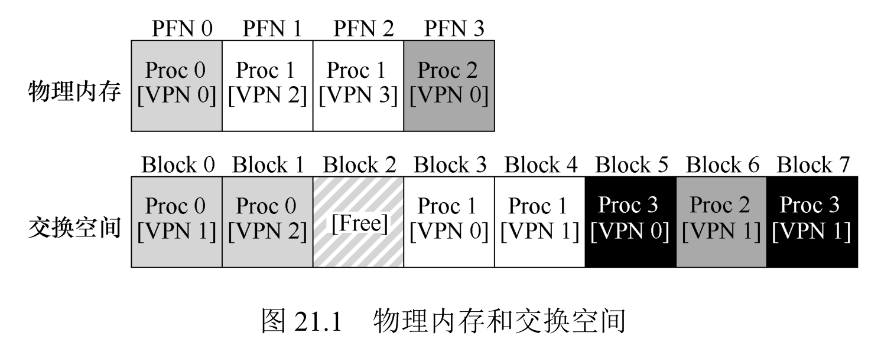

# 16 - 页表交换空间

物理内存有限，但进程想要比它更大的地址空间。办法是拿"更大但更慢"的磁盘当后援：暂时不用的页换到磁盘上的**交换空间**，要用时再换回内存。对进程完全透明——它以为自己拥有一整块连续内存，其实大部分时间只有活跃页在物理内存里。



## 一、三个核心机制

### 1. 交换空间（Swap Space）

交换空间是磁盘上预留的一块连续区域，专门存放从物理内存换出的页面，是虚拟内存的"扩展存储"。

- **核心作用**：突破物理内存容量限制，支持多进程并发——多个进程的页面可部分存于交换空间，只有核心页面留在内存。
- **大小决定上限**：交换空间越大，能同时支撑的进程/页面越多。
- **交换单位**：以页为最小单位（与物理内存页大小一致），OS 要记录每个换出页在交换空间里的磁盘地址。
- **代码页例外**：只读的代码页（如程序二进制）可直接从文件系统重新加载，无需占用交换空间。

示例场景：4 页物理内存 + 8 页交换空间，几个进程同时运行——有的页在内存、有的在交换空间：

```text
物理内存（4 页框）        交换空间（8 页）
┌───────────┐           ┌───────────┐
│  P0 VPN0  │           │  P0 VPN1  │
├───────────┤           ├───────────┤
│  P1 VPN0  │           │  P3 VPN0  │
├───────────┤           ├───────────┤
│  P2 VPN0  │           │  P3 VPN1  │
├───────────┤           ├───────────┤
│  P2 VPN1  │           │  P3 VPN2  │
└───────────┘           ├───────────┤
                        │  P3 VPN3  │
                        ├───────────┤
                        │  (空)     │
                        ├───────────┤
                        │  (空)     │
                        └───────────┘
```

物理内存里是各进程的活跃页（P0 VPN0、P1 VPN0、P2 VPN0/VPN1）；进程 0 的 VPN 1、进程 3 的全部页面都躺在交换空间。进程 3 没在运行时，它的页可以整个换出去，把物理内存让给别的进程。

> 补充：为什么 64GB 内存还需要专门划分 swap？swap 的现代意义不是"内存不够时的备用内存"，而是：
>
> 1. **换出冷页**：把长期不用的页（后台守护进程、初始化代码、冷数据）换出去，让物理内存全给活跃数据——等于变相增大有效 RAM；
> 2. **支持休眠**：Linux 挂起到磁盘（hibernate）就是把整个内存写进 swap，没有 swap 无法休眠；
> 3. **内存尖峰安全网**：临时超额申请时不至于被 OOM 随机杀进程（数据库、虚拟机尤其需要）；
> 4. **支撑过度提交（overcommit）**：程序申请超过物理内存时，swap 是这种承诺的兜底。
>
> 内存容量远超峰值、不需要休眠、或不想损耗 SSD 寿命时，可以改用 **zram**（内存压缩当 swap，不写磁盘）作为折中。

### 2. 存在位（Present Bit）

PTE 里新增一个位，区分页的位置：

- 存在位 = 1：页在物理内存，PTE 里存 PFN；
- 存在位 = 0：页在磁盘交换空间，PTE 里存磁盘地址。

注意和**有效位**的区别：有效位判断"这页属不属于进程地址空间"（无效 → 段错误）；存在位判断"这页现在在哪"（有效但不在内存 → 页故障）。

#### 示例：每个页到底在哪

下面这张页表（缩小的例子，VPN 0~9），每一行的字段：PFN/磁盘地址、有效位、权限、存在位：

```text
VPN    PFN(或磁盘地址)   valid   prot    present     页在哪
 0          10            1      r-x       1       → 物理内存（代码页）
 1           -            0       -        -       → 无效，不属于地址空间
 2          23            1      rw-       0       → 磁盘（present=0，23 是磁盘地址）
 3~7         -            0       -        -       → 无效
 8          28            1      rw-       0       → 磁盘（28 是磁盘地址）
 9           4            1      rw-       1       → 物理内存
```

三种情况：

- **valid=0**：这页不属于进程地址空间，访问 → 段错误（segmentation fault），OS 终止进程；
- **valid=1 且 present=1**：页在物理内存，PFN 字段就是物理页框号；
- **valid=1 且 present=0**：页在磁盘，那个字段存的是磁盘地址（图上标 23、28），访问 → 页故障（page fault），OS 换入。

访问 `vpn 0xb`（十进制 11）：先看这个 VPN 的 valid 位——本图页表只到 VPN 9，VPN 11 越界、属于无效访问，所以触发**段错误**。如果它是 valid=1 但 present=0，才会是页故障。

### 3. 页故障（Page Fault）

访问的页"有效但不在内存"时，硬件触发页故障，交给 OS 处理。这不是程序错误，是"合法但要等 I/O"的正常事件。

## 二、页故障的处理流程

OS 的页故障处理程序干这几件事：

1. 找空闲物理页框；没有空闲，就先**页面置换**（挑一页换出去）；
2. 按 PTE 里的磁盘地址发读请求，把目标页加载进页框；
3. 等 I/O 期间，进程阻塞，OS 切到别的就绪进程（别让 CPU 空等）；
4. I/O 完成，更新 PTE（存在位=1、填 PFN）；
5. 重试刚才那条指令，这次命中。

完整控制流分两段——硬件负责翻译，OS 负责换页：

```text
硬件：拆 VPN+offset → 查 TLB（命中直接用）
      → TLB 未命中查页表 → 有效位=0 → 段错误（终止进程）
      → 有效位=1 → 存在位=1 → 更新 TLB 重试
                → 存在位=0 → 页故障，交给 OS

OS：找空闲页框（无则置换）→ 磁盘读页 → 进程阻塞、调度他人
    → 更新 PTE → 重试指令 → 命中完成
```

## 三、页面置换

内存满、又要换入新页时，必须挑一页换出去，这叫页面置换。原则是优先换"低价值"的页（长期没访问、只读），避免频繁换入换出（抖动）。被改过的脏页要先写回交换空间才能释放；只读页（代码）可以直接丢，以后从文件重新加载。

具体"挑哪页"，由页面置换策略决定（下一章讲）。

## 四、后台页面守护进程

等内存完全满了才置换，进程会被迫阻塞等待。OS 用水位线提前动手：

- **低水位线（LW）**：空闲页框低于它，后台守护进程（swap daemon）启动，开始批量换页；
- **高水位线（HW）**：守护进程一直换，直到空闲页框回到 HW 才睡。

批量写盘能减少磁盘寻道/旋转开销，保持系统响应性。

## 五、优势与代价

### 1. 核心优势

- **透明性**：进程无需感知页面在内存与磁盘间的切换，认为自己拥有连续的虚拟地址空间；
- **利用率**：物理内存仅存放活跃页面，支持更多进程并发，提高 CPU 和内存利用率；
- **易用性**：程序员无需手动管理内存覆盖（如早期系统的 overlay），直接按需分配内存。

### 2. 关键注意事项

- **页故障代价高**：磁盘 I/O 耗时是内存访问的 10⁴~10⁵ 倍，频繁页故障会导致系统性能骤降（抖动）；
- **交换空间有限**：超出交换空间容量时，内存分配失败（进程无法扩展虚拟内存）；
- **脏页开销**：修改过的页面换出时需额外写入磁盘，比只读页置换开销更大。

## 六、总结

1. 超越物理内存的本质：磁盘交换空间当扩展，页故障触发换入、页面置换触发换出。
2. 存在位 → 页故障 → 置换 → 后台守护，四个组件协同构成完整机制。
3. 性能关键在置换策略 + 批量 I/O + 水位线。
4. 现代 OS 通用机制，支撑大地址空间和多进程。

## 七、作业方向（Measurement）

用 `homework/vm-beyondphys/mem.c` 测内存访问带宽，配合 `vmstat`/`free` 观察交换。

### 1. mem.c 的带宽

`./mem N` 分配 N MB 数组，无限循环遍历每个 int 并 +1，每 0.2s 打印一次带宽：

```shell
./mem 10     # 10MB，能装进缓存
./mem 512    # 512MB，仍在物理内存内
```

```text
# 10MB:  loop 0: 1390 MB/s → 稳定后约 8100 MB/s
# 512MB: loop 0: 1669 MB/s → 稳定后约 8800 MB/s
```

第一次 loop 慢（首次触摸每页触发缺页/分配），之后都在内存里，带宽冲到 8~9 GB/s。

### 2. 观察交换（本机情况）

```shell
free -m
vmstat 1 2
```

```text
Mem:  62009 used 11510 free 11319 ...
Swap:     0      0     0

vmstat: swpd=0, si=0, so=0   (pages swapped in/out 都是 0)
```

本机 62GB 物理内存、**没配交换分区**（Swap 全 0），所以 si/so 都是 0——意味着"超物理内存触发换页"这个场景在这台机器上跑不出来。

### 3. 换页场景（概念）

在有交换空间的机器上，分配超过物理内存的数组（如 `./mem 16384`，16GB），`vmstat` 的 `si`/`so` 会变成正数，`swpd` 上涨，带宽会从 8GB/s 掉到几十 MB/s——因为每轮循环都要和磁盘换页。这正是"页故障代价高、抖动"的体现。

### 4. 结论

- 工作集能装进内存 → 带宽 ~8GB/s，CPU 满；
- 工作集超内存 → 带宽掉到磁盘速度量级（几十~几百 MB/s），系统卡顿。
- 交换空间大小决定能超配多少；用 SSD 比机械盘交换快一个数量级。