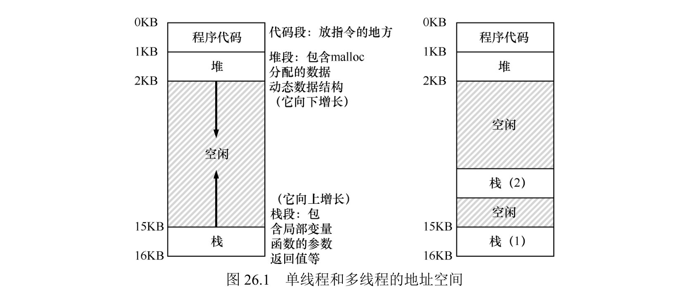

# 19 - 线程

线程是进程内的**独立执行单元**：多个线程共享进程的地址空间（代码、堆、全局变量），但各自有独立的 PC、寄存器和栈。用它有两个目的——并行加速、I/O 和计算重叠。但多个线程同时碰共享数据时，会因"调度不受控制"产生**竞态条件**，必须靠原子操作和同步原语保证临界区互斥，才能拿到确定结果。OS 本身就是第一个并发程序，内核里的共享数据也得靠这套保护，所以这是本课程的重点。

## 一、线程 vs 进程

| 特性 | 线程（Thread） | 进程（Process） |
|------|----------------|-----------------|
| 地址空间 | 共享所属进程的地址空间 | 独立虚拟地址空间 |
| 独立资源 | 独立 PC、寄存器、栈 | 独立 PCB、页表、文件描述符 |
| 上下文切换 | 不切页表，开销低 | 切页表，开销高 |
| 数据共享 | 天然共享全局变量/堆 | 需 IPC（管道、共享内存） |

多线程进程里，每个线程有自己的栈，散在地址空间的空隙里，共享代码、堆、全局变量。这打破了"栈-堆相向生长"的整洁布局，但栈通常不大，影响有限。



### 线程的状态与上下文切换

- 线程状态和进程一致（就绪、运行、阻塞），由 OS 调度器统一调度；
- 上下文切换时，把当前线程的寄存器存到**线程控制块（TCB）**，恢复目标线程的寄存器；因为地址空间不变，**不用切页表**，比进程切换快一个数量级。

## 二、为什么要用线程

### 1. 并行加速（Parallelism）

- 场景：CPU 密集型任务（大数组运算、数据处理）；
- 原理：多核下把任务拆给多个线程，每个线程占一个核同时跑，缩短总耗时；
- 示例：两个线程各算数组前半段和后半段，最后合并结果，比单线程快近一倍。

### 2. 避免 I/O 阻塞（Overlap I/O and Computation）

- 场景：I/O 密集型任务（网络通信、磁盘读写、页故障）；
- 原理：一个线程因 I/O 阻塞时，调度器切到别的就绪线程继续算或发起新 I/O，别让 CPU 空着；
- 典型应用：Web 服务器、数据库，多线程同时处理多个客户端请求，提升吞吐量。

### 3. 对比多进程的优势

- 数据共享更高效：线程天然共享地址空间，无需 IPC，传递数据/状态开销极低；
- 资源开销更低：线程创建、切换开销远小于进程，能支撑更多并发单元。

## 三、线程执行的不确定性

```c
void *mythread(void *arg) { printf("%s\n", (char *)arg); return NULL; }
int main() {
    pthread_t t1, t2;
    Pthread_create(&t1, NULL, mythread, "A");
    Pthread_create(&t2, NULL, mythread, "B");
    Pthread_join(t1, NULL);
    Pthread_join(t2, NULL);
}
```

线程创建后，执行顺序由 OS 调度器决定，与创建顺序无关。可能的执行轨迹（至少三种）：

**轨迹 1**：主线程 → t1 打印 "A" → t2 打印 "B" → 主线程结束。

| 主程序 | 线程 1 | 线程 2 |
| :---: | :---: | :---: |
| 开始运行<br>打印 "main:begin"<br>创建线程 1<br>创建线程 2<br>等待线程 1 | | |
| | 运行<br>打印 "A"<br>返回 | |
| 等待线程 2 | | |
| | | 运行<br>打印 "B"<br>返回 |
| 打印 "main:end" | | |

**轨迹 2**：主线程 → 创建 t1 后立即执行 t1 → 创建 t2 后执行 t2 → 主线程结束。

| 主程序 | 线程 1 | 线程 2 |
| :---: | :---: | :---: |
| 开始运行<br>打印 "main:begin"<br>创建线程 1 | | |
| | 运行<br>打印 "A"<br>返回 | |
| 创建线程 2 | | |
| | | 运行<br>打印 "B"<br>返回 |
| 等待线程 1<br>*立即返回，线程 1 已完成*<br>等待线程 2<br>*立即返回，线程 2 已完成*<br>打印 "main:end" | | |

**轨迹 3**：主线程 → 创建 t1 和 t2 → t2 先打印 "B" → t1 再打印 "A" → 主线程结束。

| 主程序 | 线程 1 | 线程 2 |
| :---: | :---: | :---: |
| 开始运行<br>打印 "main:begin"<br>创建线程 1<br>创建线程 2 | | |
| | | 运行<br>打印 "B"<br>返回 |
| | 运行<br>打印 "A"<br>返回 | |
| 等待线程 1<br>*立即返回，线程 1 已完成*<br>等待线程 2<br>*立即返回，线程 2 已完成*<br>打印 "main:end" | | |

核心：多线程执行的"交织顺序"不可预测，正是后面竞态条件的根源。

## 四、竞态条件

### 1. 共享计数器的异常

```c
static volatile int counter = 0; // 全局共享变量
void *mythread(void *arg) {
    for (int i = 0; i < 1e7; i++) {
        counter = counter + 1; // 共享数据更新
    }
    return NULL;
}
```

- 预期结果：两个线程各加 1000 万次，最终 `counter = 20000000`；
- 实际结果：每次运行结果都不同（如 19345221、19221041），均小于预期。

### 2. 根源：非原子的更新操作

`counter = counter + 1` 在汇编层面被拆成 3 条指令，不是"一步完成"：

```text
mov 0x8049a1c, %eax   # 把 counter 读进寄存器 eax
add $0x1, %eax        # eax 加 1
mov %eax, 0x8049a1c   # 写回内存
```

调度器可能插在这三条之间切换，导致数据覆盖：

1. 线程1 加载 counter=50 到 eax，加 1 后 eax=51，此时被中断；
2. 线程2 加载 counter=50 到 eax，加 1 后写回内存，counter=51；
3. 线程1 恢复执行，把 eax=51 写回内存，counter 仍为 51——两次更新只生效一次。

逐条看寄存器/内存的变化：

| OS | 线程 1 | 线程 2 | PC | %eax | counter |
| :--- | :--- | :--- | :---: | :---: | :---: |
| | *在临界区之前* | | 100 | 0 | 50 |
| | mov 0x8049a1c, %eax | | 105 | 50 | 50 |
| | add $0x1, %eax | | 108 | 51 | 50 |
| 中断<br>保存 T1 的状态<br>恢复 T2 的状态 | | | 100 | 0 | 50 |
| | | mov 0x8049a1c, %eax | 105 | 50 | 50 |
| | | add $0x1, %eax | 108 | 51 | 50 |
| | | mov %eax, 0x8049a1c | 113 | 51 | 51 |
| 中断<br>保存 T2 的状态<br>恢复 T1 的状态 | | | 108 | 51 | 51 |
| | mov %eax, 0x8049a1c | | 113 | 51 | 51 |

表格把丢失过程看得很清楚：两个线程都从 counter=50 出发、各自算出 51，写回后 counter 只从 50 变成 51，两次 +1 只生效了一次。

几个关键术语：

- **临界区（Critical Section）**：访问共享资源（变量、数据结构）的代码段，不能多线程并发执行；
- **竞态条件（Race Condition）**：多个线程并发进临界区，结果依赖调度顺序（不确定）；
- **不确定性（Indeterminate）**：程序输出因线程交织顺序不同而变化，违背“计算机应产生确定结果”的直觉；
- **互斥（Mutual Exclusion）**：同一时刻只有一个线程进临界区，是解药。

## 五、解决办法：原子操作 + 同步原语

理想做法是"原子操作"——要么全执行、要么全不执行，不可被中断拆分。但没法给所有操作（比如 B 树更新）都造一条硬件原子指令，所以要在硬件原子指令之上构建**同步原语**（锁、信号量），把临界区包成"原子块"。

### 1. 原子操作（硬件 / C 内建）

把 `counter = counter + 1` 变成一条不可拆的指令。x86 加 `lock` 前缀：

```asm
lock addl $1, counter        # 读-加-写一条指令原子完成
```

C 里不用写汇编，直接用 GCC 内建或 C11 `<stdatomic.h>`：

```c
__atomic_add_fetch(&counter, 1, __ATOMIC_SEQ_CST);   // GCC/Clang，原子加 1

// 或 C11：
#include <stdatomic.h>
atomic_int counter = 0;
atomic_fetch_add(&counter, 1);
```

这样两个线程各加 1000 万次，最终严格等于 20000000，不再丢更新。

### 2. 同步原语（锁）包临界区

原子指令只覆盖"单个变量的简单运算"；复杂的临界区（B 树插入、链表操作）一条指令搞不定，就用锁把整段包起来。最常用 `pthread_mutex`：

```c
pthread_mutex_t lock = PTHREAD_MUTEX_INITIALIZER;

void *mythread(void *arg) {
    for (int i = 0; i < 1e7; i++) {
        pthread_mutex_lock(&lock);    // 进临界区
        counter = counter + 1;
        pthread_mutex_unlock(&lock);  // 出临界区
    }
    return NULL;
}
```

锁保证同一时刻只有一个线程在临界区里，`counter` 的读-加-写全程不被别的线程打断（锁本身怎么实现，见后面"锁"那章）。

### 3. 等待（条件变量）

互斥只解决"不能同时改"，还有另一类需求："我等你先做完"。这用**条件变量**：

```c
pthread_mutex_t mutex = PTHREAD_MUTEX_INITIALIZER;
pthread_cond_t  cond  = PTHREAD_COND_INITIALIZER;
int done = 0;

// 等的一方：
pthread_mutex_lock(&mutex);
while (done == 0)
    pthread_cond_wait(&cond, &mutex);   // 释放锁并睡，被唤醒后再拿锁
pthread_mutex_unlock(&mutex);

// 通知的一方：
pthread_mutex_lock(&mutex);
done = 1;
pthread_cond_signal(&cond);             // 叫醒等待者
pthread_mutex_unlock(&mutex);
```

条件变量解决"等待-唤醒"，细节见后面"条件变量"那章。

## 六、为什么学并发

1. OS 是第一个并发程序：要同时处理 CPU 调度、磁盘 I/O、中断，内核里的页表、进程表、inode 都得靠同步保护；
2. 现代应用（服务器、数据库、GUI）都依赖多线程，OS 得提供锁、条件变量；
3. 互斥、原子操作这些技术最初就是为 OS 自身发明的，是 OS 设计的支柱。

## 七、作业方向（Simulation）

通过 `homework/threads-intro/x86.py` 模拟线程交织。`-p` 指定 `.s` 程序、`-t` 线程数、`-i` 中断频率、`-M` 追踪内存、`-R` 追踪寄存器。

1. 单线程/多线程执行`loop.s`，观察寄存器值变化，验证线程独立性；
2. 运行`looping-race-nolock.s`，改变中断频率（`-i`）、线程数（`-t`）和随机种子（`-s`），观察竞态条件对共享变量结果的影响；
3. 定位临界区：分析中断在哪些指令区间触发会导致错误结果，明确临界区的精确范围；
4. 验证原子性：测试不同中断间隔对结果的影响，找出能保证“正确结果”的中断区间；
5. 分析`wait-for-me.s`的线程交互逻辑，理解线程等待的必要性与CPU利用率。

### 1. loop.s：线程独立执行

`loop.s` 是 `sub $1,%dx` + `test/jgte` 的循环计数：`%dx` 每次减 1，只要 `dx >= 0` 就跳回 `.top`，减到 -1 时 `test $0,%dx` 不再满足 `>=`，跳出循环 `halt`。它用来验证"每个线程有自己独立的寄存器/PC"——两个线程跑同一份代码，但 `%dx` 各归各，谁也不碰谁的。

用 `-a dx=3,dx=3` 给两个线程的 `%dx` 都赋初值 3，`-R dx` 追踪 `%dx`，`-c` 让模拟器算出答案：

```shell
./x86.py -p loop.s -t 2 -a dx=3,dx=3 -R dx -c
```

```text
   dx          Thread 0                Thread 1
    3
    2   1000 sub  $1,%dx
    2   1001 test $0,%dx
    2   1002 jgte .top
    1   1000 sub  $1,%dx
    1   1001 test $0,%dx
    1   1002 jgte .top
    0   1000 sub  $1,%dx
    0   1001 test $0,%dx
    0   1002 jgte .top
   -1   1000 sub  $1,%dx
   -1   1001 test $0,%dx
   -1   1002 jgte .top
   -1   1003 halt
    3   ----- Halt;Switch -----  ----- Halt;Switch -----
    2                            1000 sub  $1,%dx
    2                            1001 test $0,%dx
    2                            1002 jgte .top
    1                            1000 sub  $1,%dx
    1                            1001 test $0,%dx
    1                            1002 jgte .top
    0                            1000 sub  $1,%dx
    0                            1001 test $0,%dx
    0                            1002 jgte .top
   -1                            1000 sub  $1,%dx
   -1                            1001 test $0,%dx
   -1                            1002 jgte .top
   -1                            1003 halt
```

Trace 里两件事印证"线程独立"：

1. **寄存器各归各**：Thread 0 的 `%dx` 从 3 一路减到 -1，Thread 1 的 `%dx` 也独立地从 3 减到 -1，两列 `dx` 值互不影响——线程只共享内存（地址空间），**不共享寄存器**。
2. **切换时状态保存/恢复**：默认 `-i 50`（每 50 条指令才中断），而 loop 只有 13 条指令，所以 Thread 0 完整跑完才 `Halt;Switch` 到 Thread 1，两者没有交错。想看到交错，把 `-i` 调小（如 `-i 2`）即可。

### 2. 竞态条件（looping-race-nolock.s，-i 2）

```shell
./x86.py -p looping-race-nolock.s -t 2 -a bx=1 -M 2000 -R ax -i 2 -c
```

```text
 2000   ax        Thread 0                Thread 1
    0    0
    0    0   1000 mov 2000, %ax           ← T0 读到 0
    0    1   1001 add $1, %ax             ← T0 加到 1
    0    1   ------ Interrupt ------  ------ Interrupt ------
    0    0                              1000 mov 2000, %ax   ← T1 也读到 0
    0    1                              1001 add $1, %ax     ← T1 也加到 1
    0    1   ------ Interrupt ------  ------ Interrupt ------
    1    1   1002 mov %ax, 2000           ← T0 写回 1
    1    1                              1002 mov %ax, 2000   ← T1 也写回 1
    1    1   1006 halt
    1    1                              1006 halt
```

最终 `memory[2000] = 1`，不是 2——两个线程都从 0 读到 `%ax`、各自加 1、各自写回 1，**丢了一次更新**。这就是竞态条件的典型后果。

### 3. 临界区范围

`looping-race-nolock.s` 的临界区就是碰共享变量 `memory[2000]` 的那三条指令：

```asm
mov 2000, %ax    # 读
add $1, %ax      # 加
mov %ax, 2000    # 写回
```

只有中断插在**这三条之间**才会丢更新；插在循环控制 `sub/test/jgt` 之间不影响最终结果。所以临界区 = 访问共享数据的那三条指令，不是整个循环。

### 4. 原子性 vs 中断间隔（实测 -i 扫描）

```shell
./x86.py -p looping-race-nolock.s -t 2 -a bx=1 -M 2000 -i 1  -c   # 每 1 条中断一次
./x86.py -p looping-race-nolock.s -t 2 -a bx=1 -M 2000 -i 2  -c
./x86.py -p looping-race-nolock.s -t 2 -a bx=1 -M 2000 -i 3  -c
./x86.py -p looping-race-nolock.s -t 2 -a bx=1 -M 2000 -i 10 -c
./x86.py -p looping-race-nolock.s -t 2 -a bx=1 -M 2000 -i 50 -c
```

```text
-i 1 : 最终 memory[2000] = 1   ← 频繁中断，丢更新
-i 2 : 最终 memory[2000] = 1   ← 丢更新
-i 3 : 最终 memory[2000] = 2   ← 正确
-i 10: 最终 memory[2000] = 2   ← 正确
-i 50: 最终 memory[2000] = 2   ← 正确
```

中断间隔越小（-i 1/2），越容易在临界区中间切走、丢更新；间隔够大（≥3）后两个线程各自跑完三条指令再切，结果才正确。但"靠调 -i 碰运气"不是正解——真正保证正确得让临界区原子化（用锁 / `xchg` 原子指令）。

### 5. wait-for-me.s（忙等）

```shell
./x86.py -p wait-for-me.s -t 2 -a bx=1 -i 2 -c
```

代码逻辑（用 `%ax` 区分角色，ax=0 是 waiter、ax=1 是 signaller）：

```asm
test $1, %ax
je .signaller
.waiter:      mov 2000, %cx    # 反复读 memory[2000]
              test $1, %cx
              jne .waiter      # 不是 1 就继续转圈
              halt
.signaller:   mov $1, 2000     # 置 1
              halt
```

waiter 线程在 `mov/test/jne` 三行里死循环，忙等 `memory[2000]` 变成 1；signaller 把它置 1 后 waiter 才退出。trace 里能看到 waiter 一直在 `1002/1003/1004` 转圈——**忙等白烧 CPU**。这正是"等待"问题：下一章用条件变量让等待线程睡觉、而不是空转。