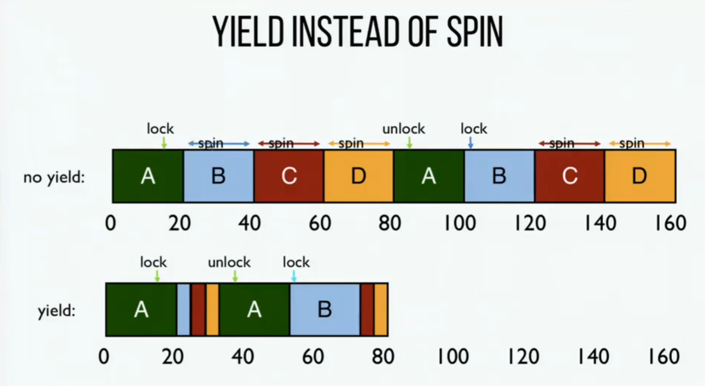

# 21 - 锁

锁的作用就一个：**保证临界区互斥**，解决多线程的竞态条件。它靠硬件原子指令（Test-And-Set、Compare-And-Swap 等）打底互斥，靠 OS 的睡眠/唤醒（park/unpark、futex）避免自旋浪费。演进路线是"先正确 → 再公平 → 最后降开销"，最终收敛到 Linux futex 这种工业级实现。

## 一、锁是什么

锁有两种状态：可用（unlocked）和持有（locked）。可用时线程 `lock()` 立刻拿到锁进临界区；持有时别的线程 `lock()` 会阻塞/自旋，直到持有者 `unlock()` 释放。

两个语义：

- **互斥**：同一时刻只有一个线程持锁进临界区；
- **原子**：`lock()` 到 `unlock()` 之间的临界区，效果等价于一条原子指令。

POSIX 接口：

```c
pthread_mutex_t lock = PTHREAD_MUTEX_INITIALIZER;   // 静态初始化
int pthread_mutex_init(pthread_mutex_t *lock, const pthread_mutexattr_t *attr);  // 动态初始化
Pthread_mutex_lock(&lock);   // 阻塞直到拿到锁
Pthread_mutex_unlock(&lock); // 释放锁
```

粒度：粗粒度（一把锁管所有共享资源）简单但并发度低；细粒度（不同资源用不同锁）并发度高。

## 二、怎么评价一把锁

- **正确性**：严格互斥，禁止多个线程同时进入临界区。锁的基础属性，是所有实现的首要目标；
- **公平性**：等待线程是否按请求顺序拿锁、会不会饿死——自旋锁不公平，票锁（Ticket Lock）公平；
- **性能**：无竞争时加解锁开销要低；单 CPU 多线程竞争别自旋/切换浪费；线程分布多 CPU 竞争别让跨核缓存一致性拖累。

## 三、锁的实现演进

### 1. 禁用中断（单 CPU 时代）

临界区前禁中断、结束后开中断，防止被切换打断。极简、单 CPU 正确，但多 CPU 无效（别的核照样进临界区）、滥用会挂系统（恶意程序禁用中断后死循环，导致系统崩溃）、还可能丢中断（长时间禁用可能错过磁盘I/O完成等关键事件）。只适合内核内部访问私有数据（可信环境）。

```c
void lock()   { DisableInterrupts(); }
void unlock() { EnableInterrupts(); }
```

### 2. 标志锁（失败尝试）

用一个全局 flag（0=可用、1=持有），线程先检查再置 1：

```c
typedef struct __lock_t { int flag; } lock_t;
void lock(lock_t *m)   { while (m->flag == 1); m->flag = 1; }
void unlock(lock_t *m) { m->flag = 0; }
```

问题是"检查-设置"不是原子的，两个线程可能同时看到 flag=0、同时置 1，互斥失效。

### 3. 硬件原子指令 + 自旋

自旋锁用硬件原子指令把"检查-设置"原子化；拿不到锁就自旋（循环等待），适合临界区短的场景。

**Test-And-Set**（原子返回旧值并置新值）：

```c
void lock(lock_t *m) {
    while (TestAndSet(&m->flag, 1) == 1); // 旧值是1说明锁被占，继续自旋
}
void unlock(lock_t *m) { m->flag = 0; }
```

优点实现简单、多 CPU 有效；缺点不公平（等待线程可能永远自旋）、自旋浪费 CPU（单核尤为严重）。

**Compare-And-Swap**（检查内存值等于预期值，是则更新为新值，返回原始值）：

```c
void lock(lock_t *m) {
    while (CompareAndSwap(&m->flag, 0, 1) == 1);
}
```

功能比 TAS 更强，能做无锁数据结构；自旋锁场景下行为和 TAS 一致。

**Load-Linked / Store-Conditional**（LL 加载内存值到寄存器，记录地址、SC 仅当地址没被其他线程修改才更新值）：

```c
void lock(lock_t *m) {
    while (1) {
        while (LoadLinked(&m->flag) == 1);
        if (StoreConditional(&m->flag, 1) == 1) return;
    }
}
```

比 CAS 多一层"检测中途被改"，避免 ABA 问题（内存值先变回预期值再修改的误判）。

**Fetch-And-Add（票锁）**——原子自增返回旧值，实现公平锁：

```c
typedef struct __lock_t { int ticket; int turn; } lock_t;
void lock(lock_t *m) {
    int myturn = FetchAndAdd(&m->ticket); // 原子取号
    while (m->turn != myturn);            // 自旋直到轮到自己
}
void unlock(lock_t *m) { m->turn++; }     // 叫下一个
```

票锁按取号顺序进、无饥饿，但仍是自旋（单核浪费）。

### 4. 别自旋了：OS 支持的锁

自旋浪费 CPU，尤其单核。需OS提供调度级支持，让等待线程放弃 CPU：

**Yield**：拿不到锁就 `yield()` 让出 CPU 从运行态转为就绪态，让持锁线程先跑。

```c
void lock(lock_t *m) {
    while (TestAndSet(&m->flag, 1) == 1) yield();
}
```

对比自旋和让出（同一个单 CPU，几个线程争一把锁，每个时间片 20 个时间单位）：

| 时间段 | No Yield（自旋策略） | Yield（让出策略） | 说明 |
|--------|----------------------|-------------------|------|
| 0 - 20 | A 运行 | A 运行 | 线程 A 持有锁并运行。 |
| 20 - 40 | B 运行（Spin） | B 短暂运行后 Yield | B 尝试获取锁失败。自旋会浪费整个时间片；Yield 会立即让出 CPU。 |
| 40 - 60 | C 运行（Spin） | C 短暂运行后 Yield | C 尝试获取锁失败。 |
| 60 - 80 | D 运行（Spin） | D 短暂运行后 Yield | D 尝试获取锁失败。 |
| 80 - 100 | A 运行（Unlock） | A 继续运行（Unlock） | A 再次获得 CPU，完成工作并释放锁。 |
| 100 - 120 | B 运行（Lock） | B 运行（Lock） | B 再次获得 CPU，成功获取锁。 |
| 120 - 140 | C 运行（Spin） | C 短暂运行后 Yield | C 尝试获取锁（此时在 B 手中）失败。 |
| 140 - 160 | D 运行（Spin） | D 短暂运行后 Yield | D 尝试获取锁失败。 |

时间轴示意（每格一个 20 单位的时间片）：



要点：自旋的线程会把整个 20 单位时间片白白烧掉，持锁线程反而被拖慢；`yield` 让等待线程刚失败就立即让出 CPU，持锁线程更快放锁、整体更快。

代价是：每个让出的线程都要经历一次上下文切换，竞争激烈时切换开销也会累积——所以 yield 比自旋好，但仍不如后面的"睡眠"方案彻底。

**队列 + Park/Unpark**：等待线程排队睡眠（park），释放时唤醒队首（unpark），彻底不自旋。用 `guard` 锁保护队列/flag，用 `setpark()` 防"唤醒丢失"（标记即将睡眠，若已被唤醒则 `park` 直接返回）。

```c
typedef struct __lock_t { int flag; int guard; queue_t *q; } lock_t;
void lock(lock_t *m) {
    while (TestAndSet(&m->guard, 1) == 1); // 守护锁保护队列/flag
    if (m->flag == 0) m->flag = 1;
    else { queue_add(m->q, gettid()); park(); }
    m->guard = 0;
}
void unlock(lock_t *m) {
    while (TestAndSet(&m->guard, 1) == 1);
    if (!queue_empty(m->q)) unpark(queue_remove(m->q));
    else m->flag = 0;
    m->guard = 0;
}
```

对比前面三种（同一个单 CPU，A 持锁，B/C/D 来抢，每格 20 个时间单位）：

```text
自旋         A运行  B自旋  C自旋  D自旋    ← 空转烧 CPU
让出         A运行  B让出  C让出  D让出    ← 反复"醒-试-让"，来回切换
Park/Unpark  A运行  B运行  C运行  D运行    ← B/C/D 睡眠，绝不占 CPU
                            ↑ A 放锁时只唤醒队首 B，B 跑完唤醒 C，依此类推
```

关键区别：

- **自旋**：等待线程空转，白烧 CPU；
- **yield**：等待线程反复"醒-试-让"，每次让出都是一次上下文切换；
- **park/unpark**：线程 sleep 一次、只被唤醒一次，轮到才醒，切换开销最小，CPU 全给持锁线程。

逐段时间片看 Park/Unpark 的完整流程：

| 时间段 | 队列 + Park/Unpark | 说明 |
|--------|---------------------|------|
| 0 - 20 | A 运行（持锁） | A 第一个来，flag=0，直接拿锁运行；这 20 个单位里 B、C、D 依次来抢，都 lock() 失败 → 入队 → park() 睡眠。 |
| 20 - 40 | B 运行（持锁） | A 跑完放锁：队列非空，unpark 队首 B；B 被唤醒、拿到锁，运行。C、D 还在睡。 |
| 40 - 60 | C 运行（持锁） | B 跑完放锁，unpark 队首 C；C 运行。D 还在睡。 |
| 60 - 80 | D 运行（最后放锁） | C 跑完放锁，unpark D；D 运行完放锁，队列空，flag=0。 |

总时间 80：等待线程全程睡眠、不占 CPU、不反复切换，只在轮到它时被唤醒一次——上下文切换次数比 yield 更少。

`setpark()` 防的是：B 刚决定要睡、还没真正 `park()` 时，A 已经 unlock 并 unpark 了 B——这次唤醒会丢，B 之后 `park()` 就永远睡下去。`setpark()` 标记"我马上要睡"，若这期间已被唤醒，`park()` 直接返回不再睡。

**Linux Futex**：用户态 + 内核态结合，无竞争时纯用户态操作（低开销），有竞争才陷内核睡眠（省 CPU）。锁字是一个整数：最高位（bit 31）标记锁是否被持有，低 31 位记录等待线程数。关键在于 `futex_wait(address, expected)` 的语义——只有当地址处的值**仍等于 expected** 时才真正睡眠，否则立即返回；这一下正好解决了上一节说的"唤醒/等待竞争"问题。`futex_wake(address)` 唤醒一个等待者。pthread_mutex 的底层实现就用它。

### 5. 两阶段锁（Two-Phase Lock）

先自旋一小会儿（赌锁快释放、拿低延迟），拿不到再睡眠（省 CPU），平衡两者，适合临界区时长不确定的场景。

```c
void lock(lock_t *m) {
    while (1) {
        for (int i = 0; i < SPIN_LIMIT; i++) {   // 阶段1：有限自旋
            if (TestAndSet(&m->flag, 1) == 0) return;  // 锁空闲，直接拿到
        }
        park();                                   // 阶段2：自旋完还没拿到，睡眠
    }
}
void unlock(lock_t *m) { m->flag = 0; unpark(等待者); }
```

两个场景对比（B 等 A 的锁，`SPIN_LIMIT` = 自旋 10 个单位）：

| 场景 | 临界区时长 | 两阶段锁行为 | 效果 |
|------|-----------|-------------|------|
| 临界区短 | 5 单位 | B 自旋 5 单位锁就放了 → 直接拿到，没睡 | 低延迟（省掉睡眠/唤醒的开销） |
| 临界区长 | 100 单位 | B 自旋 10 单位还没放 → 放弃自旋、park 睡眠 → 被唤醒 | 只烧 10 单位自旋，其余睡觉省 CPU |

时间轴：

```text
临界区短：  | A 持锁 | B 自旋 | B 拿到锁运行 |        ← 全程没睡，低延迟
临界区长：  | A 持锁...(很久)...放锁 |              ← B 先自旋 10 单位
                                   | B 自旋10 | B sleep... | B 被唤醒运行 |
```

一句话：临界区短时表现得像自旋锁（快、免睡眠唤醒开销），临界区长时像睡眠锁（省 CPU），自适应两者的折中。

## 四、关键问题与解决方案

### 1. 优先级反转（Priority Inversion）

高优先级线程等低优先级线程持的锁，中优先级线程又抢低优先级线程，导致高优先级被长期阻塞。解决：单 CPU 别用自旋锁、优先级继承（临时抬高低优先级尽快放锁）、统一优先级。

### 2. 唤醒/等待竞争（Wakeup/Waiting Race）

线程正要 `park()` 时锁被释放并唤醒，但唤醒发生在 `park` 之前 → 永久睡眠。用 `setpark()` 标记"即将睡眠"解决。

## 五、锁的实现对比

| 锁类型 | 硬件依赖 | OS依赖 | 正确性 | 公平性 | 性能（无竞争） | 性能（有竞争） |
|------|----------|--------|--------|--------|----------------|----------------|
| 禁用中断 | 中断控制指令 | 无 | 单CPU√ | - | 极高 | 多CPU× |
| 简单标志锁 | 无（load/store） | 无 | × | - | - | - |
| Test-And-Set 自旋锁 | Test-And-Set | 无 | √ | × | 高 | 单CPU差 |
| 票锁（Fetch-And-Add） | Fetch-And-Add | 无 | √ | √ | 高 | 单CPU差 |
| Yield 自旋锁 | Test-And-Set | yield | √ | × | 中 | 单CPU较好 |
| 队列 + Park/Unpark | Test-And-Set | park/unpark | √ | √ | 中 | 好（无自旋） |
| Linux Futex | 原子指令（CAS） | futex | √ | √ | 极高 | 好 |

## 六、总结

1. 锁的演进：从"单 CPU 有效"到"多 CPU 兼容"，从"自旋浪费"到"睡眠高效"，从"不公平"到"公平可控"。
2. 核心依赖：硬件原子指令（保证基础互斥）+ OS 调度支持（优化性能和公平性）。
3. 关键权衡：无竞争开销 vs 有竞争效率；实现复杂度 vs 通用性。
4. 工业级选择：Linux futex 和两阶段锁，兼顾低延迟和低浪费。

## 七、作业方向（Simulation）

通过 `homework/threads-locks/x86.py` 模拟锁的行为。`-p` 指定 `.s` 程序、`-t` 线程数、`-i` 中断频率、`-M` 追踪内存。

1. 分析简单标志锁的竞态条件，观察中断频率对结果的影响；
2. 验证Test-And-Set、CAS、票锁的正确性，对比自旋开销；
3. 测试`yield.s`在自旋场景下的CPU节省效果；
4. 分析`test-and-test-and-set.s`的优化逻辑（先检查再原子操作，减少缓存一致性开销）。

### 1. 简单标志锁的竞态（flag.s）

`flag.s` 的锁是"先检查 flag、再置 1"，两步之间被中断就互斥失效：

```shell
./x86.py -p flag.s -t 2 -a bx=1 -M count -i 1 -c
```

```text
两个线程都执行 test $0, %ax（都看到 flag=0）
两个线程都进入临界区：mov count,%ax（都读到 0）→ add → mov %ax,count
最终 count = 1（而不是 2）
```

标志锁的"检查-设置"不是原子的，`-i 1` 高频中断下两个线程同时拿到锁，丢了更新。

### 2. Test-And-Set / 票锁的正确性

`test-and-set.s` 用 `xchg` 原子换锁，`ticket.s` 用 `fetchadd` 取号：

```shell
./x86.py -p test-and-set.s -t 2 -a bx=1 -M count -i 1 -c
./x86.py -p ticket.s -t 2 -a bx=1 -M count -i 1 -c
```

```text
test-and-set.s: count 最终 = 2（正确，xchg 原子换锁）
ticket.s:       count 最终 = 2（正确，且按取号顺序公平）
```

### 3. yield.s 的 CPU 节省

`yield.s` 在自旋处加 `yield`，拿不到锁就让出 CPU：

```shell
./x86.py -p yield.s -t 2 -a bx=1 -M count -i 1 -c
```

自旋锁（test-and-set）拿不到锁时忙等烧 CPU；`yield` 让线程主动让出 CPU 转就绪，单 CPU 场景下更省。

### 4. test-and-test-and-set.s 的优化

它在 `xchg` 原子换锁**之前**先普通读一遍 `mutex`，只有看到锁空闲才去原子操作：

```text
mov  mutex, %ax      # 先普通读（便宜）
test $0, %ax
jne  .acquire        # 仍被占用就继续自旋，不打扰总线
mov  $1, %ax
xchg %ax, mutex      # 确认空闲才原子换锁
```

好处：减少自旋时反复发原子写（`xchg` 会 invalidate 其他 CPU 的缓存行），降低多核下的缓存一致性开销。
