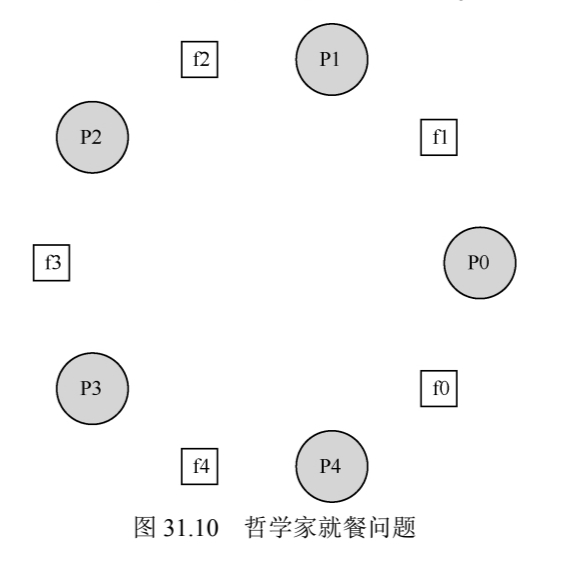
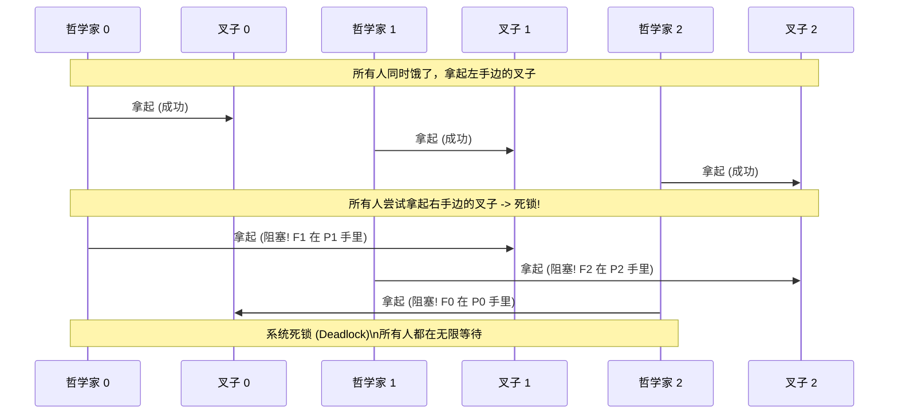

# 24 - 信号量

信号量的作用是把**锁和条件变量统一成一种原语**：一个整数状态 + 两个原子操作 `sem_wait()`（P，减 1）/`sem_post()`（V，加 1）。初始化值决定它的角色——**1 当锁、0 做排序、N 做资源限流**。

## 一、接口

`sem_wait()` 原子减 1，减完若是负数就阻塞等待；`sem_post()` 原子加 1，若之前有线程在等就唤醒一个：

```c
#include <semaphore.h>
// 初始化：sem=信号量指针，pshared=0（线程共享），value=初始值
int sem_init(sem_t *sem, int pshared, unsigned int value);
// 等待：原子减 1，值 <0 则阻塞（P 操作）
int sem_wait(sem_t *sem);
// 唤醒：原子加 1，值 ≤0 则唤醒一个阻塞线程（V 操作）
int sem_post(sem_t *sem);
```

状态值有双重含义：≥0 表示可用资源数，<0 表示阻塞线程数（绝对值）。加减都不可中断。

## 二、基本用法

### 1. 当锁用（值 =1）

初始化为 1，`sem_wait()` 当加锁、`sem_post()` 当解锁，就能保护临界区：

```c
sem_t mutex;
sem_init(&mutex, 0, 1); // 初始化值=1（锁）

// 临界区保护
sem_wait(&mutex);  // 加锁：值 1→0，无阻塞
// 临界区代码
sem_post(&mutex);  // 解锁：值 0→1，无唤醒
```

单线程跟踪：

| 信号量的值 | 线程 0 |
| :---: | :---: |
| 1 | |
| 1 | 调用 sem_wait() |
| 0 | sem_wait()返回 |
| 0 | （临界区） |
| 0 | 调用 sem_post() |
| 1 | sem_post()返回 |

两个线程跟踪：

| 值 | 线程 0 | 状态 | 线程 1 | 状态 |
| :---: | :--- | :---: | :--- | :---: |
| 1 | | 运行 | | 就绪 |
| 1 | 调用 sem_wait() | 运行 | | 就绪 |
| 0 | sem_wait()返回 | 运行 | | 就绪 |
| 0 | （临界区：开始） | 运行 | | 就绪 |
| 0 | 中断；切换到→T1 | 就绪 | | 运行 |
| 0 | | 就绪 | 调用 sem_wait() | 运行 |
| −1 | | 就绪 | sem 减 1 | 运行 |
| −1 | | 就绪 | (sem<0) →睡眠 | 睡眠 |
| −1 | | 运行 | 切换到→T0 | 睡眠 |
| −1 | （临界区：结束） | 运行 | | 睡眠 |
| −1 | 调用 sem_post() | 运行 | | 睡眠 |
| 0 | 增加 sem | 运行 | | 睡眠 |
| 0 | 唤醒 T1 | 运行 | | 就绪 |
| 0 | sem_post()返回 | 运行 | | 就绪 |
| 0 | 中断；切换到→T1 | 就绪 | | 运行 |
| 0 | | 就绪 | sem_wait()返回 | 运行 |
| 0 | | 就绪 | （临界区） | 运行 |
| 0 | | 就绪 | 调用 sem_post() | 运行 |
| 1 | | 就绪 | sem_post()返回 | 运行 |

双线程的完整流程：线程 A `sem_wait()` 值 1→0 进临界区；线程 B `sem_wait()` 值 0→-1 阻塞；A `sem_post()` 值 -1→0 唤醒 B；B 返回进临界区，结束 `sem_post()` 值 0→1。

### 2. 当条件变量用：排序（值 =0）

初始化为 0，`sem_wait()` 等事件、`sem_post()` 触发事件，就能规定线程的先后顺序（类似 `join()`）：

```c
sem_t s;
sem_init(&s, 0, 0); // 初始化值=0（等待事件）

void *child(void *arg) {
    printf("child\n");
    sem_post(&s); // 触发事件：值 0→1，唤醒父线程
    return NULL;
}

int main() {
    pthread_create(&c, NULL, child, NULL);
    sem_wait(&s); // 等待事件：值 0→-1（阻塞），被唤醒后值 -1→0
    printf("parent: end\n");
    return 0;
}
```

关键是"先 `post` 后 `wait`"和"先 `wait` 后 `post`"两种执行顺序都得对：子线程先跑时 `sem_post()` 值 0→1，父线程后 `sem_wait()` 值 1→0 直接返回；父线程先跑时 `sem_wait()` 值 0→-1 阻塞，子线程 `sem_post()` 再唤醒它。

父线程等待子线程（场景 1，父线程先跑）：

| 值 | 父线程 | 状态 | 子线程 | 状态 |
| :---: | :--- | :--- | :--- | :---: |
| 0 | create(子线程) | 运行 | (子线程产生) | 就绪 |
| 0 | 调用 sem_wait() | 运行 | | 就绪 |
| −1 | sem 减 1 | 运行 | | 就绪 |
| −1 | (sem<0)→ 睡眠 | 睡眠 | | 就绪 |
| −1 | 切换到→子线程 | 睡眠 | 子线程运行 | 运行 |
| −1 | | 睡眠 | 调用 sem_post() | 运行 |
| 0 | | 睡眠 | sem 增 1 | 运行 |
| 0 | | 就绪 | wake(父线程) | 运行 |
| 0 | | 就绪 | sem_post()返回 | 运行 |
| 0 | | 就绪 | 中断；切换到→父线程 | 就绪 |
| 0 | sem_wait()返回 | 运行 | | 就绪 |

父线程等待子线程（场景 2，子线程先跑）：

| 值 | 父线程 | 状态 | 子线程 | 状态 |
| :---: | :--- | :--- | :--- | :---: |
| 0 | create（子线程） | 运行 | (子线程产生) | 就绪 |
| 0 | 中断；切换到→子线程 | 就绪 | 子线程运行 | 运行 |
| 0 | | 就绪 | 调用 sem_post() | 运行 |
| 1 | | 睡眠 | sem 增 1 | 运行 |
| 1 | | 就绪 | wake(没有线程) | 运行 |
| 1 | | 就绪 | sem_post()返回 | 运行 |
| 1 | 父线程运行 | 运行 | 中断；切换到→父线程 | 就绪 |
| 1 | 调用 sem_wait() | 运行 | | 就绪 |
| 0 | sem 减 1 | 运行 | | 就绪 |
| 0 | (sem>=0)→不用睡眠 | 运行 | | 就绪 |
| 0 | sem_wait()返回 | 运行 | | 就绪 |

### 3. 限流（值 =N）

初始化为 N（允许并发的最多线程数），`sem_wait()` 过闸、`sem_post()` 放行，限制同时进入临界区的线程数，避免资源耗尽：

```c
sem_t throttle;
sem_init(&throttle, 0, 5); // 最多 5 个线程并发

void memory_intensive_task() {
    sem_wait(&throttle);  // 限流：值 5→4...0→-1（阻塞）
    // 内存密集型操作
    sem_post(&throttle);  // 释放：值 -1→0...4→5
}
```

## 三、经典问题

### 1. 生产者/消费者（有界缓冲区）

缓冲区大小有个上限 MAX。满时生产者不能放、空时消费者不能取，靠三个信号量配合实现：

- `empty` 初始化为 MAX，记录"还剩几个空槽"。生产者放数据前先 `sem_wait(&empty)`——空槽为 0（缓冲满了）就阻塞；
- `full` 初始化为 0，记录"已经放进了几个数据"。消费者取数据前先 `sem_wait(&full)`——数据为 0（缓冲空了）就阻塞；
- `mutex` 初始化为 1，是普通互斥锁，保证对缓冲区的 `put()`/`get()` 读写不会两个线程同时进行。

错误方案（先拿锁再等资源，会死锁）：消费者持有 `mutex` 阻塞在 `full`，生产者又在等 `mutex`，循环等待。

```c
// 生产者：先加锁再等 empty（错误）
sem_wait(&mutex);  // 加锁
sem_wait(&empty);  // 等空槽位（可能阻塞，且持有锁）
put(i);
sem_post(&full);
sem_post(&mutex);

// 消费者：先加锁再等 full（错误）
sem_wait(&mutex);  // 加锁
sem_wait(&full);   // 等满槽位（阻塞，持有锁）
get();
sem_post(&empty);
sem_post(&mutex);
```

正确方案（先等资源、再加锁，锁只包临界区）：

```c
// 生产者：先等资源，再加锁
sem_wait(&empty);  // 等空槽位（无锁）
sem_wait(&mutex);  // 加锁（临界区）
put(i);
sem_post(&mutex);  // 解锁
sem_post(&full);   // 通知消费者

// 消费者：先等资源，再加锁
sem_wait(&full);   // 等满槽位（无锁）
sem_wait(&mutex);  // 加锁（临界区）
get();
sem_post(&mutex);  // 解锁
sem_post(&empty);  // 通知生产者
```

### 2. 读写锁

读可并发、写要独占。`lock`（值 =1）保护读者计数，`writelock`（值 =1）实现写独占：

```c
typedef struct _rwlock_t {
    sem_t lock;       // 保护 readers 计数
    sem_t writelock;  // 写独占锁
    int readers;      // 当前读者数
} rwlock_t;

// 读锁获取：第一个读者占用 writelock，后续读者直接进入
void rwlock_acquire_readlock(rwlock_t *rw) {
    sem_wait(&rw->lock);
    rw->readers++;
    if (rw->readers == 1) sem_wait(&rw->writelock); // 第一个读者锁写
    sem_post(&rw->lock);
}

// 读锁释放：最后一个读者释放 writelock
void rwlock_release_readlock(rwlock_t *rw) {
    sem_wait(&rw->lock);
    rw->readers--;
    if (rw->readers == 0) sem_post(&rw->writelock); // 最后一个读者解锁
    sem_post(&rw->lock);
}

// 写锁获取/释放：直接操作 writelock
void rwlock_acquire_writelock(rwlock_t *rw) { sem_wait(&rw->writelock); }
void rwlock_release_writelock(rwlock_t *rw) { sem_post(&rw->writelock); }
```

缺点：读者持续并发，写者可能一直拿不到锁——写者饥饿。

### 3. 哲学家就餐

5 个哲学家围坐，每人要拿到左右两把叉子才能吃饭，难在避免"每人拿一把叉子等另一把"的死锁。



错误方案（会死锁）：每个哲学家都先拿左叉再拿右叉，全员同时拿左叉、等右叉，循环等待。

```c
sem_t forks[5]; // 每个叉子一个信号量（值=1）
void get_forks(int p) {
    sem_wait(&forks[left(p)]);  // 先拿左叉
    sem_wait(&forks[right(p)]); // 再拿右叉
}
```



正确方案（打破循环）：让一个哲学家反向拿叉，破坏"循环等待"条件。

```c
void get_forks(int p) {
    if (p == 4) { // 最后一个哲学家反向拿叉
        sem_wait(&forks[right(p)]); // 先拿右叉
        sem_wait(&forks[left(p)]);  // 再拿左叉
    } else {
        sem_wait(&forks[left(p)]);
        sem_wait(&forks[right(p)]);
    }
}
```

## 四、实现（Zemaphore）

信号量可以用锁 + 条件变量实现（称 Zemaphore）：锁保证原子性，条件变量做阻塞-唤醒。

```c
typedef struct __Zem_t {
    int value;          // 信号量状态值
    pthread_cond_t cond; // 条件变量（阻塞-唤醒）
    pthread_mutex_t lock; // 互斥锁（保证原子性）
} Zem_t;

// 初始化
void Zem_init(Zem_t *s, int value) {
    s->value = value;
    pthread_cond_init(&s->cond, NULL);
    pthread_mutex_init(&s->lock, NULL);
}

// 模拟 sem_wait()
void Zem_wait(Zem_t *s) {
    pthread_mutex_lock(&s->lock);
    while (s->value <= 0) { // 循环等待（防虚假唤醒）
        pthread_cond_wait(&s->cond, &s->lock);
    }
    s->value--; // 原子减 1
    pthread_mutex_unlock(&s->lock);
}

// 模拟 sem_post()
void Zem_post(Zem_t *s) {
    pthread_mutex_lock(&s->lock);
    s->value++; // 原子加 1
    pthread_cond_signal(&s->cond); // 唤醒一个阻塞线程
    pthread_mutex_unlock(&s->lock);
}
```

特点：值不会小于 0（与 Dijkstra 原始定义不同），实现简单，符合 Linux 原生信号量行为。

## 五、使用规则

- **按用途选初始值**：锁 =1、排序（事件等待）=0、资源限流 =N。
- **操作顺序防死锁**：先等资源（`sem_wait(&empty)`/`sem_wait(&full)`），再拿锁（`sem_wait(&mutex)`）；锁只包临界区，不跨 `sem_wait()` 阻塞操作；打破循环依赖（如哲学家反向拿叉）。
- **注意饥饿**：读写锁里写者可能被饿（可加"写者优先"逻辑）；信号量本身无公平性，需额外设计（如队列）保证公平。
- **Hill's Law（简单优先）**：读写锁这类复杂结构虽灵活，开销可能高于普通锁，先用二进制信号量（=锁）这类简单用法，再按需优化。

## 六、总结

1. 信号量是通用同步原语，靠初始化值适配锁、排序、限流等场景，功能覆盖锁和条件变量；
2. 核心操作 `sem_wait()`（P）和 `sem_post()`（V）必须原子，状态值隐含资源/等待线程数；
3. 经典问题：生产者/消费者（`empty`+`full`+`mutex` 三信号量）、读写锁（`lock` 保护计数 + `writelock` 写独占）、哲学家就餐（打破拿叉顺序）；
4. 主要风险是死锁（操作顺序）和饥饿（公平性），靠合理设计规避。

## 七、作业方向（Code）

代码骨架在 `OSTEP/homework/threads-sema/`，逐个补齐信号量逻辑后 `gcc -o x x.c -pthread` 编译运行：

1. `fork-join.c`：实现信号量版 fork/join，验证线程顺序同步；
2. `rendezvous.c`：解决"会面问题"（两线程必须同时进入临界区）；
3. `barrier.c`：实现屏障同步（所有线程完成 P1 后再执行 P2）；
4. `reader-writer.c` / `reader-writer-nostarve.c`：加读/写锁，并优化避免写者饥饿；
5. `mutex-nostarve.c`：用信号量实现无饥饿互斥锁。

### 实验结果

骨架已补齐，`gcc -o x x.c -Wall -pthread` 编译运行，6 个程序全部通过。

**1. fork/join：值 0 + post/wait**

父线程要等子线程干完活，才能打印 `parent: end`。信号量初始成 0，当作"子线程完成"这个事件的标记：子线程干完活 `sem_post`（值 0→1，发出"我完成了"），父线程打印前先 `sem_wait`（等这个信号）。两种顺序都对——子线程先跑：`post` 后值 1，父线程 `wait` 时 1→0 直接过；父线程先跑：`wait` 时值 0→-1 阻塞，直到子线程 `post` 唤醒它。所以 `child` 一定在 `parent: end` 之前：

```shell
./fork-join
```

```text
parent: begin
child
parent: end
```

**2. 会面问题：两个信号量互发**

两个线程都要先打自己的 `before`，等**两个 before 都打完**才准打 `after`。做法是两个信号量 s1、s2 都初始成 0，各代表"我到了"：child 1 打完 before 先 `post s1`（发出"1 到了"）再 `wait s2`（等"2 到了"）；child 2 对称。child 1 想通过 `wait s2`，前提是 child 2 已经 `post s2`——也就是已经打了 before 2。反过来也一样，所以两条 `after` 一定都晚于两条 `before`：

```shell
./rendezvous
```

```text
parent: begin
child 1: before
child 2: before
child 2: after
child 1: after
parent: end
```

**3. 屏障：两阶段转门（可复用）**

N 个线程都要先打 `before`，**所有 N 个 before 都出现后**才准打 `after`。做法：用一个 `mutex` 保护计数器 `count`，两个"转门" `turnstile1`/`turnstile2`（都初始 0）。每个线程到屏障就 `count++`；第 N 个到达的线程发现 `count == N`，就 `post turnstile1` N 次，把排着队的 N 个线程一起放行。第二阶段再"递减计数 + 放行"一次，是为了让屏障能重复使用：最后一个离开的把 count 归零、`post turnstile2`，防止跑得快的线程绕回来又挡别人。一句话——先到的在 turnstile1 上排队睡觉，最后一个到的把门打开：

```shell
./barrier 4
```

```text
parent: begin
child 0: before
child 1: before
child 2: before
child 3: before
child 3: after
child 0: after
child 1: after
child 2: after
parent: end
```

所有 "before" 都在任何 "after" 之前，屏障生效。

**4. 读写锁（基础版）：lock 保护计数 + writelock 写独占**

多个读者能同时读，但写者要独占。用两样东西：`writelock`（初始 1）给写者进出；`readers` 计数 + `lock`（保护计数）。关键在"第一个进、最后一个出"：第一个读者进来时顺手 `wait writelock` 把写锁占住，此后写者进不来，别的读者却可以继续进来一起读；最后一个读者离开时 `post writelock` 把写锁还回去。所以 readers >0 时写者被挡在门外，读者全走光写者才能进：

```shell
./reader-writer 2 1 2
```

```text
begin
read 0
read 0
read 0
read 0
write 1
write 2
end: value 2
```

`value = 2`（1 个写者 × 2 轮），读并发、写独占，计数正确。

**5. 读写锁（无写者饥饿）：加 turnstile 让写者优先**

基础版有个漏洞：读者若持续不断来，`readers` 到不了 0，写者永远被挡、饿死。加一个"转门" `turnstile`（初始 1）：写者进来前先 `wait turnstile` 并**一直占着不放**（写完才 `post`）；读者进来前必须 `wait turnstile` 再立刻 `post`（穿过但不占）。效果——一旦写者先占了转门，后来的读者全卡在 `wait turnstile`，不能再往 `readers` 里加人；老读者陆续读完、`readers` 归 0，写者就能拿到写锁：

```shell
./reader-writer-nostarve 3 2 2
```

```text
begin
read 0
read 0
read 0
read 0
read 0
read 0
write 1
write 2
write 3
write 4
end: value 4
```

`value = 4`（2 个写者 × 2 轮），写者都完成了，没被饿死。

**6. 无饥饿互斥锁：turnstile 转门**

直接用"初始 1 的信号量"当锁（`wait` 进、`post` 出）虽然正确但不公平，某线程可能一直抢不到。加一个 `turnstile`（初始 1），获取顺序改成 `turnstile.wait → mutex.wait → turnstile.post`。能防饥饿的原因：线程在等 `mutex` 的时候始终占着 turnstile，所以**同一时刻最多只有一个线程排在锁后**，后来者都得在闸门外排队；锁一释放，排队的那个先拿，天然先进先出，谁都不会饿死：

```shell
./mutex-nostarve 4 100000
```

```text
parent: begin
parent: end
shared = 400000, expected = 400000
```

`shared == 4 × 100000`，互斥正确、所有线程都跑完（无死锁/饥饿）。