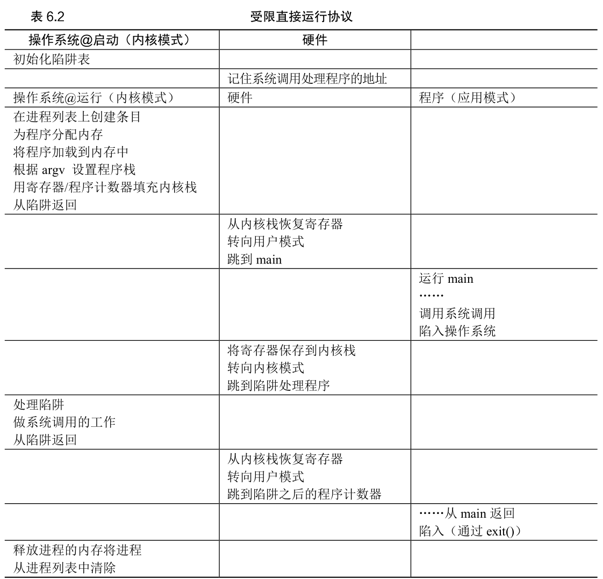

# 3 - 进程执行机制

## 一、有限直接执行（LDE）

有限直接执行（Limited Direct Execution, LDE）是 CPU 虚拟化的底层机制，核心思路是：让程序直接在 CPU 上运行以保证效率，同时靠"硬件限制 + 中断/陷阱"保证 OS 始终掌握控制权。

- **直接执行**：OS 加载程序后，让它直接在 CPU 上运行原生指令，避免额外开销。
- **有限**：靠硬件和 OS 协作，限制程序的特权操作（I/O、修改 CPU 状态），防止程序失控。

LDE 要解决两个问题：

1. 程序要执行**受限操作**（I/O、申请系统资源）时，如何防止滥用权限。
2. OS 没在运行时，如何**夺回 CPU** 完成进程切换。

## 二、受限操作的处理

防止程序执行危险操作，靠"特权分级 + 系统调用 + 陷阱机制"：

### 1. 特权模式

硬件提供两种 CPU 执行模式：

- **用户态（User Mode）**：程序运行的默认模式，禁止特权操作（I/O、修改陷阱表），违规触发异常。
- **内核态（Kernel Mode）**：OS 运行模式，可执行所有硬件操作。

### 2. 系统调用流程

程序需要特权操作时，通过系统调用向 OS 求助：

1. 调用 C 库封装接口（如 `open()`），库函数把系统调用号、参数放进指定寄存器/栈；
2. 执行**陷阱指令（Trap）**：硬件切到内核态，跳转到 OS 预设的陷阱处理程序；
3. OS 校验调用合法性，执行对应特权操作（如 I/O）；
4. 执行**返回-from-trap 指令**：切回用户态，恢复寄存器，继续执行程序。

### 3. 陷阱表（Trap Table）

- OS 开机时初始化陷阱表，记录各类异常（系统调用、中断、非法操作）对应的处理程序地址，并通过特权指令告知硬件。
- 硬件固定陷阱表地址，禁止用户程序修改，确保所有陷阱都路由到 OS 可信代码。

## 三、进程切换

OS 必须先夺回 CPU 才能切换进程，分两种方式：

### 1. 协作式调度（Cooperative）

依赖程序主动放弃 CPU（调用系统调用、触发异常），OS 在程序陷入内核时切换。

- 优点：实现简单，无额外开销。
- 缺点：不可靠，程序死循环不放弃 CPU 时 OS 无法干预，只能重启。

### 2. 非协作式调度（Non-Cooperative）

靠 **定时器中断（Timer Interrupt）** 解决程序不协作的问题：

1. OS 开机时启动定时器（特权操作），每隔固定时间触发一次中断；
2. 中断触发时，硬件暂停当前程序、保存寄存器、切到内核态，执行 OS 中断处理程序；
3. OS 此时夺回控制权，可决定是否切换进程。

### 3. 上下文切换（Context Switch）

OS 决定切换进程时：

1. 保存当前进程上下文（PC、栈指针、通用寄存器）到其 PCB 的内核栈；
2. 从目标进程 PCB 加载寄存器状态，切到它的内核栈；
3. 执行返回-from-trap 指令，切到用户态，启动目标进程。

开销来自寄存器保存/恢复，现代系统已优化到亚微秒级。

.png)

## 四、硬件支持清单

LDE 依赖硬件提供以下关键功能：

1. 双特权模式（用户态/内核态）：限制程序权限；
2. 陷阱指令与返回-from-trap 指令：用户态与内核态之间安全切换；
3. 陷阱表配置接口：让 OS 设置异常处理程序地址；
4. 定时器中断：强制夺回 CPU；
5. 寄存器自动保存/恢复：陷阱/中断发生时，硬件自动保存关键寄存器（PC、flags）到内核栈。

## 五、作业方向（Measurement）

核心是测量系统调用和上下文切换的开销：

1. 测量系统调用成本：反复执行空系统调用（如 0 字节 `read()`），用 `gettimeofday()` 或 `rdtsc` 统计平均耗时；
2. 测量上下文切换成本：用 UNIX 管道让两个进程通信，触发频繁切换，统计通信循环耗时来推导切换成本；
3. 注意：把进程绑定到同一 CPU（如 Linux `sched_setaffinity()`），避免多 CPU 调度干扰测量。

## 六、总结

1. LDE 的本质："直接执行"保证效率，"硬件限制 + 陷阱/中断"保证控制，是 CPU 虚拟化的基石。
2. 两大机制："用户态/内核态 + 系统调用"解决受限操作，"定时器中断 + 上下文切换"解决进程切换。
3. 所有控制逻辑都依赖硬件（特权分级、陷阱、中断），OS 无法独立实现。
4. LDE 让程序高效运行（原生指令），同时 OS 通过中断/陷阱随时介入，保证系统可控。