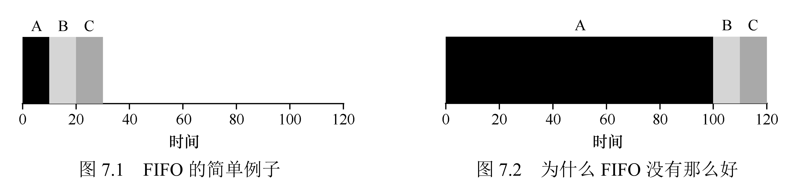
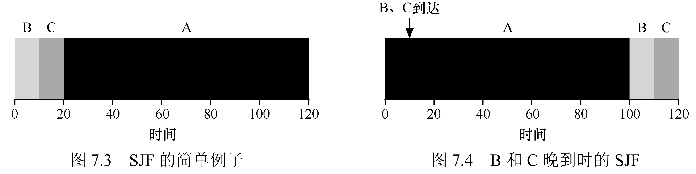
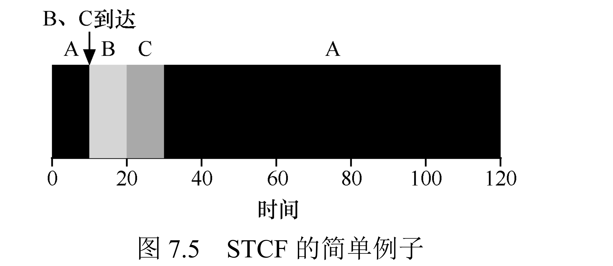
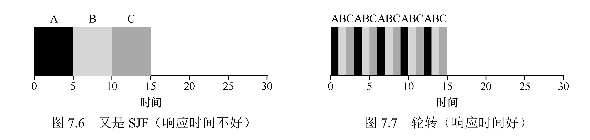
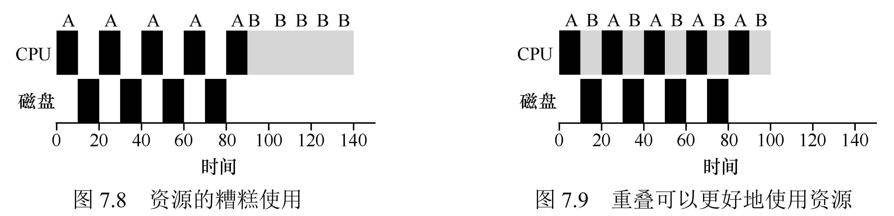

# 4 - 进程调度

调度器要回答的问题只有一个：现在 CPU 空出来了，接下来跑哪个进程？这一章从一堆不切实际的假设出发，再逐个拆掉，慢慢接近真实系统。理解这一章要抓住两条线：**周转时间**（作业从到达做到完成要多久，批处理更在意）和**响应时间**（作业第一次上 CPU 要等多久，交互系统更在意）。它们经常互相冲突，后面会反复印证这一点。

## 一、Workload 假设

为了让问题一开始可解，先定 5 条假设，后面一章其实就是在逐条推翻它们：

1. 所有作业运行时间相同；
2. 所有作业同时到达；
3. 作业一旦开跑就不被打断（不可抢占）；
4. 作业只用 CPU，不做 I/O；
5. 每个作业要跑多久，调度器事先知道。

## 二、周转时间与 FIFO

先定义一个指标：**周转时间** = 完成时刻 − 到达时刻（\(T_{turnaround} = T_{completion} - T_{arrival}\)）。若所有作业同时到达（\(T_{arrival}=0\)），它等于完成时刻。

**FIFO**（先来先服务）是最朴素的策略：按到达顺序跑，跑完一个再跑下一个。三个各 10 秒的作业同时到，完成时刻 10、20、30，平均周转 20 秒，看着没问题。

但一旦推翻第 1 条假设（作业不再等长），FIFO 就出问题了。A 要 100 秒，B、C 各 10 秒，同时到。FIFO 让 A 先占住 CPU 100 秒，B、C 只能干等，完成时刻 100、110、120，平均周转飙到 110 秒。这就是**护航效应（Convoy Effect）**：一个长作业卡在前头，后面一堆短作业全被拖住，相当于结账时排在一个推满购物车的人后面。



## 三、SJF：短的先跑

直观的修法是 **SJF（最短作业优先）**：运行时间最短的先上。同样的 A=100、B=10、C=10，按 B→C→A 的顺序，完成时刻 10、20、120，平均周转降到 50 秒。

在"作业长度已知且同时到达"的前提下，SJF 是周转时间最优的，换任何其他顺序都不会更好。但它有硬伤：短作业只要晚到一步，就只能排在已经开跑的长作业后面；而且它不可抢占，中途没法插队。



## 四、STCF：允许插队

把 SJF 改成可抢占，就得到 **STCF（最短剩余时间优先）**：每来一个新作业，就重新比一比大家"还剩多少没跑"，剩余最少的先上。

场景还是 A=100 先到、B=C=10 在 t=10 到。A 先跑 10 秒后，B、C 到达，此刻 A 剩 90 秒、B/C 各剩 10 秒，A 只好让位。B、C 各跑 10 秒完成，A 再接着跑。三个作业的周转分别是 120、10、20，平均 50 秒——短作业晚到也不吃亏了。代价则是 A 这类长作业的响应时间变长，它必须等所有短作业先跑完。



## 五、RR：为了响应时间

前面几个算法都在优化周转时间，却没人管**响应时间**（首次运行时刻 − 到达时刻，\(T_{response} = T_{firstrun} - T_{arrival}\)）。对交互式系统（敲一下键盘多久有反应），响应时间才是体验的关键。

**RR（轮转）**按**时间片**切分 CPU：每个作业轮流跑一小段，时间片到了就让出，大家转着圈来。三个各 5 秒的作业、时间片 1 秒，它们分别在第 0、1、2 秒第一次上 CPU，平均响应 1 秒；同样的作业交给 SJF，第三个要到第 10 秒才第一次跑，平均响应 5 秒。响应时间改善了整整一个量级。

但 RR 的周转时间很糟：作业被切得七零八落，5 秒的活可能拖到 13、14 秒才收尾。**时间片**的取值是关键——太小，上下文切换（保存/恢复寄存器、缓存失效）的开销占比过高；太大，响应时间又退化回 FIFO。经验法则是让时间片远大于切换开销：切换要 1ms，时间片就给 10ms，这样只有 10% 的时间浪费在切换上。



## 六、把 I/O 纳入调度

第 4 条假设是"作业只用 CPU"，但真实进程会做 I/O，而 I/O 期间进程阻塞、CPU 空转就浪费了。

正确的做法是把作业切成一段段 **CPU burst**——两次 I/O 之间连续使用 CPU 的那一段，调度器对 burst 而不是整个作业做 SJF/STCF：一个作业发起 I/O 就切走，I/O 完成后它的下一个 burst 再当作新作业重新入队。

举个例子：A 是"跑 10ms、I/O 10ms"循环 5 次，B 是跑一个 50ms。若傻等 A 的 I/O，总耗时 150ms；若允许 A 在等 I/O 时把 CPU 让给 B，A 的 burst 与 B 的计算相互重叠，总共只需 80ms。



## 七、真正的问题：调度器不是全知的

以上所有算法都偷偷用了第 5 条假设——提前知道每个作业的长度。现实里 OS 根本不知道一个进程会运行多久。那在毫无先验的情况下，怎么同时照顾周转和响应？这是下一章 **多级反馈队列（MLFQ）** 的任务：靠观察进程的历史行为来"猜"它接下来有多长。

## 八、四类算法对比

| 算法 | 类型 | 核心优势 | 核心劣势 | 优化指标 |
|------|------|----------|----------|----------|
| FIFO/FCFS | 非抢占式 | 实现简单 | 护航效应，周转时间差 | 无（基础算法） |
| SJF | 非抢占式 | 已知作业长度时周转时间最优 | 短作业晚到会被阻塞 | 周转时间 |
| STCF/PSJF | 抢占式 | 动态响应短作业，周转时间最优 | 响应时间差，依赖作业长度已知 | 周转时间 |
| RR | 抢占式 | 响应时间优，公平性好 | 周转时间差，切换开销大 | 响应时间 |

## 九、总结

1. 调度的本质是权衡：短作业优先类（SJF/STCF）优化周转时间，轮转（RR）优化响应时间，二者无法同时最优。
2. 抢占是关键：STCF 通过抢占长作业解决短作业晚到的阻塞，RR 通过抢占实现公平与快速响应。
3. 实际系统需放松所有假设：要支持 I/O、应对未知作业长度，后续 MLFQ 用"反馈学习"解决。

## 十、作业方向（Simulation）

通过 `homework/cpu-sched/scheduler.py` 模拟器验证算法特性，核心任务：

1. 计算 3 个 200 秒作业在 SJF 和 FIFO 调度下的响应时间与周转时间；
2. 改用 100/200/300 秒的异构作业，重复上述计算；
3. 加入 RR 调度（时间片 = 1），对比三类算法的指标差异；
4. 分析 SJF 与 FIFO 周转时间相同时的 workload 特征；
5. 推导 SJF 与 RR 响应时间相同时的 workload 与时间片条件；
6. 验证作业长度对 SJF 响应时间的影响趋势；
7. 推导 RR 调度下，N 个作业的最坏响应时间公式（与时间片相关）。

下面逐题给出命令与 `-c` 答案（`-l` 指定作业长度列表）。

### 1. 三个 200 秒作业：FIFO vs SJF

```shell
./scheduler.py -p FIFO -l 200,200,200 -c
./scheduler.py -p SJF  -l 200,200,200 -c
```

```text
  Job 0 -- Response: 0.00  Turnaround 200.00
  Job 1 -- Response: 200.00  Turnaround 400.00
  Job 2 -- Response: 400.00  Turnaround 600.00
  Average -- Response: 200.00  Turnaround 400.00
```

结论：作业等长时，SJF 排序后顺序不变，二者结果完全相同（平均响应 200，平均周转 400）。

### 2. 异构作业 100/200/300

```shell
./scheduler.py -p FIFO -l 100,200,300 -c
./scheduler.py -p SJF  -l 100,200,300 -c
```

```text
  Job 0 -- Response: 0.00  Turnaround 100.00
  Job 1 -- Response: 100.00  Turnaround 300.00
  Job 2 -- Response: 300.00  Turnaround 600.00
  Average -- Response: 133.33  Turnaround 333.33
```

结论：因为输入本身就是短到长（100<200<300），SJF 排序不变，所以仍与 FIFO 相同（平均响应 133.33，平均周转 333.33）。

### 3. 加入 RR（时间片 q=1）

```shell
./scheduler.py -p RR -l 100,200,300 -q 1 -c
```

```text
  Job 0 -- Response: 0.00  Turnaround 298.00
  Job 1 -- Response: 1.00  Turnaround 499.00
  Job 2 -- Response: 2.00  Turnaround 600.00
  Average -- Response: 1.00  Turnaround 465.67
```

对比三类算法（100/200/300）：

| 指标 | FIFO/SJF | RR (q=1) |
|---|---|---|
| 平均响应时间 | 133.33 | 1.00 |
| 平均周转时间 | 333.33 | 465.67 |

结论：RR 把平均响应时间从 133.33 降到 1.00，但平均周转时间从 333.33 涨到 465.67——响应时间与周转时间此消彼长。

### 4. SJF 与 FIFO 周转时间相同的 workload

当作业已经按"从短到长"的顺序到达（或所有作业等长）时，SJF 的排序不会改变执行顺序，二者周转时间便相同。如上第 2 题的 100,200,300 就是已排序的例子；换成 200,100,300 这类乱序，SJF 才会和 FIFO 出现差异。

### 5. SJF 与 RR 响应时间相同的条件

- 只有一个作业时：二者响应时间都是 0。
- 多个作业、RR 的时间片大到"一次把一个作业跑完"（q ≥ 最长作业长度）时，RR 退化为 FIFO；此时若各作业等长，SJF 也相当于 FIFO，二者响应时间相同。

### 6. 作业长度对 SJF 响应时间的影响

SJF 中某作业的响应时间 = 排在它前面所有（更短）作业的运行时间之和。长度越长、排得越靠后，响应时间越久。演示 `-l 5,10,15,20`：

```shell
./scheduler.py -p SJF -l 5,10,15,20 -c
```

```text
  Job 0 -- Response: 0.00
  Job 1 -- Response: 5.00
  Job 2 -- Response: 15.00
  Job 3 -- Response: 30.00
  Average -- Response: 12.50
```

趋势：响应时间随作业长度（及排序位置）单调上升，长作业必须等所有更短作业先跑完。

### 7. RR 最坏响应时间公式

N 个作业、时间片 q：最坏响应时间 = (N-1) × q。即最后一个作业第一次获得 CPU 前，要等前面 N-1 个作业各跑一个时间片。

验证：3 个作业、q=10 → 响应 0 / 10 / 20，最坏 = 20 = (3-1)×10。

```shell
./scheduler.py -p RR -l 100,100,100 -q 10 -c
```

```text
  Job 0 -- Response: 0.00
  Job 1 -- Response: 10.00
  Job 2 -- Response: 20.00
```