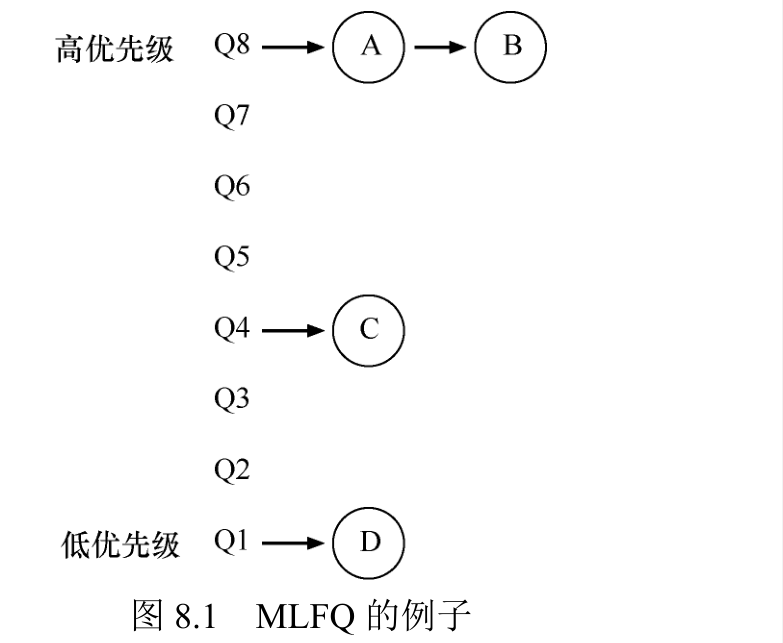
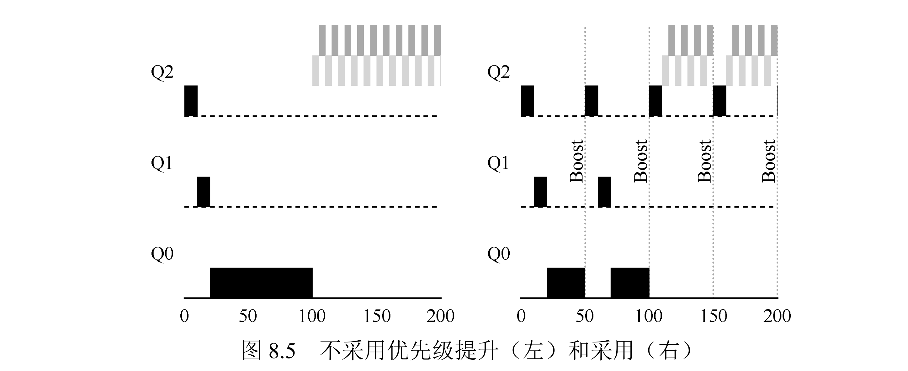
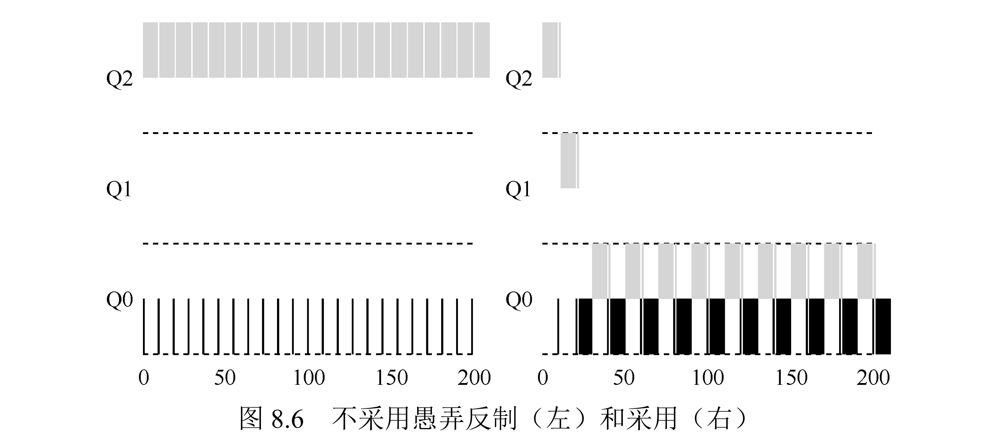
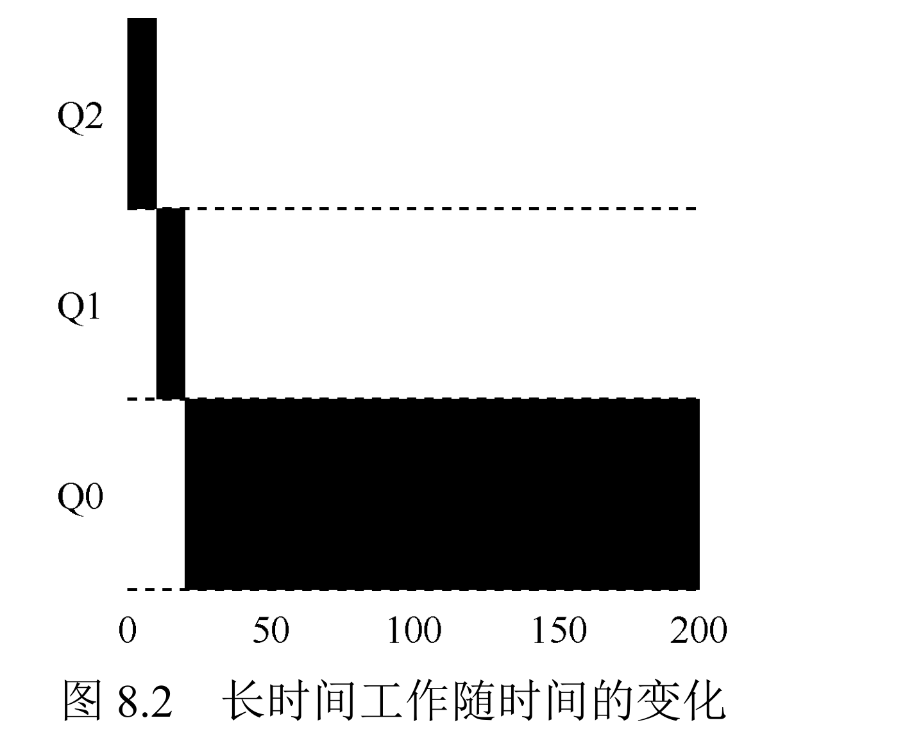
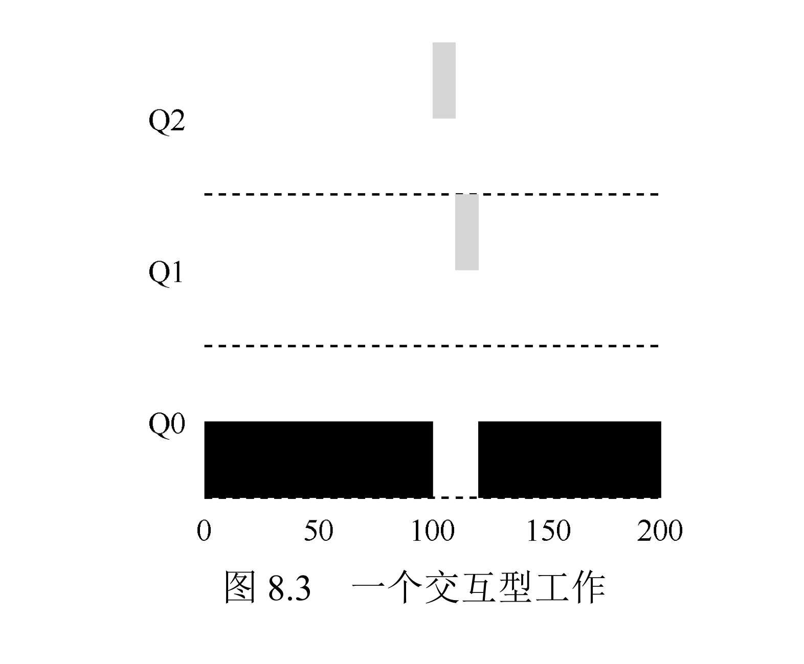
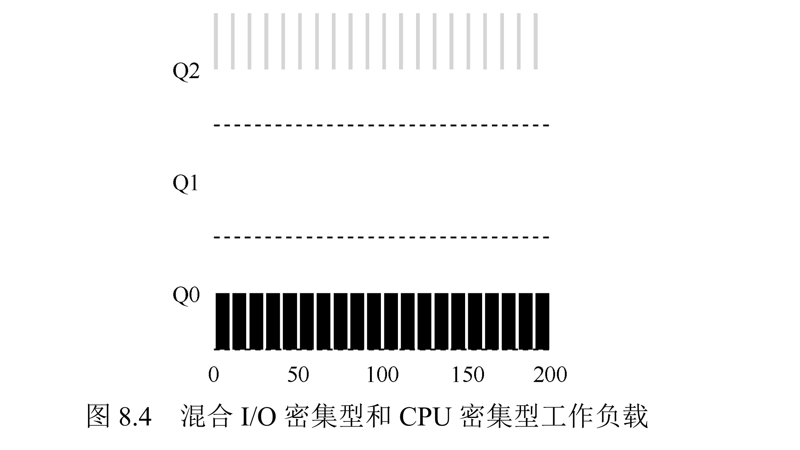

# 5 - 进程多级调度

上一章的难题是：调度器不知道每个作业要跑多久，怎么在毫无先验知识的前提下，既让短作业和交互式作业响应快，又不让长作业饿死？MLFQ（多级反馈队列）给出的答案是：不靠猜，靠观察——新来的作业先当作短作业供在高位，再根据它的实际表现决定降级还是保留。

## 一、基本思想：多级队列 + 行为反馈

MLFQ 维护若干条优先级从高到低的队列，两条最基本的调度规则是：高优先级队列里的作业先跑；同一优先级内用 RR（轮转）轮着跑。

关键在于怎么决定一个作业待在哪条队列。MLFQ 的做法是"看行为"：新作业进系统时默认它是短作业或交互式作业，先放进最高队列；如果它老老实实跑了一会儿还没完（说明是个长作业），就往下挪一级；如果它时不时放弃 CPU 去做 I/O（说明是交互式作业），就让它留在高位。



这样自然形成近似 SJF 的效果：短作业一进来就在最高队列，很快跑完；长作业慢慢沉到底部，只在 CPU 空出来时才轮到。

## 二、五条规则

| 规则 | 内容 | 意图 |
|------|------|------|
| 规则 1 | A 优先级高于 B，则 A 先运行 | 让短作业/交互式作业优先 |
| 规则 2 | A、B 同优先级，RR 轮转 | 同层公平共享 |
| 规则 3 | 新作业进入系统放最高队列 | 先假设它是短作业 |
| 规则 4 | 作业用完当前队列的配额就降一级 | 识别长作业并让它让位 |
| 规则 5 | 每隔一段时间 S 把所有作业提回最高队列 | 防止长作业饿死 |

## 三、两条补丁

初版只有规则 1-4（规则 4 拆成 4a/4b：用完时间片降级、主动放弃 CPU 则保留）。它有两个漏洞，各打一条补丁。

**漏洞一：长作业饿死。** 只要系统里持续有交互式作业进来，长作业就会永远沉在底部吃不到 CPU。补丁是规则 5（优先级提升）：每隔 S 时间把所有作业提回最高队列。长作业由此定期获得机会；如果它在这期间表现出交互式特征，还能被重新提拔。



**漏洞二：调度欺骗。** 旧规则 4b"主动放弃 CPU 就保留优先级"让恶意程序钻了空子：故意在时间片快用完时去 I/O 一下，时间片被重置，从而一直赖在高优先级霸占 CPU。补丁是把规则 4 改成按**累计配额**算：不管它主不主动放弃，在某个队列里累计用完配额就降级。



下面是三种典型作业在 MLFQ 里的表现：

| 作业类型 | 表现 | 图示 |
|----------|------|------|
| 长作业 | 进最高队列，用掉一个配额降一级、再降一级，最后一直待在最低队列轮转 |  |
| 短作业 | 长作业在底部跑时，短作业突然进来，在最高队列被优先伺候，很快跑完 |  |
| I/O 密集作业 | 跑一小段就去 I/O，一直留在高位，响应始终很快 |  |


## 四、调优参数

MLFQ 好不好用，很大程度上取决于这几个参数：

1. **队列数量**：Solaris 默认 60 条，优先级梯度更细腻；
2. **各层时间片**：高优先队列给短时间片（如 10ms），方便交互式作业快速响应；低优先级给长时间片（数百 ms），减少长作业切换开销；
3. **提升周期 S**：Solaris 约 1 秒，太大会饿死长作业、太小会伤害交互式响应；
4. **各层配额**：作业在该队列里能累计运行的时长（如顶层 20ms、下一层 40ms），而不是单个时间片。

## 五、真实系统的变种

- **Solaris TS 调度类**：60 条队列、时间片从 20ms 递增到数百 ms、1 秒提升，支持管理员自定义参数表；
- **FreeBSD**：不用定期提升，改用公式让优先级随 CPU 使用量自然衰减；
- **Windows NT 及后续**：简化版 MLFQ，把最高队列留给系统进程，用户可用 nice 调优先级。

## 六、优点与代价

优点：不需要先验知识，动态适应作业行为；对短作业/交互式近似 SJF，对长作业靠提升避免饿死；能应付真实混合负载。

代价：参数多且敏感（队列数、时间片、提升周期），没有通用最优解；对"I/O 密集但总时长很长"的作业不够友好，最终仍会沉底；实现需要跟踪每个作业在各队列累计用了多久、处理提升与队列迁移，更加复杂。

## 七、作业方向（Simulation）

通过mlfq.py模拟器验证MLFQ特性，核心任务：

1. 生成两作业两队列的简单场景，输出调度轨迹（关闭I/O，简化分析）；
2. 配置参数复现章节中的示例（如长作业饥饿、调度欺骗场景）；
3. 调整参数让MLFQ等效于RR调度（如单队列、无优先级提升）；
4. 构造欺骗 workload：利用旧规则4a/4b（-S flag），让一个作业抢占99% CPU；
5. 计算优先级提升周期S：最高队列时间片10ms，保证长作业至少获得5% CPU；
6. 测试I/O完成后队列插入位置（-I flag）对调度的影响。

通过 `homework/cpu-sched-mlfq/mlfq.py` 模拟器验证 MLFQ 特性，核心任务与答案如下（`-l x,y,z` 表示作业在 x 时刻进入、总共要 y 的 CPU 时间、每 z 个时间单位发一次 I/O，z=0 表示不发 I/O；输出里 `PRIORITY` 越大优先级越高）。

### 1. 两作业两队列（关闭 I/O）

长作业（200）在最高队列用完 10ms 就降到低队列，短作业（100）随后在最高队列先跑完，符合"短作业优先"的预期。

```shell
./mlfq.py -n 2 -l 0,200,0:0,100,0 -c
```

```text
Final statistics:
  Job  0: startTime   0 - response   0 - turnaround 300
  Job  1: startTime   0 - response  10 - turnaround 200
  Avg  1: startTime n/a - response 5.00 - turnaround 250.00
```

### 2. 复现章节示例

章节里几幅调度示意图都能用 `mlfq.py` 复现，分三种典型作业。

**（1）单个长作业：逐级降队列（图 8.1/8.2）**

一个 200ms 的长作业进系统后，在最高队列用完一个 10ms 配额就降一级，三级队列逐级沉底，最后一直待在最低队列：

```shell
./mlfq.py -l 0,200,0 -q 10 -c
```

```text
[ time 0 ]  Run JOB 0 at PRIORITY 2 ...   ← 最高队列
[ time 10 ] Run JOB 0 at PRIORITY 1 ...   ← 用完一个配额降一级
[ time 20 ] Run JOB 0 at PRIORITY 0 ...   ← 再降一级，此后一直待在最低队列
Final statistics:
  Job  0: startTime   0 - response   0 - turnaround 200
```

**（2）长作业 + 晚到的短作业（图 8.3）**

长作业（180）在 t=100 已经沉到底部，短作业（20）这时才进系统，立即被放进最高队列执行，近似 SJF：

```shell
./mlfq.py -l 0,180,0:100,20,0 -q 10 -c
```

```text
[ time 98 ]  Run JOB 0 at PRIORITY 0 ...   ← 长作业还在最低队列
[ time 100 ] JOB BEGINS by JOB 1
[ time 100 ] Run JOB 1 at PRIORITY 2 ...   ← 短作业一进来就插到最高队列
Final statistics:
  Job  0: startTime   0 - response   0 - turnaround 200
  Job  1: startTime 100 - response   0 - turnaround  20
  Avg  1: startTime n/a - response 0.00 - turnaround 110.00
```

**（3）I/O 密集 + 长作业（图 8.4，需旧规则 -S）**

图 8.4 要复现的是"交互式作业一直留在高位"——这靠的是**旧规则 4b**：主动放弃 CPU 的作业保留优先级。默认模拟器用的是改过的新规则（按累计配额降级），所以要加 `-S` 回退到旧规则。

I/O 密集作业（100ms，每 9ms 发一次 I/O，时间片 10ms）每次只跑 9ms 就去 I/O，没等时间片用完就主动让出 CPU，按旧规则 4b 它就**一直赖在最高队列**；长作业（100ms）跑满 10ms 时间片、逐级降级沉底：

```shell
./mlfq.py -l 0,100,9:0,100,0 -q 10 -S -c
```

```text
[ time 0 ]  Run JOB 0 at PRIORITY 2 ...   ← I/O 作业，从头到尾都是最高队列
[ time 9 ]  Run JOB 1 at PRIORITY 2 ...   ← 长作业前 10ms 还在最高队列
[ time 19 ] Run JOB 1 at PRIORITY 1 ...   ← 用满一个配额降到中队列
[ time 29 ] Run JOB 1 at PRIORITY 0 ...   ← 再降到底队列
Final statistics:
  Job  0: startTime   0 - response   0 - turnaround 160   ← I/O 作业，响应 0
  Job  1: startTime   0 - response   9 - turnaround 200   ← 长作业，响应 9
```

差异体现在**响应时间**：I/O 作业 `response 0`（一进来立即被调度到），长作业 `response 9`（要等 I/O 作业先跑 9ms）。此后 I/O 作业全程霸占最高队列，长作业只能在它 I/O 的 5ms 间隙里插空跑，被拖到 200 才做完。

（这正好埋下"调度欺骗"的种子——见作业 4：恶意程序也能用"时间片快用完前主动 I/O"赖在最高队列，所以后来才把规则改成按累计配额降级。）

### 3. 让 MLFQ 等价于 RR

只留一条队列（`-n 1`）且不启用提升，MLFQ 就退化成了纯 RR，两个作业交替各跑 10ms。

```shell
./mlfq.py -n 1 -l 0,100,0:0,100,0 -c
```

```text
Final statistics:
  Job  0: startTime   0 - response   0 - turnaround 190
  Job  1: startTime   0 - response  10 - turnaround 200
  Avg  1: startTime n/a - response 5.00 - turnaround 195.00
```

### 4. 构造调度欺骗（-S 旧规则）

用 `-S` 打开旧规则 4a/4b，让一个作业在时间片快用完前主动 I/O，从而赖在高优先级。作业 0 每 9ms（< 10ms 时间片）触发一次 I/O、配额被不断重置，始终霸占最高队列；作业 1 只能在它 I/O 的间隙里跑一点点，几乎被饿死。

```shell
./mlfq.py -l 0,100,9:0,100,0 -S -q 10 -c
```

```text
Final statistics:
  Job  0: startTime   0 - response   0 - turnaround 160
  Job  1: startTime   0 - response   9 - turnaround 200
  Avg  1: startTime n/a - response 4.50 - turnaround 180.00
```

### 5. 提升周期 S 的取值

最高队列时间片 10ms，要保证长作业至少拿到 5% 的 CPU：长作业每次被提上来能跑 10ms，所以需要 10/S ≥ 5%，即 **S ≤ 200ms**。用 `-B 200` 就能在轨迹里看到每 200ms 一次的 `BOOST`，把长作业提回最高队列。

```shell
./mlfq.py -l 0,200,0:0,100,0 -q 10 -B 200 -c
```

```text
  [ time 200 ] BOOST ( every 200 )
Final statistics:
  Job  0: startTime   0 - response   0 - turnaround 300
  Job  1: startTime   0 - response  10 - turnaround 200
  Avg  1: startTime n/a - response 5.00 - turnaround 250.00
```

### 6. I/O 完成后队列插入位置（-I）

三个作业都 `-l 0,20,5`：t=0 进系统、要 20 个 CPU 时间、每 5 个单位发一次 I/O（I/O 耗时 5 个单位）。`-I`（iobump）只决定一件事：作业的 I/O 完成后，回到所在优先级队列的**队头**还是**队尾**。

看最关键的一刻 t=10：

- t=0~4：JOB 0 跑 5 个单位后去 I/O（t=5~9 是它的 I/O 时间）；
- t=5~9：JOB 1 跑 5 个单位后去 I/O；
- t=10：JOB 0 的 I/O 完成，要回到 PRIORITY 2 队列。

**不加 `-I`**：JOB 0 排到队尾，此刻队里 JOB 2 排在它前面，所以轮到 JOB 2 跑：

```shell
./mlfq.py -l 0,20,5:0,20,5:0,20,5 -q 10 -c
```

```text
[ time 10 ] IO_DONE by JOB 0
[ time 10 ] Run JOB 2 at PRIORITY 2 ...   ← JOB 0 回队尾，JOB 2 先跑
```

**加 `-I`**：JOB 0 插到队头，自己紧接着继续跑：

```shell
./mlfq.py -l 0,20,5:0,20,5:0,20,5 -q 10 -I -c
```

```text
[ time 10 ] IO_DONE by JOB 0
[ time 10 ] Run JOB 0 at PRIORITY 2 ...   ← JOB 0 插到队头，马上接着跑
```

两种情况的完整统计（trace 里 `TIME n (of 20)` 是"还剩多少 CPU 时间"，`PRIORITY 2` 是最高队列）：

不加 `-I`（I/O 完成回队尾，三个作业严格轮转，谁也不插队）：

```text
Final statistics:
  Job  0: startTime   0 - response   0 - turnaround  50
  Job  1: startTime   0 - response   5 - turnaround  55
  Job  2: startTime   0 - response  10 - turnaround  60
  Avg  2: startTime n/a - response 5.00 - turnaround 55.00
```

加 `-I`（I/O 完成插队头，活跃的作业反复插队）：

```text
Final statistics:
  Job  0: startTime   0 - response   0 - turnaround  60
  Job  1: startTime   0 - response   5 - turnaround  40
  Job  2: startTime   0 - response  20 - turnaround  55
  Avg  2: startTime n/a - response 8.33 - turnaround 51.67
```

对比能看出 `-I` 的取舍：反复插队的作业（JOB 1）周转从 55 缩到 40，更快做完；代价是排队靠后的作业（JOB 2）第一次被调度从 10 推迟到 20、响应变差；整体平均周转只略降（55→51.67），且插队让 JOB 0 反而变慢（50→60）。一句话：`-I` 偏爱 I/O 频繁的作业，牺牲不"活跃"作业的响应。

## 八、总结

MLFQ 的本质是"反馈学习"：不问你有多长，而是看你怎么跑——跑得久就降级，频繁 I/O 就留在高位，再定期普升防止饿死。这套机制让调度器在毫无先验知识的情况下，同时兼顾了响应时间和周转时间，也是 Solaris、Windows 等现代系统调度器的底层思路。