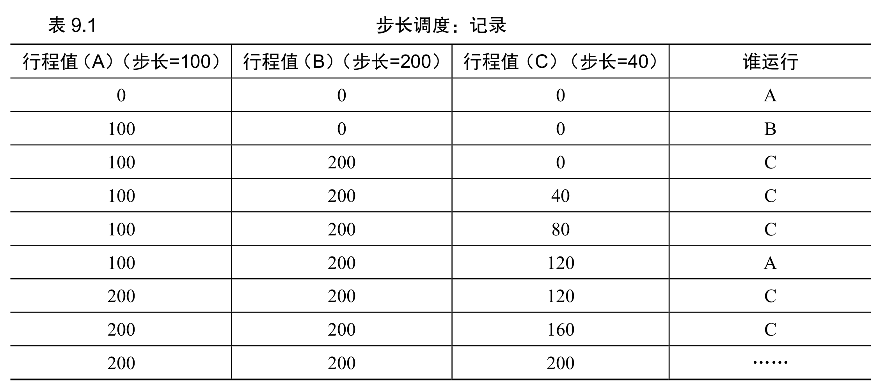

# 6 - 进程比例份额调度

前面几章的调度器都在优化周转时间或响应时间，这一章换一个目标：**按比例**分配 CPU。即每个进程拿到的 CPU 时间，应该和它持有的"份额"成正比，谁份额大谁跑得多，而不是谁短谁先跑。这类算法在云服务器、虚拟机配额等"明确要按比例分资源"的场景很常用。

份额的具象表示叫 **Ticket（彩票）**：每个进程持若干张票，总票数是所有进程之和。进程 A 持 75 张、B 持 25 张，那么 A 就该拿到 75% 的 CPU。下面三种实现都围绕这个目标，差别在"随机还是确定、简单还是实用"。

## 一、彩票调度：随机抽奖

每次调度就抽一次奖：在 0~总票数之间生成一个随机数，这个数落在谁的票区间里，谁就赢下这个时间片。长期来看，每个进程赢的次数就逼近它的票数占比——概率正确，短期有波动。

彩票调度最妙的地方是"灵活调份额"的三板斧：

- **Ticket 货币**：用户用内部自定义货币给自己进程分票，系统再换算成全局票。比如用户 A 有 100 张全局票，给内部两个进程各分 500"用户币"，系统自动换算成各 50 张全局票。
- **Ticket 转移**：进程可以临时把票转给别人。客户端把票转给服务器，等于让服务器更快处理自己的请求。
- **Ticket 膨胀**：在可信环境里，进程可以临时增减自己的票，反映短期需求（不可信环境里这招会被滥用）。

实现极简：维护所有进程的票数和一个总票数；每次生成随机中奖票，然后从头累加票数，累加结果第一次超过中奖票的进程就是赢家——O(1) 选赢家前需要 O(n) 遍历，但胜在无全局状态，加新进程只要加它的票，不用动别人。

优缺点：优点是简单、无全局状态、轻量；缺点是短期比例不准（20 次抽奖里，25% 份额的进程可能只跑 4 次甚至更少），进程运行时间越短，公平性越差。

## 二、步长调度：确定性的比例

彩票调度靠运气，步长调度把它换成确定性逻辑，保证每一步比例都精确：

1. **步长（Stride）**：与票数成反比，`Stride = 大常数 / 票数`，票越多步长越小；
2. **通行证（Pass）**：每个进程初始 Pass=0，每被选中运行一次就 `Pass += Stride`；
3. **调度规则**：每次选 Pass 最小的进程运行。

示例：A 有 100 票、B 有 50 票、C 有 250 票，取大常数 10000，则步长分别为 100、200、40。Pass 累加后 C 被选中的次数最多、A 次之、B 最少，正好吻合 250:100:50 的票数比。



优缺点：优点是比例精确、无随机波动；缺点是有全局状态（Pass），新进程进场时 Pass 初值不好设——设成 0 会让它瞬间霸占 CPU，需要额外处理，实现比彩票调度复杂。

## 三、Linux CFS：实用型的比例共享

CFS 是 Linux 的主调度器，思路是"谁占用 CPU 少，谁先跑"，用虚拟运行时（**vruntime**）来衡量每个进程已占用的 CPU 资源，每次挑 vruntime 最小的进程运行，从整体上逼近按权重（比例）分 CPU。

几个关键设计：

1. **动态时间片**：`sched_latency`（默认 48ms）是"一轮调度覆盖所有进程"的目标时长，`min_granularity`（默认 6ms）是时间片下限。时间片 = `sched_latency / 进程数`，若小于下限就取下限。4 个进程时时间片 12ms，10 个进程时理论 4.8ms、实际取 6ms。
2. **Nice 权重**：Nice 从 -20（最高）到 +19（最低），默认 0；每个 Nice 对应一个固定权重（Nice=0 是 1024，Nice=-5 是 3121）。一个进程的时间片占比 = 它的权重 / 所有进程权重之和。
3. **vruntime 累加**：`vruntime += (1024 / 权重) × 实际运行时间`——高权重进程 vruntime 涨得慢，于是能被选中更多次（分到更多 CPU）。
4. **红黑树**：把所有可运行进程按 vruntime 存进红黑树，插入/删除/查最小都是 O(log n)，千级进程也扛得住（链表是 O(n)）。
5. **睡眠唤醒**：长期睡眠的进程 vruntime 很低，醒来后会突然垄断 CPU。CFS 在唤醒时把它的 vruntime 设为红黑树里的最小值，避免这种饥饿。

## 四、三种算法对比

| 特性 | 彩票调度 | 步长调度 | CFS（Linux） |
|------|----------|----------|--------------|
| 比例保证 | 概率性（长期正确） | 确定性（短期也正确） | 近似比例（实用平衡） |
| 实现复杂度 | 极低 | 中等 | 较高（工业级） |
| 新增进程兼容性 | 极佳（无全局状态） | 较差（需处理 Pass 初值） | 极佳（红黑树动态插入） |
| 适用场景 | 简单比例分配、轻量系统 | 需精确比例的场景 | 通用操作系统 |
| 优先级支持 | 无（需扩展票数） | 无（需扩展步长） | 原生支持（Nice+权重） |

## 五、总结

1. 比例共享调度的核心是按份额分 CPU，Ticket 是份额的统一载体。
2. 彩票调度胜在简单灵活，步长调度胜在比例精确，CFS 胜在实用高效、能落地到 Linux。
3. CFS 靠动态时间片、红黑树、vruntime 这三板斧平衡了公平性、效率和扩展性。
4. 局限：对 I/O 密集进程不够友好（睡眠后可能拿不到公平份额）；"份额该给多少"（票数/权重怎么定）本身仍是个没有统一答案的问题。

## 六、作业方向（Simulation）

通过 `homework/cpu-sched-lottery/lottery.py` 模拟彩票调度。`-l 时长:票数,...` 指定作业（时长和票数），`-s` 指定种子，`-q` 指定时间片。核心任务：

1. 不同随机种子下，3 个进程的调度结果与比例匹配度；
2. 极端 Ticket 分配（1:100）对调度的影响（低 Ticket 进程是否能运行）；
3. 进程长度、时间片大小（`-q` 参数）对公平性的影响；
4. 绘制公平性随进程长度变化的图表，对比彩票调度与步长调度的差异。

### 1. 不同种子下 3 个进程的调度

```shell
./lottery.py -j 3 -s 1 -c
```

随机生成 3 个进程，每次抽奖的赢家取决于"随机数 mod 总票数"。不同种子给出不同的片段，但长期统计上每个进程被选中的次数趋近其票数占比——这就是"概率正确"的含义。

### 2. 极端票数分配（1:100）

```shell
./lottery.py -l 10:1,10:100 -s 0 -c
```

```text
--> JOB 1 DONE at time 10   (100 票)
--> JOB 0 DONE at time 20   (1 票)
```

作业 0 只有 1 票（占比约 1/101），几乎轮不到它。多种子测试 0~4 里，作业 0 全都等作业 1 跑完才开始——极端票差会导致低票进程"事实上饿死"。

### 3. 等票长作业的公平性

```shell
./lottery.py -l 100:100,100:100 -s 0 -c
```

```text
seed 0: JOB 0 DONE at 192, JOB 1 DONE at 200
seed 1: JOB 1 DONE at 196, JOB 0 DONE at 200
seed 2: JOB 1 DONE at 190, JOB 0 DONE at 200
seed 3: JOB 0 DONE at 196, JOB 1 DONE at 200
```

两个作业各 100 票、各要 100 个时间单位，最终大体平分，但完成时刻有 ±8~10 的随机偏差。作业越长，比例越趋近 50:50（大数定律）；越短，运气成分越明显。

### 4. 时间片大小与公平性趋势

```shell
./lottery.py -l 10:1,10:100 -q 10 -s 0 -c
```

```text
--> JOB 1 DONE at time 10
--> JOB 0 DONE at time 20
```

把 `-q` 从 1 加到 10，低票作业并没有变公平：`-q 10` 时每个作业赢一次就跑完整 10 个时间单位，所以作业 1 第一次抽中就完成。时间片变大只让"赢家一次跑更久"，而不会改变抽中的概率。公平性随进程长度变化的趋势是：长度越长，彩票调度越接近票数占比（方差相对变小）；步长调度则始终精确，这也是两者的本质区别。