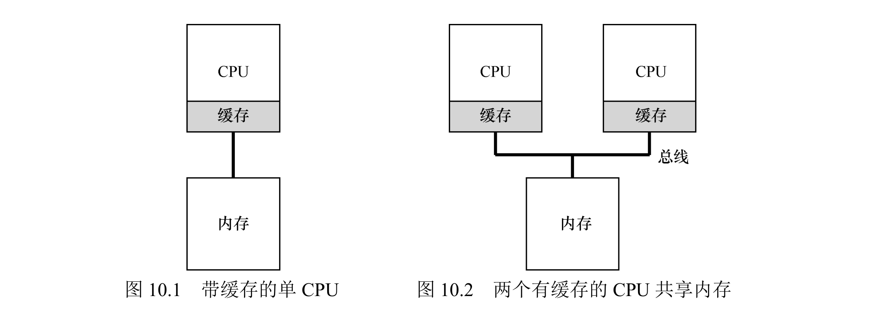
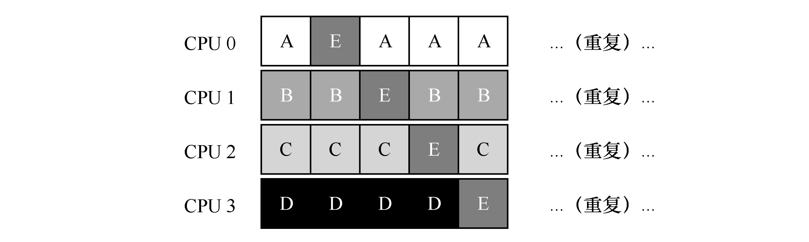
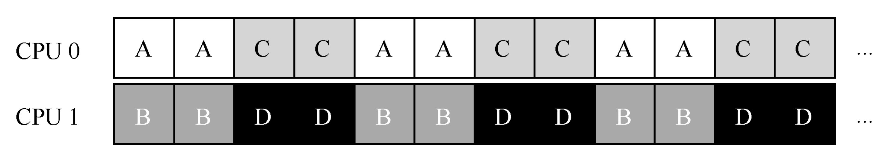
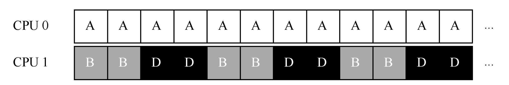
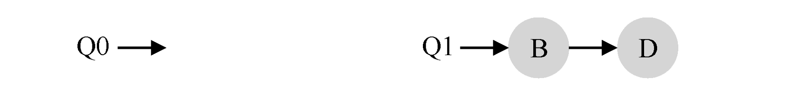
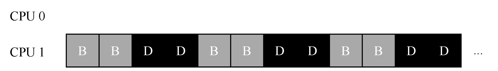
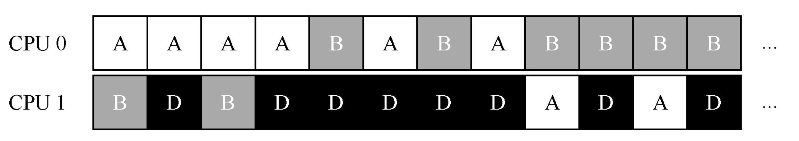

# 7 - 多核处理器调度

单核时代只要回答"下一个跑谁"，多核时代更难——多个 CPU 同时取进程，还要处理它们共享的主存和各自的缓存。这一章要解决的核心矛盾是三维的：**扩展性**（核越多越好使）、**缓存亲和性**（进程尽量留在原核复用缓存）、**负载均衡**（别让某些核闲着）。

## 一、多核带来的三个新问题

### 1. 缓存一致性

多个 CPU 共享主存，但各自有缓存。CPU1 改了数据没写回主存时，CPU2 可能读到旧值。硬件用 **总线嗅探（Bus Snooping）** 解决：每个 CPU 的缓存监听总线，发现有别的 CPU 改了它缓存里的数据，就自动失效或更新本地副本。

### 2. 共享数据同步

多个 CPU 并发改同一个队列/链表会出竞争（双删节点、重复返回值）。靠软件同步原语（互斥锁等）保证原子性。

### 3. 缓存亲和性

进程在某个 CPU 上跑过，它的指令和数据就进了那个 CPU 的缓存和 TLB；下次还在这核跑，直接命中缓存，快得多。频繁换核会让缓存作废、重新加载，性能下降。所以调度器要尽量让进程"认家"（将进程保持在同一个 CPU 上）。



## 二、两条路线：单队列 vs 多队列

### 1. 单队列调度（SQMS）

所有就绪进程放一个全局队列，各 CPU 都从这同一个队列取进程。本质是把单核调度逻辑直接复制过来，只是同时选出 N 个进程（N=CPU 数）。


好处是天然负载均衡（都从同一队列取，不会有的核闲有的核忙）、实现简单。坏处有两个：

- **扩展性差**：全局队列要加锁保护，核越多锁竞争越凶，调度开销占比涨上去。
- **破坏缓存亲和性**：进程可能被不同核交替拿走，缓存反复作废。

改进方向是加亲和机制，尽量让进程回到之前跑过的核：



### 2. 多队列调度（MQMS）

每个 CPU 一条独立队列，进程进来时被分到某条队列（随机或按负载）。各核只调度自己队列，互不干扰。




好处是扩展性极好（无全局锁，本地队列操作零竞争）、天然有缓存亲和性（进程默认待在同一核）。坏处是**负载不均**：可能 CPU0 队列空了、CPU1 还堆着好几个长进程。






解决办法是**迁移（Migration）**，最经典的是**工作窃取（Work Stealing）**：空闲核定期瞄一眼别的核的队列，对方队列明显更长就"借"一两个进程过来。偷得太勤开销大，偷得太懒又不均衡，要取平衡。



## 三、Linux 的多核调度器

Linux 社区没有统一方案，历史上出现过三种：

| 调度器 | 队列方案 | 核心特性 |
|--------|----------|----------|
| O(1) 调度器 | 多队列 | 基于优先级（类似 MLFQ），动态调优先级，侧重交互响应 |
| CFS | 多队列 | 比例共享（类似步长调度），用 vruntime 衡量占用，兼顾公平与扩展 |
| BFS | 单队列 | 单队列简化逻辑，适合特定场景 |

## 四、SQMS vs MQMS 对比

| 维度 | 单队列（SQMS） | 多队列（MQMS） |
|------|----------------|----------------|
| 扩展性 | 差（全局锁竞争） | 好（无全局锁） |
| 缓存亲和性 | 差（易换核） | 好（默认留在本核） |
| 负载均衡 | 天然均衡 | 需手动迁移（工作窃取） |
| 实现复杂度 | 低 | 高（迁移策略、队列管理） |
| 适用场景 | 少核（2-4 核） | 多核服务器、云主机 |

## 五、总结

1. 多核调度的核心是"扩展性—缓存亲和性—负载均衡"的三角权衡，没有完美解。
2. SQMS 简单、均衡但锁竞争和缓存失效严重；MQMS 扩展性好、亲和性好，但要靠迁移解决负载不均。
3. 现代多核系统主流是 MQMS + 工作窃取，兼顾扩展性和亲和性。
4. 缓存亲和性是最关键的优化点，直接影响进程运行效率。

## 六、作业方向（Simulation）

通过 `homework/cpu-sched-multi/multi.py` 模拟多 CPU 调度。`-n` CPU 数、`-M` 每核缓存大小、`-L 名:运行时长:工作集` 指定作业、`-p` 多队列、`-A` 亲和、`-P` 窥探间隔、`-w/-r` 缓存预热时间/速率。

1. 研究缓存大小对进程运行时间的影响（如工作集是否拟合缓存）；
2. 验证缓存亲和性：限制进程在固定CPU运行，对比自由调度的性能差异；
3. 探索超线性加速比：多CPU+缓存协同，是否能实现“N核CPU速度提升超N倍”；
4. 测试工作窃取策略：调整 peek 间隔（-P参数），观察负载均衡效果与调度开销的平衡；
5. 对比单队列与多队列调度：在不同CPU数量、进程数下，测试扩展性差异。

### 1. 缓存大小（工作集是否拟合缓存）

先搞清两个词：**冷缓存（cold cache）** 指该 CPU 的缓存里还没有这个作业的工作集，作业只能按 1 倍速跑（慢）；**热缓存（warm cache）** 指作业在这个 CPU 上连续跑了预热时间（`-w`，默认 10 单位）后、工作集进了缓存，就能按 `-r`（默认 2）倍速跑。冷缓存有两种来源：工作集太大装不进缓存（永远冷），或作业刚被换到新核（要重新预热）。

```shell
./multi.py -n 1 -M 100 -L a:100:50 -c    # 工作集 50 < 缓存 100，拟合
./multi.py -n 1 -M 100 -L a:100:150 -c   # 工作集 150 > 缓存 100，装不下
```

```text
# 拟合:   Finished time 55   CPU 0 warm 81.82%   ← 前 10 单位冷跑预热，之后 2 倍速
# 不拟合: Finished time 100  CPU 0 warm 0.00%    ← 工作集装不进缓存，永远冷、永远 1 倍速
```

工作集能装进缓存时，预热 10 单位后按 2 倍速跑（100 单位的工作量只花 55 完成）；装不进就一直是冷缓存、跑满 100。缓存是否拟合直接决定进程快慢。

### 2. 缓存亲和性：换核 vs 绑核

3 个作业（各 100 单位、工作集 50）放 2 个核上。不绑核时，单队列 + 时间片让它们轮流换核——下面 `-t` 轨迹里作业 a 一会儿在 CPU0、一会儿在 CPU1（每次换核，新核的缓存对它都是冷的，得多花 10 单位重新预热）：

```shell
./multi.py -n 2 -L a:100:50,b:100:50,c:100:50 -q 3 -t -c
```

```text
   0   a      b
   1   a      b
   2   a      b
   3   c      a        ← a 从 CPU0 被换到 CPU1
   4   c      a
   5   c      a
   6   b      c        ← b、c 也换来换去
   ...
```

来回换核的后果就是缓存永远热不起来；用 `-A` 绑核后，作业固定待在分配好的核上，缓存能保持热：

```shell
./multi.py -n 2 -L a:100:50,b:100:50,c:100:50 -c                          # 不绑核
./multi.py -n 2 -L a:100:50,b:100:50,c:100:50 -A a:0,b:0,c:1 -c           # 绑核
```

```text
# 不绑核: Finished time 150   CPU 0 warm 0.00%    CPU 1 warm 0.00%
# 绑核:   Finished time 110   CPU 0 warm 81.82%   CPU 1 warm 40.91%
```

把 a、b 绑到 CPU0、c 绑到 CPU1 后，作业不再换核、缓存保持热，完成时间从 150 缩到 110。这就是缓存亲和性的价值——尽量让进程"认家"，别让它被不同核来回踢。

### 3. 超线性加速比

两个工作集各 100 的作业，缓存也是 100。放 1 个核上，两者互相抢占缓存（200 > 100）、全程冷跑；放到 2 个核上，每个作业独占一个缓存、全程热跑：

```shell
./multi.py -n 1 -M 100 -L a:100:100,b:100:100 -c
```

```text
Finished time 200
Per-CPU stats
  CPU 0  utilization 100.00 [ warm 0.00 ]
```

```shell
./multi.py -n 2 -M 100 -L a:100:100,b:100:100 -c
```

```text
Finished time 55
Per-CPU stats
  CPU 0  utilization 100.00 [ warm 81.82 ]
  CPU 1  utilization 100.00 [ warm 81.82 ]
```

2 个核把完成时间从 200 干到 55，加速比 200/55 ≈ 3.6 倍，**超过核数 2**——这就是"超线性"。根因：缓存总容量随核数翻倍（100 → 200），两个工作集都装得下、都能热跑；单核时两个工作集在 100 的缓存里互相踩踏，只能冷跑。

### 4. 工作窃取与窥探间隔（-P）

多队列（`-p`）下，初始把作业轮流塞进各队列，可能不均。`-P N` 让空闲 CPU 每 N 步窥探别的队列并窃取作业（`-P 0` 关闭）。下面 2 核塞了 3 个作业（一核 a+c、另一核 b）：

```shell
./multi.py -n 2 -p -P 0 -L a:100:50,b:100:50,c:20:50 -c
./multi.py -n 2 -p -P 5 -L a:100:50,b:100:50,c:20:50 -c
```

```text
# P=0: CPU 0 util 100%, CPU 1 util 78.57%   (CPU1 干完自己那份就空转)
# P=5: CPU 0 util 78.57%, CPU 1 util 100%   (CPU1 窥探后窃取了工作)
```

`-P` 越大，窃取越勤、负载越均衡，但每次窥探也有开销——两个目标之间取平衡。

### 5. 单队列 vs 多队列扩展性

均衡负载下两者完成时间一样（都是瓶颈核的时间），区别在扩展性：单队列靠一把全局锁，核越多锁竞争越凶；多队列无全局锁、可水平扩展，代价是可能负载不均、需要迁移策略：

```shell
./multi.py -n 2 -L a:100:50,b:100:50,c:100:50,d:100:50 -c        # 单队列
./multi.py -n 2 -p -L a:100:50,b:100:50,c:100:50,d:100:50 -c     # 多队列
```

```text
# 两者: Finished time 110, CPU 0/1 均 util 100% warm 81.82%
```