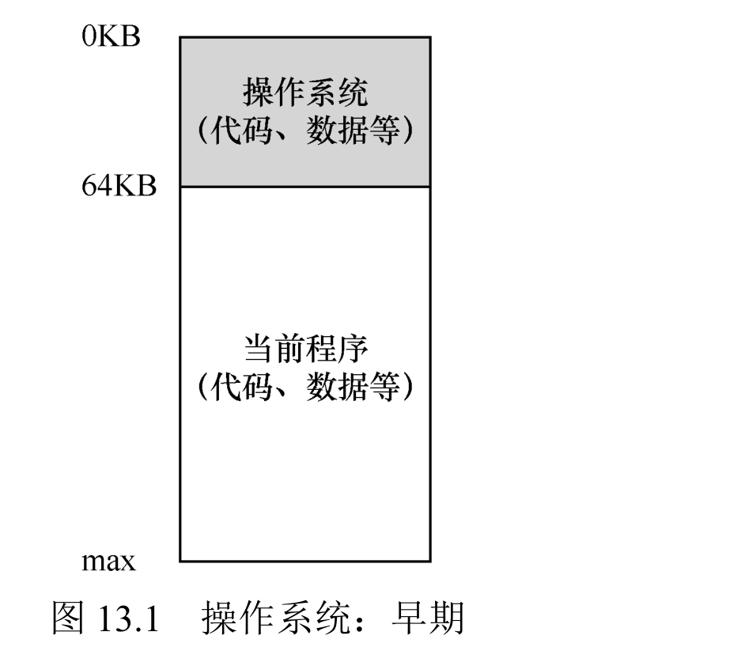
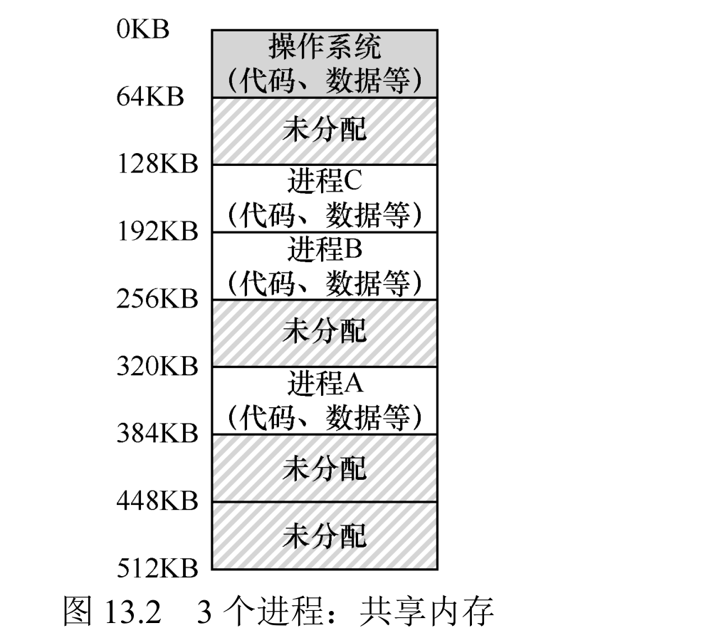
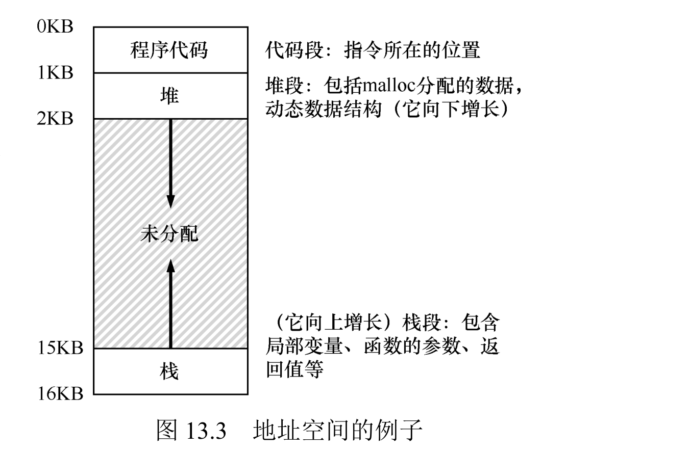

# 8 - 内存地址空间

## 一、从"一个程序独占内存"到"共享内存"

最早的系统最简单：物理内存直接暴露给程序，OS 作为一组例程待在物理内存开头（比如 0 地址），同一时刻只跑一个程序，程序占用剩下的内存。开发起来省事，但用户体验和资源利用率都极差。



后来为了把昂贵的机器用起来，引入了多道程序设计：让多个进程同时处于就绪态，一个进程去做 I/O 时，OS 就切到另一个进程，别让 CPU 空着。

再进一步就是分时系统。最初的想法是：进程跑一会儿就暂停，把它的整个内存状态存到磁盘，再加载另一个进程接着跑。但"整存整取"太慢了（内存来回读写磁盘），行不通。于是改成：进程切换时**不搬出内存**，只切换 CPU 执行权，让多个进程同时驻留在内存里。这带来一个新麻烦——多个进程共享同一块物理内存，得防止一个进程乱读乱写别人的地盘。



## 二、地址空间：给每个进程一片"私有"内存

地址空间是 OS 给"运行中的程序"造的一个抽象：程序以为自己独占一块连续内存，其实这块是假的（虚拟的），和真实的物理地址解耦。程序不用管自己到底被放在了物理内存的哪个位置。

一个地址空间里装着一个程序运行所需的全部内存状态，主要分三块：



- **代码段（Code）**：程序指令，静态、位置固定，一般放在地址空间开头。
- **堆（Heap）**：动态分配的内存（C 的 `malloc()`、Java 的 `new`），跟在代码段后面，往高地址方向长。
- **栈（Stack）**：管函数调用链，存局部变量、参数、返回值，放在地址空间最末端，往低地址方向长。

这个布局的精妙之处在于"代码段固定、堆和栈朝中间反向生长"，尽量挤用中间的空地。除此之外还有静态初始化变量等杂项，但核心就这三块。

要解决的关键问题是：怎么在**一块**物理内存之上，给多个并发进程各自造出私有的、可能还挺大的地址空间？这就引出内存虚拟化。

## 三、内存虚拟化：虚拟地址到物理地址

程序用的是虚拟地址（比如它眼里的地址 0），OS 结合硬件把这个虚拟地址翻译成真正的物理地址（比如进程 A 的虚拟地址 0 实际对应物理地址 320KB）。程序看到的永远是虚拟地址，物理地址只有 OS 和硬件知道。

这个机制要同时满足三个目标：

- **透明性**：对程序完全不可见，程序表现得像独占物理内存，一行代码都不用改。
- **高效性**：时间上不能拖慢程序，空间上不能为了支撑虚拟化吃掉太多内存——这要靠 TLB 之类的硬件来加速。
- **保护性**：进程之间互相隔离，进程也碰不到 OS 的内存；取指、读写都只能落在自己的地址空间里。

背后是一条更基本的原则——**隔离**：两个实体彻底隔离，一个挂了不会连累另一个。OS 靠内存隔离实现进程隔离，微内核架构甚至把隔离用到 OS 内部模块之间。

## 四、实践验证

- 写个小 C 程序打印代码段、堆、栈的虚拟地址，能看到代码在低地址、堆紧随其后、栈在高地址，正好对上上面的布局。
- `free` 看系统总内存/空闲内存（`-m` 按 MB 显示）。
- `memory-user.c`：按命令行参数分配指定大小内存并持续访问，配合 `free` 观察程序运行/退出时的内存变化。
- `pmap <pid>`（`-X`）看某个进程的完整地址空间，会发现真实的地址空间比"代码/堆/栈"三件套复杂得多。

### 1. 打印代码段 / 堆 / 栈的虚拟地址

```c
#include <stdio.h>
#include <stdlib.h>
int global_var;
int main(void) {
    int local_var;
    int *heap_ptr = malloc(sizeof(int));
    printf("code  (main)   : %p\n", (void*)main);
    printf("static(global) : %p\n", (void*)&global_var);
    printf("heap  (malloc) : %p\n", (void*)heap_ptr);
    printf("stack (local)  : %p\n", (void*)&local_var);
    free(heap_ptr);
    return 0;
}
```

```text
code  (main)   : 0xaaaacc4908d8
static(global) : 0xaaaacc4b0014
heap  (malloc) : 0xaaab04ca5330
stack (local)  : 0xffffda20b36c
```

代码段和静态数据在低地址（0xaaaa...），堆稍高（0xaaab...），栈在最高处（0xffff...），正好对上"代码低、堆中、栈高"的布局。

### 2. free 看系统内存

```shell
free -m
```

```text
               total        used        free      shared  buff/cache   available
Mem:           62009        7849       15608         112       39667       54159
Swap:              0           0           0
```

### 3. memory-user.c 分配并持续访问内存

```c
#include <stdio.h>
#include <stdlib.h>
#include <unistd.h>
#include <assert.h>
int main(int argc, char *argv[]) {
    if (argc != 2) { fprintf(stderr, "usage: memory-user <megabytes>\n"); exit(1); }
    long mb = atol(argv[1]);
    long bytes = mb * 1024 * 1024;
    int *p = malloc(bytes);
    assert(p != NULL);
    for (long i = 0; i < bytes / (long)sizeof(int); i += 4096 / (int)sizeof(int))
        p[i] = i;   // 逐页写一下，真正提交页面
    printf("allocated %ld MB, pid=%d\n", mb, getpid());
    fflush(stdout);
    sleep(15);
    free(p);
    return 0;
}
```

```shell
./memory-user 200 &
free -m
```

```text
# 运行 memory-user 后，used 从 7849 涨到 8072（约 +200MB）
Mem:           62009        8072       15386         112       39667       53937
```

### 4. pmap 看真实地址空间

```shell
pmap -X <pid>
```

```text
Address        Perm  Size     Rss    Mapping
aaaae6b30000   r-xp      4K      4K  memory-user          (代码段)
aaaae83ac000   rw-p    132K      8K  [heap]
ffff99a7f000   rw-p 204804K 204800K  (anonymous = 200MB 分配)
ffffa6280000   r-xp   1640K   1216K  libc.so.6
ffffa64fb000   r-xp      4K      4K  [vdso]
ffffc3c38000   rw-p    140K     24K  [stack]
                                                total 207524K
```

值得注意的一点：200MB 的大块 `malloc` 并不在 `[heap]` 里，而是在一块独立的匿名映射区域——因为 Linux 对大块分配用 `mmap` 而不是 `brk` 扩展堆，`[heap]` 只有 132K。真实的地址空间除了代码/堆/栈，还塞满了共享库（libc、ld）、`[vdso]`、`[vvar]` 等，比"三件套"模型复杂得多。

## 五、总结

内存虚拟化靠地址空间这个抽象，给每个进程一份"大容量、稀疏、私有"的内存视图，核心是虚拟地址到物理地址的映射，要满足透明、高效、保护三个目标，并建立在隔离之上。后面几章会展开这套机制底层的硬件与 OS 支持，以及空闲内存管理、页面置换等具体策略。
